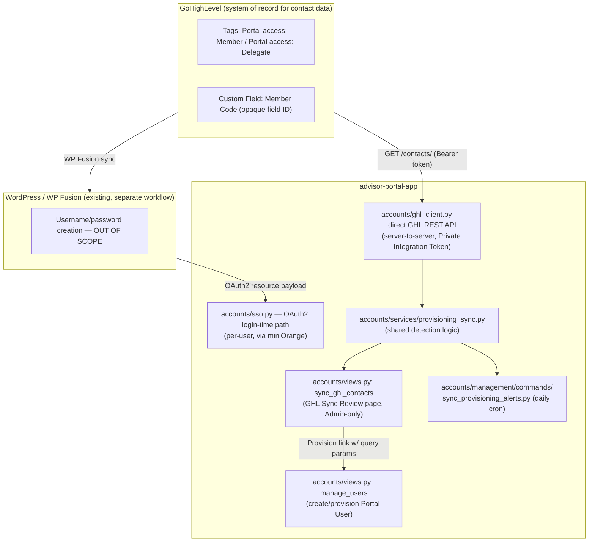

I now have a complete picture. Here is the full analysis — **no files were created, modified, or deleted; nothing was staged, migrated, or committed.**

---

## A. Current-State Architecture and Workflow



**Two structurally separate GHL-adjacent paths exist today** — this is the single most important architectural fact for all three requests:

1. **SSO login-time path** (`accounts/sso.py`) — per-user OAuth2 flow through WordPress/miniOrange (WP Fusion relays GHL tag data). Fires on every login. **Already has a name-capitalization fix** (`_smart_case()`).
2. **Direct GHL API path** (`accounts/ghl_client.py` + `accounts/services/provisioning_sync.py`) — server-to-server calls to GHL's REST API v2 using a static Private Integration Token. Powers the **manual "GHL Sync Review" page** and the **daily cron**. **Has no name-capitalization fix at all.**

These are not duplicates of "a second GHL integration" — they were built for different purposes (real-time per-user SSO vs. bulk discovery/admin-review) and already share the tag→role logic (`determine_role_from_tags()`, reused from `sso.py`). Any new work should reuse path 2's existing primitives, not create a third integration.

---

## B. Exact Files/Functions Involved

| Area | File | Key functions/classes |
|---|---|---|
| GHL REST client | `accounts/ghl_client.py` | `get_ghl_headers()`, `fetch_ghl_contacts()`, `normalize_contact()`, `normalize_tags()` |
| SSO/WP Fusion client | `accounts/sso.py` | `_extract_user_data()`, `_smart_case()`, `_normalize_tags()`, `determine_role_from_tags()`, `get_or_create_user_from_sso()`, `_sync_user_fields()` |
| Shared GHL↔Portal detection | `accounts/services/provisioning_sync.py` | `_fetch_and_index_contacts()`, `get_relevant_contacts()`, `compute_new_ghl_contacts()`, `compute_missing_tag_users()`, `sync_provisioning_alerts()`, `run_provisioning_alert_cycle()`, `check_ghl_status_for_email()` |
| GHL Sync Review UI | `accounts/views.py` → `sync_ghl_contacts()`, `link_ghl_contact()`, `run_provisioning_alerts_now()`; template `accounts/templates/accounts/ghl_sync.html` |
| Daily cron | `accounts/management/commands/sync_provisioning_alerts.py` |
| Provisioning (manual create) | `accounts/views.py` → `manage_users()`; `accounts/forms.py` → `UserCreationForm` |
| Delegate management | `accounts/views.py` → `delegate_management()`; template `accounts/templates/accounts/delegate_management.html`; nav link in `cases/templates/cases/manager_dashboard.html` |
| User model | `accounts/models.py` → `User`, `ProvisioningAlert` |
| Authorization helpers | `accounts/views.py` → `is_admin()`, `is_technician()`, `can_create_user()`, `can_edit_user()`; `core/views.py` → `is_admin()` (role=='administrator' only); `core/views_audit.py` → `is_admin()` (role in ['administrator','manager']) — **note: multiple, inconsistent, locally-scoped `is_admin` helpers exist across files, not one shared decorator** |

GHL authentication: `get_ghl_headers()` reads `settings.GHL_PRIVATE_TOKEN` (Bearer token, `Version: 2021-07-28`), configured via `.env` (`GHL_PRIVATE_TOKEN`, `GHL_LOCATION_ID`, `GHL_API_BASE_URL`, `GHL_MEMBER_CODE_FIELD_ID`). Scopes granted: `contacts.readonly` + `locations/customFields.readonly` only — **no write scope**, confirming the integration is read-only by design (per `docs/PROVISIONING_SYNC_CRON_ACTION_PLAN_2026-09-06.md` §0).

---

## C. Current Authorization Behavior — Admin vs. Manager

**GHL Sync (`sync_ghl_contacts`, `link_ghl_contact`, `run_provisioning_alerts_now`):**
```python
# accounts/views.py, all three functions, identical pattern
if request.user.role != 'administrator':
    messages.error(request, 'Only administrators can sync from GHL.')
    return redirect('manage_users')
```
This is an **inline, hardcoded check**, not a shared decorator/helper — each of the 3 view functions repeats the identical `!= 'administrator'` condition independently. **Manager is explicitly and currently blocked**, the same as every other non-admin role.

**UI visibility:** the only template link to `sync_ghl_contacts` is in `cases/templates/cases/admin_dashboard.html` (line 339) — it does **not** appear anywhere in `manager_dashboard.html`. So today, UI visibility and server authorization happen to agree (Manager sees no button and would be rejected if they guessed the URL), but **they are not driven by the same logic** — the template simply omits the link from the Manager's dashboard; there is no explicit `` role check guarding it anywhere.

**Manage Delegates (`delegate_management`):**
```python
# accounts/views.py
if user.role in ('administrator', 'manager'):
    pass  # Always allowed
elif user.role == 'technician' and user.can_manage_delegates:
    pass  # Explicitly granted
elif user.role == 'technician':
    messages.error(...); return redirect('cases:technician_dashboard')
else:
    messages.error(...); return redirect('cases:member_dashboard')
```
**Manager already has unconditional access to Manage Delegates today** — confirmed both in the view and by the existing "Manage Delegates" button already present in `cases/templates/cases/manager_dashboard.html` (lines ~17-19). This is the natural, already-authorized home for a GHL Sync entry point for Managers.

---

## D. Current Provisioning Behavior

**Stable identifier:** `User.contact_id` (GHL contact ID string, e.g. `"Kzqrc450LtP3s461wVAz"`) — `unique=True, null=True, blank=True` on the `User` model. Matching order, consistently applied in both the SSO path (`get_or_create_user_from_sso`) and the admin-review path (`get_relevant_contacts`): **(1) `contact_id` exact match, (2) `email__iexact` fallback.**

**Manual admin creation** (`manage_users` view + `UserCreationForm`):
- `first_name`, `last_name`, `email`, `workshop_code`, `contact_id`, `role` are all plain form fields, saved via `UserCreationForm.save()` with **no transformation whatsoever** (`accounts/forms.py`).
- When reached via the GHL Sync Review page's "Provision" link, `manage_users`'s GET handler pre-fills the form's `initial` dict **directly from `request.GET`** (`contact_id`, `email`, `first_name`, `last_name`, `workshop_code`, `role`) — these values originated from `ghl_client.py::normalize_contact()`, which applies **no capitalization transform**, only `.strip()`. This is the exact, traceable path by which a lowercase GHL name reaches a saved Portal user.
- `clean_contact_id()` enforces uniqueness; `clean()` requires a password unless a `contact_id` is present (SSO-only account).
- **Can this overwrite an existing user?** No — `UserCreationForm` always does `User.objects.create(...)`-equivalent creation (via its own `save()`); there is no `update_or_create`/overwrite path here. A duplicate `contact_id` or email is rejected by `clean_contact_id()`/`clean_email()`, not merged into an existing record.

**SSO auto-provisioning / login-time sync** (`accounts/sso.py::get_or_create_user_from_sso`):
- New user → `User.objects.create(username=..., email=data['email'], first_name=data['first_name'], last_name=data['last_name'], contact_id=contact_id, role=role, workshop_code=data['workshop_code'], phone=data['phone'], is_pure_delegate=..., is_active=True)`, then `set_unusable_password()`.
- **Existing user (matched by contact_id/email) → `_sync_user_fields()` DOES overwrite**: `contact_id` (only if currently empty), `email`, `first_name`, `last_name`, `workshop_code`, `phone`, and `role` (only if `role not in PORTAL_MANAGED_ROLES = {'technician','manager','administrator'}`). Every field comparison is a simple `if data[x] and data[x] != user.x`. **This means first_name/last_name ARE already overwritten on every SSO login if WP Fusion sends a different value** — including a lowercase value that differs from a previously-corrected mixed-case name, since this path's only protection is `_smart_case()` applied once at `_extract_user_data()` time, not idempotence against manual corrections.

---

## E. Current Daily-Sync Behavior for Existing Users

The daily cron (`sync_provisioning_alerts` management command → `provisioning_sync.run_provisioning_alert_cycle()` → `sync_provisioning_alerts()`) is **purely a discovery/alerting mechanism — it never writes to an existing `User` record's business fields**:

- `compute_new_ghl_contacts()` — finds GHL contacts with a portal-access tag and **no** matching `User` (`portal_user is None`). Read-only.
- `compute_missing_tag_users()` — finds **active, `role='member'`** `User`s whose GHL contact no longer carries the tag. Read-only (only used to populate `ProvisioningAlert` rows and the digest email).
- The **only** write this entire pipeline ever performs against a `User` record is `link_ghl_contact()` (manually triggered, admin-only), which sets `contact_id` alone (`update_fields=['contact_id']`) — explicitly documented as *"Does NOT change role or any other field."*
- `ProvisioningAlert` rows themselves do not touch `User` at all (they're bookkeeping for "first detected"/"still open"/"resolved" state, per `docs/PROVISIONING_SYNC_CRON_ACTION_PLAN_2026-09-06.md` Decision #8: *"Cron only alerts... a human always takes the action."*).

**Conclusion: confirmed — the business's suspicion is correct.** The daily GHL sync is **entirely a discovery/provisioning-candidate mechanism for contacts not yet Portal users** (plus a deactivation-candidate alert); it does **not** refresh any field on an already-provisioned Portal user. The only mechanism that currently refreshes an existing user's GHL-owned fields is the unrelated SSO login-time path (§D above), which depends on the user actually logging in via WP Fusion/OAuth, not on GHL directly, and is not part of the "daily GHL synchronization" the business is asking about.

---

## F. Field Ownership Matrix

| Field | System of record today | Who writes it | Notes |
|---|---|---|---|
| `contact_id` | GHL (immutable) | SSO create; `link_ghl_contact` (admin); manual form | Never overwritten once set (`if not user.contact_id`) |
| `email` | GHL/WP (per business rule) | SSO `_sync_user_fields` (every login); manual form at creation | **Not** touched by the daily cron/admin review path for existing users |
| `first_name` / `last_name` | GHL/WP (per business rule) | SSO `_sync_user_fields` (every login, with `_smart_case`); manual form at creation (**no transform**) | Daily cron/admin-review path never writes these for existing users |
| `workshop_code` (Member/Workshop Code) | GHL custom field | SSO `_sync_user_fields` (every login); manual form at creation | Daily cron never writes this for existing users |
| `role` | **Advisor Portal** (portal-owned) | SSO only updates `role` for non-`PORTAL_MANAGED_ROLES`; manual form | Explicitly protected: `technician`/`manager`/`administrator` are never touched by GHL/SSO |
| `is_pure_delegate` | GHL tag-derived, but portal-cached | SSO only | Never touched by the GHL-direct/daily-cron path |
| `MemberDelegate` assignments | **Advisor Portal only** | `delegate_management` view | Entirely portal-owned; GHL has no concept of this relationship at all |
| `can_manage_delegates`, `can_manage_review_settings` | **Advisor Portal only** | Admin via Manage Users | Never touched by any GHL path |

---

## G. Recommended Minimal Implementation Approach (per request — NOT implemented)

**1. Manager access to GHL Sync:**
- Change the 3 inline checks in `sync_ghl_contacts`, `link_ghl_contact`, `run_provisioning_alerts_now` from `request.user.role != 'administrator'` to a **shared helper** (e.g. extend `accounts/views.py::is_admin` into something like `is_admin_or_manager(user)`, or simply `user.role in ('administrator', 'manager')`, mirroring the exact pattern already used by `delegate_management` and `core/views_audit.py::is_admin`). Apply the **same condition** to all 3 server-side checks — do not special-case any one of them.
- Add the GHL Sync entry point to `delegate_management.html` (or its header actions) since Manager already has unconditional access there (§C) — this satisfies "conveniently accessible from the existing Manage Delegates page" without needing any new page-level authorization work.
- Decide whether `link_ghl_contact` and `run_provisioning_alerts_now` (currently admin-only) should also open to Manager, or stay admin-only while only the read-heavy `sync_ghl_contacts` review page opens up — this is a business decision, not a technical constraint (flagged in §I).

**2. Name capitalization:**
- The fix belongs in **exactly one place**: `accounts/ghl_client.py::normalize_contact()` — apply the **same `_smart_case()` logic already proven in `accounts/sso.py`** (title-case only if the name is entirely lowercase; preserve existing mixed case like `McGregor`/`DeLuca`) to `first_name`/`last_name` there, so both the GHL Sync Review page's display and the "Provision" pre-fill benefit automatically, with zero duplicate logic. Strongly recommend **extracting `_smart_case()` into a shared utility** (e.g. `accounts/name_utils.py`) imported by both `sso.py` and `ghl_client.py`, rather than copy-pasting it a second time — directly avoids the kind of duplication this task was warned against.
- Do **not** apply a blind `.title()` anywhere else — the existing `_smart_case()` already encodes the "preserve legitimate mixed case" requirement correctly; reuse it, don't reinvent it.
- Separately (flagged, not necessarily in scope): there is currently **no edit capability for first/last name** anywhere in `manage_users.html`'s user list beyond initial creation — confirm whether "no convenient way to correct the name afterward" should also be addressed (e.g. an edit-user-role page already exists at `edit_user_role` — check if it's scoped only to role, which it appears to be, confirmed by its name).

**3. Existing-user data synchronization:**
- Extend `provisioning_sync.py` with a clearly-separate function (e.g. `sync_existing_user_fields(user, contact)`), modeled closely on `sso.py::_sync_user_fields()` but restricted to **only GHL-owned fields** (`first_name`, `last_name`, `email`, `workshop_code`) — **never** `role`, `is_pure_delegate`, or any delegate/permission field, matching the business's explicit "must not overwrite Portal roles/permissions/delegate relationships" requirement.
- Call it from `compute_missing_tag_users`'s sibling path or a new "matched, needs refresh" category inside `get_relevant_contacts()`/`sync_provisioning_alerts()` — likely as an **opt-in, explicitly logged** action (reuse the existing `AuditLog` pattern, same as `sso_sync`) rather than a silent overwrite, given this is new write behavior for a path that has been read-only since inception.
- Reuse the smart-case fix from request #2 here too, so a GHL-driven field refresh never regresses a name back to lowercase.

---

## H. Tests That Should Be Added or Changed

**Currently existing, extendable:**
- `accounts/tests.py::DetermineRoleTest`, `NormalizeTagsTest`, `ExtractUserDataTest` — cover `sso.py` tag/role/field logic already; good models to copy for new `ghl_client.py` tests.
- `accounts/tests.py::AdminRoleFlagsTest` — pattern to copy for any new "Manager can/cannot do X" assertions.
- `core/tests.py` already has a precedent exactly matching what's needed: `test_case_metrics_report_allows_manager_and_technician_access` / `test_case_metrics_report_denies_member_access` — this is the right template for new Manager-vs-non-Manager GHL Sync access tests.

**Entirely missing today (new tests required):**
- No test exists for `accounts/ghl_client.py` (`fetch_ghl_contacts`, `normalize_contact`, `normalize_tags`) at all — needs mocked-`requests` unit tests.
- No test exists for `accounts/services/provisioning_sync.py` (`get_relevant_contacts`, `compute_new_ghl_contacts`, `compute_missing_tag_users`, `sync_provisioning_alerts`, `run_provisioning_alert_cycle`) — needs tests with a mocked `fetch_ghl_contacts`.
- No test exists for `sync_ghl_contacts`/`link_ghl_contact`/`run_provisioning_alerts_now` view authorization at all (Administrator allowed, Manager/Technician/Member denied) — critical given this task introduces a real authorization change.
- No test exists for `manage_users` provisioning (name pre-fill, capitalization, uniqueness) — a test proving `UserCreationForm` + GHL pre-fill applies the new capitalization fix would directly validate request #2.
- No test exists proving the daily cron does **not** touch existing users' GHL-owned fields today — worth a regression test *before* changing this behavior, so the new "sync existing users" capability can be proven additive rather than accidentally changing today's "discovery only" behavior for the two existing alert categories.
- No test exists verifying `role`/`is_pure_delegate`/`MemberDelegate` are preserved when a new "existing-user sync" write path is introduced — this is the most important new test given the business's explicit "must not overwrite roles/delegates" requirement.

---

## I. Questions / Ambiguities to Resolve Before Implementation

1. **Scope of Manager's new GHL Sync access** — should Manager get the full set (review AND `link_ghl_contact` AND `run_provisioning_alerts_now`), or only the read-heavy review page, with linking/manual-run staying Administrator-only?
2. **Should Manager also be able to *provision* (create) a user via `manage_users`, or only review/trigger sync and still hand off creation to an Administrator?** `can_create_user()` currently has no `'manager'` branch at all — it would return `False` for Manager today.
3. **For name capitalization:** should the fix apply retroactively (a one-time cleanup pass over existing lowercase names), or only to newly-provisioned/newly-synced users going forward? The request text implies "no convenient way to correct the name afterward" — is a manual edit-name capability also wanted as part of this work, or strictly the capitalization-at-ingestion fix?
4. **For existing-user sync:** should it run automatically as part of the existing daily cron (silently updating matched users each night), or should it require an explicit admin/manager review step (like the current "Provision" flow), given this is new write behavior on a path that's been read-only since it was built? The business text says "we do NOT want GHL sync to overwrite Portal-owned info" but doesn't specify whether GHL-owned-field updates should be automatic or human-confirmed.
5. **Email changes specifically** are called out as a GHL-owned attribute, but email is also the historically-used fallback matching key (`email__iexact`) when `contact_id` is absent — if GHL sync is extended to update `email` for existing matched users, confirm this can never cause a `User.objects.get(email__iexact=...)` collision with a *different* existing user (not currently validated anywhere in the sync path, only in `UserCreationForm.clean_email()` at creation time).
6. **Duplicate GHL contacts** sharing one email (not currently guarded against in `_fetch_and_index_contacts`'s `by_email` dict, which silently keeps only the first-seen contact per email) — worth deciding whether this matters for the new sync path or is an acceptable pre-existing limitation.
