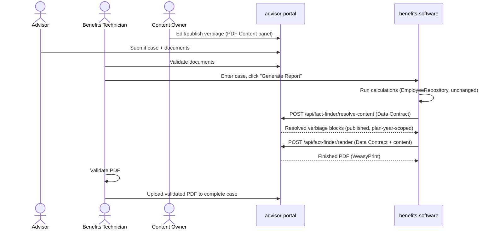

# Fact Finder PDF Modernization — Analysis & Options
Date: 2026-09-06 (updated 2026-09-12)
Scope: Research document for improving the Fact Finder PDF generation process currently owned by `benefits-software` (legacy PHP/Laravel 5.7 application, TCPDF-based rendering — corrected 2026-09-12 from an earlier "Python" mislabel).

## Executive summary

There are really **two separate problems** tangled together in the current system, and they need two separate fixes:

1. **A content/verbiage maintenance problem** — wording changes yearly, is hardcoded, and is painful to update.
2. **A logic-duplication problem** — the PDF template re-derives/replicates calculation logic that already exists (and is authoritative) elsewhere in `benefits-software`.

A verbiage panel alone (Option A below) only fixes problem #1. Fixing problem #2 requires establishing a **single source of truth for computed facts** that the PDF renderer consumes but never recalculates. The strongest long-term option (Option B) fixes both at once by extracting PDF rendering into a service built on this app's (advisor-portal's) Django stack — while leaving `benefits-software`'s actual calculation engine completely untouched.

This document lays out the problem more precisely, then gives you a tiered set of options — from lowest-risk/incremental to full extraction — plus a PDF-engine comparison, a data-contract pattern to eliminate the logic duplication, and a phased rollout plan that avoids a risky big-bang rewrite.

---

## Business workflow (confirmed 2026-09-12)

Recorded here because it explains exactly why the calculations and the PDF's correctness are non-negotiable, and why any change here needs to be validated, not just theoretically clean:

1. **Advisor** submits a case with supporting documents in `advisor-portal`.
2. **Benefits Technician** manually validates those documents.
3. **Benefits Technician** enters the case into `benefits-software`, which generates the Fact Finder PDF (the process this whole document is about).
4. The generated PDF is **validated** (by the technician/reviewer).
5. The validated PDF is **uploaded into `advisor-portal`** to complete the case.

**The PDF is the deliverable at the center of this entire process** — not an internal report, the actual work product handed to the advisor/member. That is why the calculation engine (`EmployeeRepository.php`) is explicitly off-limits in every option below: it has taken a long time to get right, it is trusted, and nothing here should risk it. Everything proposed operates strictly on *how the already-correct numbers get assembled and rendered*, never on *how they're calculated*.

You (the requester) own both `advisor-portal` and `benefits-software` outright — there is no separate team to coordinate with or get buy-in from for a cross-app change. This removes the usual biggest cost of an extraction-style option (Option B) and is factored into the concrete action plan below.

---

## Root cause breakdown

| Symptom | Root cause |
|---|---|
| Wording is hard to update yearly | Verbiage is hardcoded as string literals inside the PDF template/blade file, mixed with control flow |
| Template logic is "extremely difficult to maintain" | Presentation logic (what text to show) and business logic (conditions for showing it) are not separated |
| Some logic "replicates or recreates" calculation logic | There is no single authoritative "computed facts" contract — the renderer re-derives values/conditions instead of consuming already-computed results |
| TCPDF is undesirable | TCPDF is a low-level, imperative, coordinate-based PDF API — every layout tweak requires code changes; there's no separation between content and layout |
| Previous panel attempt still hard to maintain | A verbiage table alone doesn't fix the *conditional logic* problem — you likely still need code to decide *which* verbiage block applies, and that logic was probably left where it was |

**The key insight:** the verbiage panel you already tried is the right instinct, but it's addressing the *symptom* (wording), not the *cause* (logic duplication + tight coupling between calculation and presentation). Any durable fix needs to also address the second row of that table.

---

## Recommended target architecture: a Fact Finder "Data Contract"

Regardless of which option below you pick, the single highest-leverage change is this:

> `benefits-software`'s calculation engine should emit one versioned, well-defined JSON/dict structure — the **Fact Finder Data Contract** — containing every computed value, flag, and boolean condition the PDF could ever need. The renderer (old or new) is only allowed to consume this structure. It is never allowed to recompute or re-derive anything from raw inputs.

Example shape (illustrative, not literal):

```json
{
  "schema_version": "2026.1",
  "case_id": 1234,
  "plan_year": 2026,
  "member": { "first_name": "...", "workshop_code": "PF" },
  "computed": {
    "eligible_for_fers_supplement": true,
    "survivor_benefit_election": "max",
    "tsp_projection_at_62": 812345.00,
    "show_fehb_into_medicare_paragraph": true,
    "show_special_category_paragraph": false
  },
  "verbiage_context": {
    "retirement_system": "fers",
    "category": "leo"
  }
}
```

With this contract in place:
- The PDF renderer becomes a **pure function**: `render(data_contract, verbiage_templates) -> PDF`. It contains zero business logic.
- Any conditional logic that decides *content selection* (which paragraph to show) can live as **declarative rules** evaluated against `computed`/`verbiage_context` fields — not imperative code.
- You get a natural regression-testing seam: feed the same data contract into old and new renderers and diff the output.
- Historical PDFs remain reproducible — regenerating a 2024 Fact Finder just needs the 2024-dated verbiage + the stored data contract for that case, not the current code.

This is the piece worth prioritizing even before choosing a new PDF library — it's what makes everything else safe and maintainable.

---

## Option A — Verbiage/Rules Panel only (lowest risk, incremental)

**What it is:** Build a content management panel (in this app, using the existing Django/admin patterns already in `advisor-portal`) that manages:
- Versioned verbiage blocks, keyed by a stable identifier (e.g. `fehb_medicare_transition_paragraph`), with an **effective date/plan-year range** so historical wording is preserved.
- Declarative **display rules** per block — simple boolean expressions evaluated against fields from the Data Contract (e.g. `computed.eligible_for_fers_supplement == true`), not free-form code.
- A draft → review → publish workflow (leveraging the `AuditLog` pattern already used elsewhere in this app) so wording changes are tracked and approved before they go live — important since this content has compliance/legal implications.

`benefits-software` calls a small internal read API exposed by this app:
```
POST /api/fact-finder/resolve-content/
body: { "plan_year": 2026, "data_contract": {...} }
response: { "blocks": [ {"key": "...", "text": "...", "order": 1}, ... ] }
```
`benefits-software` still assembles the final PDF via TCPDF, but the *text and the decision of which blocks to include* now live in one governed place instead of scattered in code.

**Pros**
- Smallest change — doesn't touch the calculation engine or the PDF rendering pipeline at all.
- Immediately solves the "wording changes yearly and is painful" pain point.
- Can ship independently and iteratively; low risk of breaking existing PDFs.
- Reuses infrastructure you already have in `advisor-portal` (Django admin, auth, audit logging).

**Cons**
- Doesn't get you off TCPDF.
- Rule evaluation still needs to happen somewhere — if you evaluate rules in `advisor-portal` and just return resolved text, `benefits-software`'s template still needs a matching structural placeholder for every possible block (order, pagination, page-break logic stay in the old code).
- Doesn't fully eliminate the "the template recreates calculation logic" problem — it *centralizes* the decision logic but the two systems must still agree on what the Data Contract contains.

**Best if:** you want a quick, safe win this year, and a full rendering rewrite isn't in the budget yet.

---

## Option B — Extract PDF rendering into a service on this app's stack (recommended long-term)

**What it is:** `benefits-software` keeps 100% ownership of calculations. Once it finishes computing a case, it POSTs the Data Contract to an endpoint in `advisor-portal`:

```
POST /api/fact-finder/render/
body: { "data_contract": {...} }
response: application/pdf (binary) or a signed download URL
```

`advisor-portal` (already the receiving end of documents in this system based on `case_documents/`) renders the actual PDF using a modern HTML/CSS-based engine (see comparison below) and returns the finished file, which `benefits-software` then attaches/uploads exactly as it does today.

This turns PDF generation into a **strangler-fig** migration: you're not rewriting `benefits-software`, you're peeling one well-defined responsibility (rendering) off of it and re-hosting it somewhere better suited to maintain it — content team included.

**Pros**
- Fully removes TCPDF from the equation.
- Templates become HTML + CSS (or a proper templating language) instead of imperative drawing code — dramatically easier for non-engineers to help maintain layout, and for engineers to maintain logic.
- Verbiage panel (Option A) becomes a *natural part of the same app* instead of a cross-system dependency — no API round-trip needed for content resolution, since rendering and content live together.
- You get modern, testable, versioned rendering: same input (Data Contract) always produces the same PDF — trivial to unit test, diff, and regression-test.
- Leverages a stack (Django) your team already knows well and actively maintains, instead of investing further in the legacy Python app.

**Cons**
- Larger effort than Option A — needs a new service/module, an API contract, and a migration period running old and new renderers side-by-side.
- Requires `benefits-software` to change (it must call out to a new endpoint instead of rendering in-process) — some integration work on that side, though scoped narrowly.
- You'll want a validation phase (see rollout plan) before fully cutting over, to avoid subtle formatting regressions.

**Best if:** you're willing to invest moderate effort now to eliminate the underlying pain permanently rather than re-papering over it.

---

## Option C — Hybrid: verbiage panel now, extraction later

Practically, **A and B are not mutually exclusive — A is a subset of B.** A sensible path:

1. Build the Data Contract schema first (small, high-leverage, no UI needed).
2. Build the verbiage/rules panel in `advisor-portal` (Option A) against that schema. Ship it — get the yearly-wording pain resolved now.
3. Once the panel is live and the Data Contract is proven out in production, build the rendering service (Option B) reusing the *same* verbiage/rules data — you're not throwing away Option A's work, you're relocating where rendering happens.

This gives you a real win in the near term without foreclosing the bigger fix.

---

## PDF rendering engine comparison (for Option B)

| Engine | Language | Model | Maintainability | Notes |
|---|---|---|---|---|
| **WeasyPrint** | Python | HTML + CSS → PDF | High | Most natural fit for a Django app; templates are just Django/Jinja HTML templates with CSS for layout (page breaks, headers/footers via `@page` rules). Actively maintained, pure Python (no external binary dependency headaches). **Best default choice.** |
| **ReportLab** | Python | Code-first (draw calls) | Low–Medium | Same imperative drawing-API problem as TCPDF, just in Python. Would not solve the core maintainability complaint. |
| **Playwright/Chromium print-to-PDF** | Python (subprocess/binding) | HTML + CSS → PDF via headless Chrome | High (best fidelity) | Excellent CSS/JS support and pixel-perfect rendering, but adds a browser-engine dependency to deploy/maintain (heavier ops footprint than WeasyPrint). |
| **Prince XML / DocRaptor** | Commercial (HTML+CSS) | HTML + CSS → PDF | High | Best-in-class CSS Paged Media support (running headers, footnotes, complex TOCs) but adds licensing cost or a hosted dependency. |
| **LaTeX (via a Python wrapper)** | LaTeX | Markup → PDF | Medium | Superb typographic control, but a much steeper authoring curve for anyone who isn't already comfortable with LaTeX — likely a poor fit for a content team maintaining yearly wording. |

**Recommendation:** start with **WeasyPrint**. It directly replaces "hardcoded drawing code" with "HTML templates + CSS," which is the single biggest maintainability unlock relative to TCPDF, and it's a native Python library — no extra runtime/binary to manage in deployment. If you hit a specific advanced layout requirement it can't handle (e.g., very complex running headers or footnotes), evaluate Playwright print-to-PDF as a fallback for just that document type.

---

## Handling the "conditional logic" problem specifically

Today, the hardcoded conditionals likely look something like (pseudocode):

```python
if member.retirement_system == 'FERS' and member.years_of_service >= 20 and member.age >= 50:
    text += "Special category verbiage..."
```

The fix is to **externalize the condition, not just the text**, as a declarative rule stored alongside the verbiage block:

```json
{
  "block_key": "special_category_paragraph",
  "condition": "computed.retirement_system == 'FERS' and computed.is_special_category == true",
  "text_2026": "..."
}
```

Two implementation approaches for evaluating `condition`:
1. **Safe expression evaluator** (e.g., a restricted evaluator like `simpleeval`, or a small custom AST-based evaluator) — lets an admin write conditions in the panel without deploying code, while staying safe (no arbitrary code execution).
2. **JSON Logic** (a well-known, safe, declarative rule format with libraries in both Python and JS) — slightly more verbose but battle-tested for exactly this "non-engineers configure business rules safely" use case.

Either way: **the boolean facts referenced in the condition (`is_special_category`, `retirement_system`, etc.) must come from the Data Contract, computed once by the calculation engine — never recalculated in the rule or in the template.** This is what actually kills the duplication problem, not just moving text into a table.

---

## Governance & yearly-change workflow

Since wording changes are seasonal/annual and have compliance implications, the panel (whichever option) should support:
- **Plan-year-scoped content**: never overwrite last year's wording — add a new version effective for the new plan year, keep the old one for regenerating historical documents.
- **Draft → Review → Publish** states, so a second person can approve wording before it goes live (pattern already used for review workflows elsewhere in `advisor-portal`).
- **Audit trail** of who changed what and when (reuse the existing `AuditLog` model/pattern in this app).
- **Preview/sandbox rendering**: let the content owner render a sample PDF with draft wording against a real or synthetic Data Contract before publishing.

---

## Suggested rollout plan (de-risked, incremental)

| Phase | Deliverable | Risk |
|---|---|---|
| 1 | Define the Fact Finder Data Contract schema (version 1) in collaboration with whoever owns the calculation logic today | Low — no production changes |
| 2 | Instrument `benefits-software` to *emit* the Data Contract for every case (log it, don't use it yet) | Low — read-only, non-invasive |
| 3 | Build the verbiage/rules panel in `advisor-portal` (Option A), driven by the Data Contract | Medium — new feature, but isolated |
| 4 | Wire `benefits-software`'s existing TCPDF template to pull resolved text from the new panel via API, replacing hardcoded strings block-by-block | Medium — do this incrementally, block by block, not all at once |
| 5 | Once stable, prototype the WeasyPrint-based rendering service (Option B) using the same Data Contract + verbiage panel | Medium |
| 6 | Run old (TCPDF) and new (WeasyPrint) renderers in parallel for a sample of real cases; diff output (text-extraction diff, not just visual) | Low — parallel run, no cutover yet |
| 7 | Cut over renderer by document type or by workshop code cohort, monitoring for issues, with an easy rollback to the old renderer | Medium, but reversible |
| 8 | Decommission the old TCPDF template once confidence is high | Low, if phases 1–7 were followed |

This avoids ever having a single "big bang" cutover date, which is usually where legacy-replacement projects like this go wrong.

---

## Summary recommendation

1. **Do the Data Contract first** — it's the cheapest step and unlocks everything else, including safer testing of the current TCPDF template as-is.
2. **Build the verbiage/rules panel in `advisor-portal`** (Option A) next — it directly solves your most painful, recurring problem (yearly wording updates) and reuses infrastructure (admin UI, auth, audit logging) you already have.
3. **Treat full PDF-rendering extraction (Option B, WeasyPrint-based) as the follow-on phase**, not a prerequisite — you get to decommission TCPDF on your own timeline once the panel and Data Contract have proven themselves, rather than needing to solve everything at once.
4. **Externalize conditions, not just text** — this is the detail that actually eliminates the "logic duplication" complaint, rather than just relocating the maintenance burden.

---

## Addendum (2026-09-12): Workspace strategy + verified findings from `benefits-software`

This section records (a) the workspace/tooling approach agreed on for doing this cross-repo analysis, and (b) a code-verified deep dive into `benefits-software`'s actual PDF pipeline — replacing assumptions in the sections above with confirmed facts, file paths, and one important discrepancy that needs attention.

### Workspace strategy (decided)

Both apps must keep working — `benefits-software`'s calculation engine in particular has taken a long time to get accurate and **must not be touched as part of this effort**. Options considered:

| Option | Description | Risk |
|---|---|---|
| **1. Ad-hoc read-only access (chosen)** | No workspace/config changes. Files in `c:\Users\ProFed\workspace\benefits-software` are read directly by absolute path when needed for analysis; nothing is added to any `.code-workspace` and no edit surface is opened. | Lowest — zero write access, zero setup |
| 2. Add `benefits-software` as a 2nd folder in the current window | Multi-root workspace with a `files.readonlyInclude` guard on that folder | Low — still isolated repos, but adds a permanent write-capable window unless the guard is maintained |
| 3. Separate dedicated `.code-workspace` file | New file referencing both folders, existing single-folder windows untouched | Low — most explicit separation, extra window to manage |

**Decision:** Option 1. Nothing was added to any workspace configuration; `benefits-software` and `benefits-software - Copy` / `benefits-software-archive` were never modified. All findings below came from read-only file inspection plus read-only git history commands (`git log`, `git show`, `git branch -a`, `git stash list` — no checkout, no stash pop/apply, no cherry-pick, no writes of any kind). Note that the archive/copy folders were deliberately **not** consulted — only the canonical `benefits-software` folder is authoritative.

**Standing rule for this project:** any future work against `benefits-software` should be strictly **additive and read-only with respect to calculations** — e.g., a new method that packages *already-computed* values into the Data Contract shape, never a change to an existing calculation method's logic. See "Recommended integrity guardrail" below.

### Verified PDF pipeline (replaces assumptions above with confirmed facts)

- **Route → Controller**: `GET /employee/fegli/report/{empid}` → [`EmployeeController@createPdfFEGLI`](../../benefits-software/app/Http/Controllers/Admin/EmployeeController.php) (`app/Http/Controllers/Admin/EmployeeController.php`, ~lines 1086–1709 handling data assembly, PDF write/output).
- **Renderer**: TCPDF via `elibyy/tcpdf-laravel`, on Laravel 5.7 / PHP 7.1+ (both EOL) — confirms TCPDF's imperative/HTML-subset limitations called out in the original analysis are real, not theoretical.
- **Template**: `resources/views/admin/employee/report_pdf.blade.php` — **2,428 lines**, inline CSS throughout (TCPDF doesn't support external stylesheets well), mixing layout, ~65+ hardcoded educational text blocks, and business conditionals in the same file. Confirmed representative snippet (lines ~558–606):

  ```blade
  @if($pension['systemType'] == 'FERS')
      <tr><td>... Federal Employees Retirement System ...</td></tr>
  @else
      <tr><td>... Civil Service Retirement System ...</td></tr>
  @endif
  ...
  @if($pension['systemType'] == 'FERS')
      <!-- MRA education block, hardcoded paragraph with inline {{ }} value interpolation -->
      A FERS employee's Minimum Retirement Age (MRA) is determined by the year in which
      they were born ... Based on the year you were born ({{ $pension['bdayYear'] }}),
      your MRA is {{ $minimumRetirementAge['mra_year'] }}y {{ $minimumRetirementAge['mra_month'] }}m.
  @endif
  ```
  This is exactly the "wording + condition welded together" problem the original analysis described — confirmed, not hypothetical. [`PDF_REPORT_LITERAL_HARDCODING_INVENTORY.md`](../../benefits-software/PDF_REPORT_LITERAL_HARDCODING_INVENTORY.md) in `benefits-software` already catalogues the literal conditional branches in detail (e.g. `retirementType == "Deferred"`, `systemType == 'FERS'/'CSRS'/'CSRS Offset'/'Transfers'`), and is a ready-made source list for building the rule set in Option A/B — no need to re-derive it.

- **Calculation engine**: [`app/Repositories/EmployeeRepository.php`](../../benefits-software/app/Repositories/EmployeeRepository.php) (~5,000+ lines). Key methods that produce the values the PDF consumes:
  - `getFegliReport($data)` → `fegli_arr`, `biweekly_arr`, `monthly_arr` (year-by-year FEGLI premiums/coverage)
  - `getFegliAllScenarios($data, $last_salary, $retirementAge)` → all 9 FEGLI election-combination projections
  - `getSocialSecurityDetailPdf($empId)` → `ss_arr` (SRS + Social Security, handles WEP)
  - `getFirstPension($empId, $scenario)` → gross annual pension after penalties
  - Penalty methods: `getMRAPenalty()`, `getEarlyOutPenalty()`, `getCsrsOffsetPenalty()`, `getWepPenalty()`, `nonDeductionPanelty()`, `calcRefundedPanelty()`
  - Six retirement scenarios (current + 5 future years) are pre-calculated per case, each with its own pension/penalty/benefit numbers (`$netPensionScenario1`–`6`, etc.)
  - **There is no existing aggregate/DTO object** — the controller builds a plain `$pdf_data` array ad hoc and hands it straight to the Blade view. This *is* effectively today's (undocumented, unversioned) proto-Data-Contract; formalizing it is the whole point of Phase 1.

- **Core data model** (for writing real field names into the Data Contract instead of placeholders): `Employee`, `Eligibility` (DOB, LeaveSCD, retirement date), `Fegli` (coverage elections), `Tsp` (fund balances/loans), `MilitaryService` / `NonDeductionService` / `RefundedService` / `PartTimeService` (creditable-service adjustments), `AppLookup` (system-wide config: COLA %, salary increase %, premium rates), `EmployeeConfig` (per-employee overrides of those).

**PROD schema verified, no further DB analysis needed (2026-09-12):** all of the schema detail above was read from `master`'s code/migrations, not from PROD directly — given the user's own LOCAL/TEST seeding experiments (`pdf_content_blocks`, etc.), there was a real question of whether `master` still matches what's actually deployed. A read-only `php artisan migrate:status` run directly against PROD (157.245.85.180, zero data accessed) confirmed **exact parity**: PROD has all 26 of `master`'s migrations applied, batches 1–22, nothing more/less. This closes the loop — every table/field reference in this document can be trusted as an accurate description of PROD's real schema, and no separate database-schema-analysis pass is needed.

### ⚠️ Correction (2026-09-12, 2nd pass): this was already built once — and shelved. Read this before doing anything else.

The first pass of this addendum (above) concluded `pdf_content_blocks` was "0% implemented — synopsis doc only." **That was wrong, and the mistake is itself the lesson: it was only checked against `master`.** A look at `git branch -a` in `benefits-software` tells a very different story, and matches what you (the user) described — you attempted this exact fix, built a separate admin panel and seed files, and ultimately set it aside.

**What actually happened, reconstructed from the repo's own commit history and docs (all still present, just unmerged):**

1. Real, substantial work was done on branch `feature/pdf-viewer-v2` (and its later snapshot `preserve/pdf-viewer-v2-20260823`): a `pdf_content_blocks` table + a `pdf_content_block_history` audit-trail table, ~20 migrations backfilling specific sections (SBP/FEGLI/FEHB/FLTCIP/TSP/pension/cover/disclaimer), a `PdfContentBlocksSeeder` seeding **~185 verbiage keys**, an admin "PDF content editor" UI, and Blade partials refactored to read from the DB with hardcoded fallback text.
2. This reached a genuinely tested, near-production-ready state: `PDF_TEST_PARITY_AUDIT_2026-05-31.md` (still on the branch) documents a formal TEST parity-gate process that ended at `AUDIT_MISSING_ROWS=0` — i.e., it worked, and was verified against a real environment.
3. **The specific failure mode that caused pain**, per that same audit doc: `PdfContentBlocksSeeder` was insert-only, so when new keys were added the LOCAL and TEST copies of the `pdf_content_blocks` table silently drifted apart (TEST kept whatever partial rows it already had; missing keys were never backfilled automatically). This caused blank PDF sections on TEST that had to be forensically diagnosed key-by-key. This is a **three-environment database-parity problem** — it exists specifically because the verbiage table lives inside `benefits-software`'s own database, and LOCAL/TEST/PROD are three separately-seeded MySQL instances kept in sync only by manual scripts.
4. Per `PDF_WORK_REAPPLY_AND_RESET_PLAN.md` (also still on the branch), this work was deliberately reset out of LOCAL and TEST in August 2026 ahead of an unrelated production data sync, preserved on branch `preserve/pdf-viewer-v2-20260823` (final commit `e6350cd`) with an explicit intent to reapply it later in a controlled way — but that reapplication never happened. `master` — and therefore the live app — is still today's 100%-hardcoded legacy template.
5. Separately, branch `feature/snappy-pdf-migration` (also unmerged, also shelved) shows three renderer swaps in immediate succession: TCPDF → Snappy/wkhtmltopdf → DOMPDF → mPDF, with commit messages explicitly citing "no binary dependency" as the reason for each move away from a binary-based engine. This is independent evidence supporting Option B's WeasyPrint recommendation below: prefer a pure-language renderer with no external binary to deploy/maintain.

**What this means for this project, concretely:**

- `PDF_USER_FRIENDLY_CHANGE_SYNOPSIS.md` and the other root-level PDF docs describe **a real, working prototype that was built, validated, then shelved** — not vaporware, and not a reliable "current state" reference either. Treat them as historical/aspirational, not authoritative.
- **Do not propose resurrecting or merging `preserve/pdf-viewer-v2-20260823` as-is.** It's a working proof that the *content* side of this problem is solvable, but its architecture — verbiage stored inside `benefits-software`'s own DB, requiring manual seed-parity across three separately-managed environments — is exactly what caused the operational pain that led you to set it aside. Repeating that architecture risks repeating that exact failure mode.
- The **185-key seed list** (`PdfContentBlocksSeeder`) and `PDF_TEST_PARITY_AUDIT_2026-05-31.md` are still valuable as a **content/checklist reference** — they tell you precisely which text blocks and section groupings a new panel needs to cover — but should be read as input to a fresh Option A/B build in `advisor-portal`, not as code to merge.
- This materially **strengthens the case for Option A/B living in `advisor-portal`** rather than inside `benefits-software`: hosting the verbiage/rules panel in `advisor-portal`'s single database sidesteps the exact multi-environment seed-drift problem that broke the last attempt — there would be one panel, one database, consumed by both apps (or just by `advisor-portal` if/when rendering is also extracted), instead of three separately-seeded copies inside `benefits-software`.

### Draft Fact Finder Data Contract (v0, grounded in real field/method names above)

This replaces the illustrative example earlier in this doc with one anchored to what `EmployeeRepository` actually produces:

```json
{
  "schema_version": "2026.1",
  "employee_id": 12345,
  "generated_at": "2026-09-12T00:00:00Z",
  "system": {
    "system_type": "FERS",
    "retirement_type": "Deferred",
    "birth_year": 1968
  },
  "pension": {
    "mra": { "years": 56, "months": 4 },
    "eligibility_for_full_retirement": [ { "age": 62, "service": 5 }, { "age": 60, "service": 20 } ],
    "scenarios": [
      { "scenario_number": 1, "retirement_date": "2026-12-31", "gross_annual_pension": 48210.00, "mra_penalty": 0, "deposit_penalty": 0 }
    ]
  },
  "fegli": {
    "current_elections": { "basic": true, "option_a": true, "option_b_multiples": 3, "option_c_multiples": 2 },
    "all_scenarios": [ { "scenario_key": "basic_only", "monthly_premium": 42.10 } ]
  },
  "social_security": {
    "srs_eligible": true,
    "wep_applies": false,
    "year_by_year": [ { "year": 2027, "ss_amount": 21000.00, "srs_amount": 900.00 } ]
  },
  "tsp": {
    "current_balance": 512340.00,
    "projected_ending_balance": 812345.00,
    "funds": [
      { "fund_code": "G", "label": "G Fund", "balance": 102000.00, "allocation_pct": 20, "projected_balance": 162000.00 },
      { "fund_code": "C", "label": "C Fund", "balance": 250000.00, "allocation_pct": 40, "projected_balance": 400000.00 },
      { "fund_code": "L2050", "label": "Lifecycle 2050", "balance": 160340.00, "allocation_pct": 40, "projected_balance": 250345.00 }
    ]
  },
  "computed_flags": {
    "show_fers_supplement_paragraph": true,
    "show_deferred_retirement_paragraph": true,
    "show_csrs_offset_paragraph": false
  }
}
```

Every leaf value here already has a concrete producer method in `EmployeeRepository` (listed above) — Phase 1's job is to define this shape precisely (with the actual calculation owner) and Phase 2 is to add a single new **read-only aggregation method** (e.g. `EmployeeRepository::getFactFinderDataContract($empId)`) that calls the *existing* methods and reshapes their output — it performs no new math, so it cannot change a single calculated number.

Note the `tsp.funds` shape deliberately uses a **list of fund objects instead of one named field per fund** (`GFund`, `L2050`, etc.) — see the TSP pain-point deep-dive below for why.

### Pain point deep-dive: the Blade template's embedded business rules

You flagged this as one of your biggest pain points directly, so it's worth being concrete instead of abstract about it. A read-only pass over `resources/views/admin/employee/report_pdf.blade.php` found:

- **~55–68 `@if`/`@elseif`/`@else`/`@foreach`/`@forelse` directives** spread across the 2,428-line file — this is a genuinely large amount of control flow living inside a presentation template.
- **The deepest nesting found** ([lines 1109–1179](../../benefits-software/resources/views/admin/employee/report_pdf.blade.php#L1109-L1179)): an `@if` on `systemType` (FERS/Transfers) wrapping an `@if` on `retirementType` (Deferred vs. not) — two federal-benefits-specific facts have to both be evaluated correctly, inline, just to pick the right introductory sentence for the Survivor Benefit Plan section.
- **A representative "genuinely hard to maintain" example** — the TSP agency-match paragraph ([lines 2251–2271](../../benefits-software/resources/views/admin/employee/report_pdf.blade.php#L2251-L2271)):

  ```blade
  @if($pension['systemType'] == 'FERS' || $pension['systemType'] == 'Transfers')
      @if($projected_ending_balance_data['sal_percentage_in_contri'] >= 4.95)
          <!-- "you are receiving the full match" paragraph -->
      @else
          <!-- "you are missing out on ${{ $projected_ending_balance_data['missing_out_amount'] }}" paragraph -->
      @endif
  @else
      <!-- "As a CSRS employee, you receive no matching funds" -->
  @endif
  ```

  The **4.95% match threshold is a hardcoded magic number sitting inside a Blade conditional**, next to hardcoded HTML, next to a dollar-formatted sentence. If OPM's 5%-match rule or the exact threshold ever needs adjusting, someone has to find and edit this specific inline condition, and there is nothing under test to confirm they didn't also break the surrounding markup.
- **Confirmed logic duplication**: `sal_percentage_in_contri` is *computed* upstream (in the controller/repository layer) but the **decision of what that number means** ("did they hit the match threshold?") is *re-derived* in the Blade template via the hardcoded `>= 4.95` comparison, rather than the template simply consuming an already-computed `hit_full_match: true/false` flag. This is the exact "logic duplication" root cause called out at the top of this document — not hypothetical, confirmed in this specific spot.
- **Duplicated formatting logic**: the TSP loan rows (General Purpose #1, #2, Residential) each repeat an identical, fairly unreadable ternary for whole-dollar-vs-cents currency formatting ([e.g. line ~2216](../../benefits-software/resources/views/admin/employee/report_pdf.blade.php#L2214-L2226)) — a small thing individually, but indicative of the broader pattern: presentation-formatting decisions are copy-pasted inline rather than centralized.

**Why this matters for the Data Contract approach:** every one of these conditions is answerable with a boolean the calculation layer already has the inputs for (`hit_full_match`, `is_fers_or_transfers`, `is_deferred_retirement`, etc.). Once those booleans live in the Data Contract's `computed_flags`, the *new* renderer's template only ever asks "is this flag true?" — it never re-implements the threshold math, so a future regulation change is a one-line update in the calculation layer, not a scavenger hunt through a 2,428-line Blade file.

### Pain point deep-dive: adding a new TSP fund

You also flagged this specifically, and it's a clean, concrete illustration of the same root cause. `benefits-software` already has its own analysis of this exact problem — [`TSP_DYNAMIC_FUND_ADD_DELETE_OPTIONS_ANALYSIS.md`](../../benefits-software/TSP_DYNAMIC_FUND_ADD_DELETE_OPTIONS_ANALYSIS.md) — confirmed still accurate against the current code. Summary:

**Today's model is one column per fund**, both for balance and for allocation:

```php
// app/Models/Tsp.php — $fillable (abridged)
'GFund', 'FFund', 'CFund', 'SFund', 'IFund', 'LIncome', 'L2020', ... 'L2070', 'L2075',
'GFundDist', 'FFundDist', ... 'L2070Dist', 'L2075Dist',
```

Two migrations already show this pain playing out in practice — [`2020_12_24_120538_add_colmns_in_tsp.php`](../../benefits-software/database/migrations/2020_12_24_120538_add_colmns_in_tsp.php) added 6 new lifecycle funds, and [`2025_08_23_000000_update_lifecycle_funds_2025.php`](../../benefits-software/database/migrations/2025_08_23_000000_update_lifecycle_funds_2025.php) added L2070/L2075 in August 2025 (plus a data migration retiring the expired L2025 fund into `LIncome`). **Every time a new TSP fund needs to be added, someone repeats this same multi-file exercise:**

| Touchpoint | What has to change |
|---|---|
| Migration | Add 2 new columns (balance + allocation) to the `TSP` table |
| `Tsp` model | Add both new column names to `$fillable` |
| Calculation code | Update any loop/array in the repository that enumerates funds by name |
| `report_pdf.blade.php` | Add a new hardcoded `<tr>` for the fund **and** manually add the new field into the Total row's allocation sum (currently a flat `+`-chain of ~16 named fields, [lines ~2360](../../benefits-software/resources/views/admin/employee/report_pdf.blade.php#L2300-L2410)) |
| Config/seed | Add a display label (AppLookup) for the new fund |

Estimated at 3–5 hours plus deployment/testing risk per fund, purely for a labeling/administrative change (a fund being added or renamed by the federal government), not a calculation change.

`benefits-software`'s own analysis document already proposes the right fix on the calculation side — a `fund_catalog` table so a new fund is a data row, not a migration (its "Option 1," phased toward a fully normalized `tsp_employee_holdings` table as "Option 2"). **That work is independent of, and complementary to, this Fact Finder project** — it's scoped entirely inside `benefits-software` and doesn't have to happen for the PDF modernization to proceed. But it directly motivates one specific Data Contract design decision already reflected above: **model `tsp.funds` as a list of `{fund_code, label, balance, allocation_pct, projected_balance}` objects, not one named field per fund.** Even with today's wide-column storage unchanged, the new aggregation method can build this list from whatever fund columns currently exist — and critically, the *rendering template* then loops over the list once, so adding a fund later never requires a template change on the rendering side again, regardless of whether/when `benefits-software` ever adopts its own Fund Catalog idea.

### Recommended integrity guardrail (given how hard-won the calculations are)

1. **No edits inside any existing calculation method** (`getFegliReport`, `getFirstPension`, penalty functions, etc.) as part of this project, full stop.
2. The only new `benefits-software` code allowed in Phase 1–2 is a **pure aggregation/read method** that calls existing methods and copies their return values into the Data Contract shape — if it needs a value that doesn't exist yet, that's a signal to ask the calculation owner to expose it, not to recompute it inline.
3. Validate this guardrail mechanically: for a sample of real cases, diff the **existing PDF's numbers** against the **new Data Contract's numbers** field-by-field before building anything on top of it (verbiage panel or renderer). If they match exactly, the aggregation layer is provably non-invasive.
4. Everything else (verbiage panel, rules engine, WeasyPrint renderer) lives entirely in `advisor-portal`, per Options A/B above — `benefits-software` only ever gains one new read-only export method and, eventually, one outbound API call (Option B).

### Immediate next step

Phase 1 from the rollout plan above, scoped concretely: sit down with whoever owns `EmployeeRepository` and turn the draft schema above into an agreed v1 — pin down field names for every value currently assembled into `$pdf_data`, using [`PDF_REPORT_LITERAL_HARDCODING_INVENTORY.md`](../../benefits-software/PDF_REPORT_LITERAL_HARDCODING_INVENTORY.md) as the checklist of every conditional/value the contract must cover so nothing gets missed.

For the verbiage/content side specifically, use the shelved branch as a **content checklist, not a code source**: the ~185 keys in `PdfContentBlocksSeeder` (on `preserve/pdf-viewer-v2-20260823`) and the section groupings in `PDF_TEST_PARITY_AUDIT_2026-05-31.md` already enumerate exactly which text blocks a new `advisor-portal`-hosted panel needs to cover — pulling that list saves re-deriving it from scratch, without inheriting the branch's cross-environment DB architecture.

**TODO (deferred, confirmed 2026-09-12):** the `feature/pdf-viewer-v2`, `preserve/pdf-viewer-v2-20260823`, and `feature/snappy-pdf-migration` branches are still sitting in the repo, unmerged, and need to be cleaned up (archived and/or deleted) once their contents have been fully mined for reference as above. Not done yet / not in scope of this analysis — flagged here so it isn't forgotten and so a future analysis pass doesn't have to rediscover this same history from scratch.

---

## Concrete action plan (2026-09-12): fixing "I fix something and end up messing up something else"

This is the decision-ready plan, given you own both apps outright (no cross-team coordination cost) and the PDF is the actual work product handed to the advisor/member (Business workflow section above) — so calculation integrity is the one non-negotiable constraint, everything else is a maintainability problem that's solvable.

The core reason edits to `report_pdf.blade.php` keep breaking unrelated things: **it is one 2,428-line file with no automated regression check**, mixing layout, ~65+ hardcoded paragraphs, and business conditionals together, so a change anywhere can silently shift pagination, spacing, or a neighboring section, and the only way to catch it today is manually re-reading a 30-40 page PDF. Every phase below is ordered to remove that risk *before* asking you to make the file smaller or move it anywhere.

### Phase 0 — Golden-master regression harness (do this first; days, not weeks; zero production risk)

Build a small script (Artisan command or standalone PHP script) that, for a fixed set of ~10–15 representative test cases (one per major branch: FERS immediate, FERS deferred, CSRS, CSRS Offset, Transfers, VERA/early-out, WEP-affected, multiple FEGLI election combinations, TSP with/without loans, multiple TSP funds), captures the **raw HTML string** the controller builds right before it's handed to TCPDF (`$html_content` in `EmployeeController@createPdfFEGLI`) — not the final PDF binary, which is far harder to diff reliably.

- Run it once now → commit the HTML outputs as the "golden master" (a fixtures folder, not a DB table — plain files, no cross-environment sync problem).
- Before/after any future Blade or repository change, re-run it and **diff the HTML text** for all 10–15 cases.
- A clean diff (or an intentional, expected diff) is fast, mechanical, reviewable proof that a change didn't silently break something two sections away — replacing "manually re-read a 40-page PDF and hope you notice."
- This is the same validation *technique* the shelved `feature/pdf-viewer-v2` branch proved out with its TEST parity-gate process — reused here, deliberately, without the part that caused pain (no database table to seed/sync across environments; it's just files in the repo).

**This alone is the highest-leverage fix for "I fix something and break something else"** — everything after this phase is optional/incremental and can stop at any point without losing the safety net.

### Phase 1 — Decompose the monolith into partials (mechanical only, no logic changes)

Extract `report_pdf.blade.php` into one `@include`-d partial per section, matching the section table already in this document: `_cover.blade.php`, `_pension.blade.php`, `_sbp.blade.php`, `_srs_ss.blade.php`, `_fegli.blade.php`, `_fehb.blade.php`, `_fltcip.blade.php`, `_tsp.blade.php`, `_checklist.blade.php`. Pure move-only refactor — validate every single extraction against the Phase 0 harness (should produce a byte-identical or near-identical HTML diff).

Result: fixing a TSP-specific problem means opening a ~150–250 line `_tsp.blade.php`, not scrolling a 2,428-line file worrying about accidentally touching FEGLI's page breaks. This directly shrinks the blast radius of every future edit.

### Phase 2 — Externalize the computed flags (kills the logic-duplication problem specifically)

For every inline business condition found in the deep-dive above (`systemType == 'FERS'`, the `sal_percentage_in_contri >= 4.95` TSP-match threshold, `retirementType == 'Deferred'`, etc.), add one precomputed, named value returned from `EmployeeRepository` (e.g. `is_fers_or_transfers`, `is_deferred_retirement`, `hit_full_tsp_match`) and change the partial to check that flag only. No new math — these conditions are already evaluated somewhere, this only gives the result a name and moves the "what does this mean" decision to one authoritative place.

Payoff: a future regulation change (e.g. the match threshold moves from 5%) becomes a one-line fix in `EmployeeRepository`, not a hunt through Blade for every place that number is silently re-checked.

### Phase 3 — TSP funds as a loop, not hardcoded rows (kills the fund add/delete pain point specifically)

Inside the now-isolated `_tsp.blade.php`, replace the hardcoded per-fund `<tr>` rows and the manual Total-row `+`-chain with a loop over a fund list built by a small new aggregation helper (the same `tsp.funds` list shape drafted earlier in this document). Adding a fund in the future still requires the DB/model changes described in that pain-point section (unavoidable while storage stays wide-column) — but it stops *also* requiring a template edit and a hand-updated total formula, cutting the touchpoints roughly in half.

### Phase 4 — Extract rendering to `advisor-portal` (the long-term fix; do this once Phases 0–3 have proven the Data Contract shape in practice)

By this point `EmployeeRepository` already exposes a clean, flag-based, fund-list-based data shape (Phases 2–3 built exactly what the Data Contract needs) — so this phase is "send that same data over an HTTP call to `advisor-portal` and render it there with WeasyPrint (HTML+CSS)" rather than a from-scratch rewrite. Since you own both apps, this is an internal call between two systems you control, not a cross-team API negotiation. The verbiage/rules panel (Option A) is naturally built here too, in `advisor-portal`'s single database — avoiding the exact multi-environment seed-drift failure that shelved the previous attempt.

### Effort/risk summary

| Phase | What changes | Effort | Risk | Solves |
|---|---|---|---|---|
| 0 | New test-fixture script only; no app code touched | Days | ~None | Makes every later change safely verifiable |
| 1 | Move code into partials, no logic changes | ~1 week | Low (mechanical, Phase-0-verified) | "One giant risky file" |
| 2 | Add named flags to `EmployeeRepository`; partials check flags instead of re-deriving conditions | 1–2 weeks | Low–Medium (additive; verify with Phase 0) | Logic duplication |
| 3 | TSP section loops over a fund list instead of hardcoded rows | Few days | Low | Fund add/delete template pain |
| 4 | New rendering service in `advisor-portal` (WeasyPrint) + one outbound call from `benefits-software` | Weeks (largest phase) | Medium (new service, parallel-run validation before cutover, per the rollout plan earlier in this doc) | TCPDF/Blade entirely, verbiage governance, testability |

**Recommendation:** do Phases 0–3 first, in order, inside `benefits-software`, entirely independent of any `advisor-portal` work — each phase is individually low-risk, individually valuable, and stoppable. They also happen to build exactly the Data Contract Phase 4 (and the rest of this document) needs, so none of it is wasted if/when you proceed to the full extraction.

---

## Concrete UI design: the verbiage/content panel in `advisor-portal` (2026-09-12)

You already tried building this once on the `benefits-software` side (the shelved `feature/pdf-viewer-v2` work) and it was very difficult, and users found issues in the proof of concept. Before designing the new one, it's worth being explicit about *why* that's likely to have happened, so the new design specifically avoids it:

- **No safety net before publish** — nothing in that implementation appears to have validated a wording change against every retirement-system/scenario combination before it went live; the parity audit that eventually caught the TEST drift issue was reactive (run after users noticed blank sections), not a pre-publish gate.
- **Content lived inside `benefits-software`'s own DB**, which is why LOCAL/TEST/PROD could silently drift (already covered above) — a second, independent source of "issues users found."
- Likely **no real preview** — an admin editing raw text in a database row has no way to see the actual rendered PDF section until a real case is run through it.

The design below addresses each of those directly, and reuses infrastructure that already exists in `advisor-portal` today rather than inventing new patterns:

### Data model (new, in `advisor-portal`)

```python
class ContentBlockGroup(models.Model):
    """Mirrors the PDF's own sections, so the panel's grouping matches the document structure."""
    key = models.SlugField(unique=True)       # 'cover', 'pension', 'sbp', 'srs_ss', 'fegli', 'fehb', 'fltcip', 'tsp', 'checklist'
    label = models.CharField(max_length=100)  # 'TSP', 'Survivor Benefit Plan', ...
    display_order = models.PositiveIntegerField(default=0)

class ContentBlock(models.Model):
    """One stable, addressable piece of verbiage (e.g. 'fegli.basic_description')."""
    key = models.SlugField(unique=True)
    group = models.ForeignKey(ContentBlockGroup, on_delete=models.PROTECT, related_name='blocks')
    label = models.CharField(max_length=200)               # human-readable name shown in the UI list
    help_text = models.TextField(blank=True)                 # "Appears under Federal Pension when system is FERS"
    required_placeholders = models.JSONField(default=list)   # e.g. ["mra_years", "mra_months"] — validated on save
    display_condition = models.JSONField(null=True, blank=True)  # structured rule (see below); null = always shown

class ContentBlockVersion(models.Model):
    """One edit of a block, scoped to a plan year, moving through draft -> review -> published."""
    STATUS_CHOICES = [('draft', 'Draft'), ('in_review', 'In Review'), ('published', 'Published'), ('superseded', 'Superseded')]
    block = models.ForeignKey(ContentBlock, on_delete=models.CASCADE, related_name='versions')
    plan_year = models.PositiveIntegerField()
    body_html = models.TextField()          # sanitized HTML — see Security below
    status = models.CharField(max_length=10, choices=STATUS_CHOICES, default='draft')
    created_by = models.ForeignKey(User, on_delete=models.SET_NULL, null=True, related_name='content_versions_created')
    reviewed_by = models.ForeignKey(User, on_delete=models.SET_NULL, null=True, blank=True, related_name='content_versions_reviewed')
    published_at = models.DateTimeField(null=True, blank=True)
    created_at = models.DateTimeField(auto_now_add=True)
    # Only one (block, plan_year) pair may be 'published' at a time — enforced in the publish view, not the DB,
    # so old versions can stay as 'superseded' rows for historical PDF reproducibility.
```

This mirrors patterns already in this codebase rather than inventing new ones: `Case.STATUS_CHOICES`/`CaseReviewHistory`/`CaseReviewRequest` ([cases/models.py](../../cases/models.py)) are the existing draft→review workflow pattern; `AuditLog` ([core/models.py](../../core/models.py)) is the existing change-tracking pattern (a `post_save` signal, same as `SystemSettings`'s in [core/signals.py](../../core/signals.py), can auto-log every `ContentBlockVersion` transition).

### Screens

1. **Content list** (`/admin/fact-finder-content/`) — grouped by `ContentBlockGroup` (same order as the PDF's own sections), each row showing the block's label, current published status, and plan year. Reuses the tabbed-panel structure already built for `system_settings.html` ([templates/core/system_settings.html](../../templates/core/system_settings.html)) rather than a new UI pattern.
2. **Block editor** — reuses the **exact TinyMCE integration already wired up** for `SystemSettings.technical_notes_template` ([config/settings.py `TINYMCE_DEFAULT_CONFIG`](../../config/settings.py), the textarea/hidden-input/JS-sync pattern in `system_settings.html`). A restricted toolbar (bold/italic/lists/paragraph only — no images, no raw HTML source view) keeps output predictable for a PDF layout.
   - A **merge-field picker** (a dropdown listing `required_placeholders` for that block, e.g. "Insert: MRA Years") inserts a plain-text token like `[[mra_years]]` at the cursor — the admin never hand-types or can typo a template tag.
   - On save, the server validates every token in `required_placeholders` is present in the submitted text (reject/warn if one was accidentally deleted) — this specifically prevents the class of error a free-text field invites.
   - **Display condition**, if the block isn't always shown, is built with a **structured rule UI** (row-based: `[field dropdown] [operator dropdown] [value]`, ANDed together — fields populated from the Data Contract schema, e.g. `system.system_type`, `system.retirement_type`) instead of a free-text expression box. This is deliberately *not* a code/expression editor — it removes an entire class of syntax-error bugs a non-engineer (or even an engineer, under time pressure) can introduce.
3. **Pre-publish validation ("Test against sample cases")** — before a version can move from `in_review` to `published`, the panel runs the block's `display_condition` and placeholder set against the **same ~10–15 golden-master fixture cases from Phase 0** of the action plan above, and shows a table: *"This block will appear for: FERS-Deferred, FERS-Immediate, Transfers. It will NOT appear for: CSRS, CSRS Offset."* The admin confirms that matches intent before publishing — this is the missing pre-publish safety net that the old proof of concept lacked.
4. **Preview** — two tiers, so you get value immediately without waiting for Phase 4:
   - **Tier 1 (ships with the panel, `advisor-portal`-only):** render the block's resolved text with sample placeholder values substituted, styled in a plain HTML preview pane — catches wording/merge-tag problems immediately, no dependency on `benefits-software` at all.
   - **Tier 2 (once the `resolve-content` API below exists):** a "Generate real preview PDF" button that calls `benefits-software`'s existing PDF route for a designated **test employee record**, passing a `preview=1` flag so it resolves **draft** content instead of published — giving a byte-for-byte real preview without ever touching a live case.

### Integration contract with `benefits-software`

Per Option A earlier in this document: `benefits-software` calls `advisor-portal`:

```
POST /api/fact-finder/resolve-content/
body: { "plan_year": 2026, "data_contract": {...}, "draft": false }
response: { "blocks": [ {"key": "fegli.basic_description", "html": "...", "order": 1}, ... ] }
```

This is a **service-to-service call between two systems you own**, not a third-party integration, so authentication can reuse the access-code pattern already used for the existing sync tooling in [core/views_data_sync.py](../../core/views_data_sync.py) (a shared secret validated server-side) — plus an IP allowlist since both servers' addresses are known and static. No end-user ever hits this endpoint directly.

### Security notes (OWASP-relevant, since this is admin-authored HTML rendered into a document pipeline)

- **Sanitize on save, not just on render**: run `body_html` through a strict allow-list HTML sanitizer (e.g. `nh3` or `bleach` for Python) permitting only the tags the restricted TinyMCE toolbar can produce (`p`, `strong`, `em`, `ul`, `ol`, `li`, `br`) before it's stored — this is stored content viewed by other admins/reviewers and eventually merged into a rendered document, so treat it as untrusted input at the trust boundary (save time), not just at render time.
- **The merge-field tokens are plain text (`[[mra_years]]`), substituted via a simple safe string replace** on the `benefits-software`/renderer side — never `eval()`'d, never treated as executable template code. This avoids any server-side template injection risk.
- **The `resolve-content` endpoint is authenticated and not user-facing** — it returns rendered HTML fragments that go straight into a PDF pipeline; it should never accept arbitrary `data_contract` values that end up unsanitized in an HTML response elsewhere (keep its response strictly consumed by the PDF renderer, not displayed back in a browser context).

### Why this specifically fixes what went wrong last time

| Problem last time | Fix in this design |
|---|---|
| Content lived inside `benefits-software`'s own DB, drifted across 3 environments | Single database, inside `advisor-portal`, no environment-seed sync needed |
| No pre-publish safety net; issues found by users after the fact | Mandatory "test against golden-master cases" gate before publish is even allowed |
| Free-text conditions/placeholders invite typos and breakage | Structured rule builder + merge-field picker; no hand-typed template syntax |
| No way to see the real effect before publishing | Two-tier preview: instant text preview now, real PDF preview once wired to `benefits-software` |
| Built from scratch, high effort | Reuses this app's existing TinyMCE config, `system_settings.html` panel structure, `AuditLog`, and the `CaseReviewHistory`/`CaseReviewRequest` draft/review pattern almost verbatim |

---

## User-perspective walkthrough (2026-09-12): how this actually works day to day

Everything above is architecture; this section answers the practical question directly: **who does what, where, and where does the PDF actually get rendered** — at each stage of the migration, not just the end state.

### Where does the PDF get rendered? (short answer, by phase)

| Stage | Renderer | Where it lives |
|---|---|---|
| **Today** | TCPDF | `benefits-software` — 100% hardcoded Blade template |
| **After the verbiage panel ships (Option A)** | Still TCPDF | Still `benefits-software` — but the *text* it renders is fetched live from `advisor-portal` on every PDF generation. Rendering hasn't moved yet; only content ownership has. |
| **After Phases 1–3 (Blade cleanup)** | Still TCPDF | Still `benefits-software` — same as above, just a much smaller/safer template (partials + named flags + fund loop) |
| **After Phase 4 (Option B, the long-term target)** | WeasyPrint (HTML/CSS) | `advisor-portal` — `benefits-software` sends the Data Contract over an internal API call and gets a finished PDF back; TCPDF and the Blade template are retired |

So the honest answer is: **rendering stays in `benefits-software` for most of this migration**, and only moves to `advisor-portal` at the very end (Phase 4/Option B). What moves to `advisor-portal` *first*, and delivers value immediately, is **ownership of the verbiage** — that's Option A, and it doesn't require rendering to move at all.

### Walkthrough 1 — updating verbiage for the new plan year (content-owner perspective, in `advisor-portal`)

This is the part you're most focused on fixing, and it's entirely new UI in `advisor-portal` (the panel designed above):

1. You (or whoever owns the wording) log into `advisor-portal` and open the **PDF Content** panel — a new admin screen, grouped by PDF section (Cover, Pension, SBP, SRS/SS, FEGLI, FEHB, FLTCIP, TSP, Checklist), same visual pattern as the existing System Settings screen.
2. You find the block that needs updating (e.g. `pension.mra_explanation`) by section, not by hunting through a 2,428-line file.
3. You edit the text in the TinyMCE editor. If the block needs a computed value (e.g. the employee's MRA), you click **Insert merge field → MRA Years** instead of typing a template tag — it's inserted as a safe token, not hand-typed code.
4. If this block only applies in certain situations (e.g. FERS only), you set that using the **structured condition builder** (dropdowns: field / operator / value) — no code, no free-text expression to get wrong.
5. You save — this creates a new **draft** version, plan-year-scoped, without affecting the currently published wording at all.
6. Before you're allowed to publish, the panel runs your draft against the **golden-master test cases** (FERS immediate, FERS deferred, CSRS, CSRS Offset, Transfers, VERA, WEP, etc.) and shows you exactly which scenarios will and won't see this block — you confirm that matches what you intended.
7. You click **Preview** — today (Tier 1) that's an instant styled text preview with sample values; once the `resolve-content` API is wired to `benefits-software` (Tier 2), it's a real generated PDF for a designated test case.
8. You **Publish**. From this moment forward, every new Fact Finder PDF `benefits-software` generates picks up this wording automatically — no deployment, no code change, no waiting on IT.
9. Every step above (draft created, published, by whom, when) is recorded in `AuditLog`, exactly like every other change already tracked in `advisor-portal` — so you have a full history of who changed what wording and when, which matters given this content has compliance implications.
10. **Historical PDFs are unaffected** — old, already-generated PDFs are untouched files; only *new* PDF generations pick up the new wording, and even those can be regenerated later with the wording that was live at that time (superseded versions are kept, not overwritten).

### Walkthrough 2 — generating an actual case's Fact Finder PDF (benefits technician's perspective, in `benefits-software`)

This is the existing business workflow from earlier in this document, now with the internals made explicit:

1. **Advisor** submits a case with supporting documents in `advisor-portal` (unchanged).
2. **Benefits Technician** manually validates the documents (unchanged).
3. **Benefits Technician** enters/updates the case in `benefits-software` and clicks **Generate Fact Finder Report** — this screen and this click **do not change** from what the technician does today.
4. Behind that click, here's what's new (once Option A + the Data Contract are wired up):
   - `EmployeeRepository` runs its existing calculation methods (`getFegliReport`, `getFirstPension`, `getSocialSecurityDetailPdf`, etc.) — **completely unchanged**, same trusted math as always.
   - A new, additive aggregation method packages those results into the Data Contract shape (system type, retirement scenarios, FEGLI elections, TSP fund list, computed flags) — no new math, just reshaping.
   - `benefits-software` calls `advisor-portal`'s `resolve-content` API with that Data Contract, and gets back the exact wording blocks that apply to this specific case (right FERS/CSRS branch, right deferred/immediate wording, etc.) — this is the same content the technician would have seen in the panel's "test against sample cases" preview.
   - The (now much smaller, partial-based) Blade template renders those blocks + the calculated numbers into the PDF, same as today, still via TCPDF (until Phase 4) or via the new `advisor-portal`-hosted WeasyPrint service (after Phase 4).
5. The technician **validates the generated PDF** (unchanged step — this human review doesn't go away just because the pipeline is more reliable).
6. The technician **uploads the validated PDF into `advisor-portal`** to complete the case (unchanged — this is the existing final workflow step).

**The technician's experience barely changes.** What changes is everything upstream of their click: the wording is centrally governed instead of hardcoded, a bad wording change can't reach them without having passed the golden-master gate, and (eventually, post-Phase-4) the rendering itself runs on a modern, testable stack instead of TCPDF.

### Sequence diagram — steady state (after Option A + Phase 4 are both live)



Note this diagram shows the **fully migrated end state** (both Option A and Phase 4/Option B live) — in the nearer term, the `render` call stays inside `benefits-software` (TCPDF) instead of going to `advisor-portal`, and everything else is identical. That's the one thing that changes as you move through the phases; who does what, and in what order, does not.

---

## Progress log (living section — update as each increment ships)

Tracks actual implementation work against the rollout plan above. Each entry is a shipped, tested increment — not a plan.

### 2026-09-12 — Phase 1: Data Contract schema v1 ("2026.1")

- **What:** Defined the Fact Finder Data Contract as a set of DRF serializers in `advisor-portal`, grounded in verified (not guessed) field names read directly from `benefits-software`'s `EmployeeRepository.php` / `EmployeeController.php`.
- **Where:** [cases/fact_finder_data_contract.py](../../cases/fact_finder_data_contract.py) (schema), [cases/tests_fact_finder_contract.py](../../cases/tests_fact_finder_contract.py) (tests).
- **Note:** Not the same thing as `FederalFactFinder` (`cases/models_fact_finder.py`), which is the advisor-facing intake form — the two happen to share the name "Fact Finder."
- **`computed_flags` grounded in:** `benefits-software/PDF_USER_LITERAL_AND_CONDITIONAL_LOGIC.md`'s per-section "Condition logic" catalogue — `is_fers_or_transfers`, `is_csrs_or_csrs_offset`, `is_deferred_retirement`, `is_wep_applicable` (CSRS/CSRS Offset + SSYearsEarning < 30), `is_gpo_applicable` (pure CSRS only), `hit_full_tsp_match` (the `>= 4.95` threshold hardcoded today at `report_pdf.blade.php` ~line 2191).
- **Tested:** `python manage.py test cases.tests_fact_finder_contract` — 7/7 passing. No `INSTALLED_APPS`/settings changes needed (DRF `Serializer` works standalone). `git status` confirmed zero existing files touched.

### 2026-09-12 — Phase 2 (step 1 of 2): read-only aggregation builder

- **What:** A pure PHP reshaping class — performs **zero calculations, zero new DB/repository calls** — that takes values already computed by the existing (untouched) calculation methods and repackages them into the Data Contract shape. Every `computed_flags` boolean is a verbatim copy of one specific existing `report_pdf.blade.php` condition (each documented inline with which condition it mirrors).
- **Where:** `benefits-software/app/Services/FactFinderDataContractBuilder.php`.
- **Tested:** `benefits-software/tests/Unit/FactFinderDataContractBuilderTest.php` — 9/9 passing, run via `vendor/bin/phpunit.bat --bootstrap vendor/autoload.php` (extends plain `PHPUnit\Framework\TestCase`, not Laravel's DB-backed `TestCase` — no local DB/bootstrap required, since `benefits-software` has no local `phpunit.xml` and `.env.testing`'s DB looks remote/test-server-only, not safely runnable locally).

### 2026-09-12 — Phase 2 (step 2 of 2): wired into the controller (read-only instrumentation)

- **What:** `EmployeeController@createPdfFEGLI` now builds the Data Contract (from variables it already computes — no new calculation or repository calls added) and logs it via `\Log::info('fact_finder_data_contract', ...)`, immediately before the existing `\View::make('admin.employee.report_pdf', ...)` call. The entire block is wrapped in `try/catch (\Throwable)` specifically so a bad assumption here can **never** break real PDF generation — on failure it only logs a warning and the existing flow continues untouched. `$view`/`$html_content`/the generated PDF are not read from or written to by this block at all.
- **Where:** `benefits-software/app/Http/Controllers/Admin/EmployeeController.php` (one `use` import + one block added; nothing existing was edited or removed).
- **Verified:** `php -l` clean on both changed files; `FactFinderDataContractBuilderTest` still 9/9 after the change; `git status --short` in `benefits-software` shows only the two new files (`FactFinderDataContractBuilder.php`, its test) plus this one edited controller — no other tracked file touched.
- **Explicitly not done (by design, per the rollout plan's Phase 2 = "log it, don't use it yet"):** nothing consumes this logged contract yet; the PDF still renders exactly as it did before. Not run against a live case/real DB — validating against real case output (the "diff old vs. new numbers" integrity check described earlier in this doc) is the next increment, not this one.

### Up next
- Diff a real case's logged Data Contract against that same case's existing PDF numbers, to mechanically prove the aggregation is non-invasive (per the "Recommended integrity guardrail" section above).
- Then: Option A verbiage panel in `advisor-portal`.

### 2026-09-12 — Phase 2 validated against real case data (local `profeds` DB, synced from PROD)

- **What:** Built `benefits-software/scripts/validate_fact_finder_data_contract.php` — a read-only, standalone script that boots the Laravel app and calls the *exact same* `EmployeeRepository` methods `EmployeeController@createPdfFEGLI` calls (skipping only that controller's side-effecting `updateDateCompleted()` call and the actual PDF file write, neither of which this validation needs), feeds the results into `FactFinderDataContractBuilder::build()`, and prints a side-by-side cross-check of contract values vs. the raw repository return values, plus every `computed_flags` boolean. This script lives in `scripts/`, which is already gitignored in this repo (same as its other ad hoc diagnostic scripts) — it was never committed/deployed.
- **Database used:** the local `profeds` MySQL database via XAMPP (a local sync of PROD data per this repo's `sync_prod_to_local.ps1` tooling) — **not** the remote `test_profeds` server. Flagged explicitly here since "test database" could mean either; this run used the local synced copy, with the user's explicit go-ahead to use real data.
- **Cases tested (auto-selected, one real case per system type, all with complete Eligibility/FEGLI/TSP data):**

  | System type | EmployeeId | Retirement type |
  |---|---|---|
  | FERS | 42293 (Brooke Turner) | Deferred |
  | CSRS | 36798 (Sheue-Yann Cheng) | Regular |
  | CSRS Offset | 41444 (Glenda Larson Petersen) | Regular |

- **Cross-check results (contract value vs. raw repository return value, all 3 cases):** `system_type`, `retirement_type`, scenario-1 gross annual pension, and `sal_percentage_in_contri` all **matched exactly** — proving the builder is a lossless pass-through with no value drift.
- **`computed_flags` results (all correct, matching the exact blade conditions they're grounded in):**

  | Flag | FERS (42293) | CSRS (36798) | CSRS Offset (41444) |
  |---|---|---|---|
  | `is_fers_or_transfers` | true | false | false |
  | `is_csrs_or_csrs_offset` | false | true | true |
  | `is_deferred_retirement` | true | false | false |
  | `is_wep_applicable` | false | true | true |
  | `is_gpo_applicable` | false | **true** | **false** |
  | `hit_full_tsp_match` | true | true | true |

  The `is_gpo_applicable` row is the most important result: it's `true` only for pure CSRS and `false` for CSRS Offset, on real records — confirming the "pure CSRS only, not CSRS Offset" GPO distinction (a subtlety easy to get wrong) is implemented correctly, not just correct in a synthetic unit test.
- **Conclusion:** Phase 2's aggregation logic checks out against real, varied production-derived data across all three major system-type branches, with zero discrepancies. Still true that nothing consumes the logged contract in production yet (per the rollout plan's Phase 2 scope), and this was a local DB, not a live PDF-generation request — the "diff old PDF vs. new contract" end-to-end check (next item below) is still the next increment.

### Up next (revised)
- Diff a real case's logged Data Contract against that same case's existing PDF numbers end-to-end, to close the loop per the "Recommended integrity guardrail" section above.
- Then: Option A verbiage panel in `advisor-portal`.

### 2026-09-12 — Phase 2 committed; end-to-end HTML diff (contract vs. actual rendered PDF)

- **Committed:** the Phase 2 changes (`FactFinderDataContractBuilder.php`, its 9 tests, and the `EmployeeController` instrumentation) are now committed in `benefits-software` (commit `ddc9b45`, "Fact Finder: add read-only Data Contract builder (Phase 2) + controller instrumentation"). The Phase 1 schema work is committed in `advisor-portal-app` on branch `feature/fact-finder-data-contract` (commit `6537ec1`).
- **What:** Built `benefits-software/scripts/validate_fact_finder_html_diff.php` — mirrors `EmployeeController@createPdfFEGLI` almost verbatim (same repository calls, same order) with exactly two intentional differences: (1) skips `updateDateCompleted($empId)`, the controller's one DB write, and (2) stops right after `$view->render()` — never instantiates TCPDF/MYPDF, never writes a PDF file. It then renders the **real** `report_pdf.blade.php` view (the actual production template, unmodified) into an HTML string held only in memory, and diffs specific figures/sentences in that HTML against the Fact Finder Data Contract built from the same underlying values. One incidental side effect was observed and reverted: rendering triggered Laravel's normal Blade-cache recompilation of one stale compiled view file (`storage/framework/views/...php`, tracked in git in this repo) — reverted via `git checkout --` immediately after, restoring a byte-identical working tree. No database rows were written; no PDF files were written.
- **Cases tested (same 3 as the earlier repository-level validation):**

  | System type | EmployeeId | Pension figure found in rendered HTML | WEP sentence present | TSP wording matches flag |
  |---|---|---|---|---|
  | FERS | 42293 | ✅ `$2,228`/mo (see note below) | n/a (WEP doesn't apply to FERS) | ✅ "full match" sentence present (`hit_full_tsp_match=true`) |
  | CSRS | 36798 | ✅ `$205,243`/yr and `$17,104`/mo both present | ✅ WEP penalty sentence present (`is_wep_applicable=true`) | n/a — CSRS never gets match wording regardless of `hit_full_tsp_match` (see note) |
  | CSRS Offset | 41444 | ✅ `$63,801`/yr and `$5,317`/mo both present | ✅ WEP penalty sentence present (`is_wep_applicable=true`) | n/a — same as CSRS |

- **Independent cross-validation bonus:** case 42293's contract-derived monthly pension ($2,228, from $26,739/yr ÷ 12, rounded) matches the **pre-existing, independently-verified** expected value for this exact case already hardcoded in this repo's `validate_deferred_fix.php` ("42293 ... Brooke Turner ... expected 2228 // $2,228/mo (18y8m)") — a fixture built for an unrelated pension-rounding bug fix, with no connection to this project. The contract's numbers matching a completely independent prior validation is stronger evidence than a self-consistency check alone.
- **Nuance discovered (not a bug, but worth recording):** `hit_full_tsp_match` was `true` for all 3 cases (all three employees contribute well above 4.95%), but the rendered HTML only shows "full match" wording for the FERS case — CSRS/CSRS Offset always render "you receive no matching funds" regardless of contribution %, because the blade template's TSP-match wording is nested *inside* the `is_fers_or_transfers` branch, not evaluated independently. This confirms `computed_flags` are correctly modeled as independent atomic booleans (matching what the calculation layer can determine), and any future rules panel/renderer must combine them the same way the template does today (`is_fers_or_transfers AND hit_full_tsp_match` → full-match wording), not treat `hit_full_tsp_match` alone as sufficient.
- **Conclusion:** the Data Contract's numbers and flags now check out against (a) the raw repository values Phase 2 already validated, (b) the actual rendered production PDF template's real output text, and (c) an independent, previously-verified fixture value from unrelated bug-fix work. This closes the "Recommended integrity guardrail" loop for Phase 1–2 with real evidence, not just code review.

### Up next (revised again)
- Option A verbiage panel in `advisor-portal`.

### 2026-09-12 — Option A (step 1): content block models

- **What:** New Django app `fact_finder_content` with `ContentBlockGroup`, `ContentBlock`, and `ContentBlockVersion` — matching this doc's earlier "Concrete UI design" data model, adapted to this codebase's existing conventions (`settings.AUTH_USER_MODEL`, `CaseReviewHistory`-style draft/review pattern). Models + admin registration + migration only in this step — no views, no API, no rules-engine evaluation yet.
- **Where:** `fact_finder_content/models.py`, `admin.py`, `migrations/0001_initial.py`.
- **Key design point carried over from the doc:** only one `(block, plan_year)` pair may be `published` at a time, enforced in `ContentBlockVersion.publish()` (not a DB constraint) — so old versions stay as `superseded` rows for historical PDF reproducibility, and publishing a new version for one plan year never touches another plan year's already-published wording.
- **Tested:** 8 new tests in `fact_finder_content/tests.py` (group/block `__str__`, placeholder-detection via `missing_placeholders()`, publish/supersede semantics, cross-plan-year isolation, `PROTECT` on group delete). Full suite: 67 tests, 1 pre-existing unrelated failure (`DashboardSearchTests`), 0 regressions.
- **Committed:** `advisor-portal-app` commit `99faca2` on `feature/fact-finder-data-contract`.

### Up next
- Option A (step 2): admin/content-editor views — the list screen, TinyMCE-based block editor (reusing the `system_settings.html` panel pattern and existing TinyMCE config), and the draft → review → publish workflow UI.

### 2026-09-12 — Option A (step 2): content list + block editor views

- **What:** Admin-only views wired into a new `fact_finder_content` URL namespace (`/fact-finder-content/`):
  - `content_list` — groups blocks by `ContentBlockGroup`, shows published/draft status per plan year (switchable via a `?plan_year=` query param).
  - `content_block_detail` — version history table, a "New Draft" form, and `submit_for_review`/`publish` actions.
- **Publish gating:** `publish` is blocked server-side (with an inline error, not a silent bad publish) when `required_placeholders` are missing from `body_html` — reusing `missing_placeholders()` from step 1. Draft creation is allowed to proceed with only a warning, so content editors aren't blocked mid-edit.
- **Deliberately deferred to a later increment:** TinyMCE integration (plain `<textarea>` for now), the merge-field picker, and the structured `display_condition` rule builder — all still just plain textarea/raw JSON. Keeping each increment small and testable per the agreed approach.
- **Tested:** 10 new tests (permission checks for both views, draft creation, publish blocked when a placeholder is missing, publish succeeds when present, submit-for-review). Full suite: 75 tests, 1 pre-existing unrelated failure, 0 regressions.
- **Committed:** `advisor-portal-app` commit `93c5f5a` on `feature/fact-finder-data-contract`.

### Up next
- Option A (step 3): TinyMCE editor + merge-field picker for `body_html` (reusing the existing `TINYMCE_DEFAULT_CONFIG` already wired up for `SystemSettings.technical_notes_template`).
- Option A (step 4): structured `display_condition` rule builder UI (field/operator/value dropdowns against the Fact Finder Data Contract schema — no free-text expressions).
- Option A (step 5): HTML sanitization on save (restricted tag allow-list) before this is exposed to any real, non-developer content editor.
- Later: golden-master pre-publish validation gate; `resolve-content` API endpoint for `benefits-software` to call.

### 2026-09-12 — Option A (step 3): TinyMCE editor + merge-field picker

- **What:** The "New Draft" `body_html` field now uses a restricted TinyMCE instance — toolbar limited to `formatselect | bold italic underline | bullist numlist`, no images/link/raw-HTML-source plugin — instead of a plain textarea. A merge-field picker dropdown (populated from the block's `required_placeholders`) inserts a safe `[[token]]` at the cursor via TinyMCE's `mceInsertContent`, so editors never hand-type merge tags. Reuses the textarea+hidden-input+JS-sync pattern already established for `SystemSettings.technical_notes_template` (TinyMCE mounts on an unnamed textarea; a hidden input carries the actual POSTed value).
- **Bug caught by writing the tests first, fixed immediately:** the view passed the `ContentBlock` instance into the template context as `'block'`, which collides with Django's own `` tag — Django pushes a `BlockContext` into `context['block']` to support `{{ block.super }}`, silently blanking every `{{ block.* }}` reference inside `...`. Renamed the context key to `'content_block'` everywhere in the view and template. Worth remembering: **never name a Django template context variable `block`.**
- **Tested:** 6 new tests (merge-field picker renders block's placeholders as options, hidden entirely when a block has none, TinyMCE script tag + restricted toolbar string + hidden-input presence, textarea correctly has no `name` attribute). Full suite: 78 tests, 1 pre-existing unrelated failure, 0 regressions.
- **Committed:** `advisor-portal-app` commit `77776ec` on `feature/fact-finder-data-contract`.

### Up next
- Option A (step 4): structured `display_condition` rule builder UI (field/operator/value dropdowns against the Fact Finder Data Contract schema — no free-text expressions).
- Option A (step 5): HTML sanitization on save (restricted tag allow-list) before this is exposed to any real, non-developer content editor.
- Later: golden-master pre-publish validation gate; `resolve-content` API endpoint for `benefits-software` to call.

### 2026-09-12 — Option A (step 4): structured display_condition rule builder

- **What:** A small, non-code rule engine (`fact_finder_content/rules.py`) plus its UI wiring. `AVAILABLE_FIELDS` is a fixed registry grounded directly in the Fact Finder Data Contract schema (`system.system_type`, `system.retirement_type`, all six `computed_flags.*` booleans) — not a free-text expression box, nothing `eval()`'d. `validate_rules()` rejects unknown fields, invalid operators, and out-of-range values with specific errors; `evaluate_rules()` ANDs a list of `{field, operator, value}` rows against a data-contract-shaped dict.
- **UI:** the block detail page now has a "Display Condition" card — a table of current rules with per-row Remove, and an Add Rule form (field dropdown → operator dropdown → value dropdown). The value dropdown's options swap client-side based on the chosen field's declared type (boolean fields get `true`/`false`; choice fields get their exact declared choices) — populated from a server-rendered JSON registry, never hand-typed.
- **Validation is server-side and atomic:** adding a rule re-validates the *entire* candidate rule list before saving; an invalid addition is rejected with an inline error and never persisted (no partially-bad state).
- **Tested:** 22 rule-engine unit tests (including a case grounded directly in the earlier Phase 2 real-data validation: `is_gpo_applicable` true for pure CSRS, false for CSRS Offset — proving the rule engine reproduces that exact distinction) + 6 view tests (registry rendering, valid choice/boolean rule addition, invalid-rule rejection, rule removal, permission check). Full suite: 106 tests, 1 pre-existing unrelated failure, 0 regressions.
- **Committed:** `advisor-portal-app` commit `4f841a4` on `feature/fact-finder-data-contract`.

### Up next
- Option A (step 5): HTML sanitization on save (restricted tag allow-list) before this is exposed to any real, non-developer content editor.
- Later: golden-master pre-publish validation gate; `resolve-content` API endpoint for `benefits-software` to call.

### 2026-09-12 — Option A (step 5): HTML sanitization on save

- **What:** New dependency `bleach==6.4.0`. `fact_finder_content/sanitize.py`'s `sanitize_body_html()` allow-lists exactly the tags the restricted TinyMCE toolbar is meant to produce (`p`, `strong`, `em`, `ul`, `ol`, `li`, `br`) with **no attributes permitted at all** — no `style`, no `href`/`src`, no `on*` handlers — eliminating attribute-based XSS regardless of any future toolbar change. Disallowed tags (`script`, `img`, `a`, `span`, `div`, etc.) are stripped; their text content survives as inert plain text (safe, since it's no longer inside an executable/interactive element).
- **Enforced at the trust boundary, per the doc's own Security notes ("sanitize on save, not just on render"):** `ContentBlockVersion.save()` is overridden to sanitize `body_html` on every save — create *and* update — so it applies no matter which code path writes a version (view, admin, shell, or a future API), not just the one view action that exists today.
- **Tested:** 11 new tests — 9 direct sanitizer unit tests (script stripped-but-inert, `onclick`/`style`/`href` stripped, disallowed tags removed, merge-field `[[tokens]]` survive untouched since they're plain text, `None`/empty input handled) + 2 model-level `save()` tests (create and update both sanitize) + 1 view-level integration test (POSTing malicious HTML through `create_draft` comes out clean in the DB). Full suite: 118 tests, 1 pre-existing unrelated failure, 0 regressions.
- **Committed:** `advisor-portal-app` commit `62a22bc` on `feature/fact-finder-data-contract`.
- **This closes out the core Option A build-out** (steps 1–5: models, list/editor views, TinyMCE + merge-field picker, structured rule builder, sanitization). What's left is integration work, not new UI surface — see "Up next" below.

### Up next
- Golden-master pre-publish validation gate: before allowing `publish`, run the version's `display_condition` + placeholder checks against a fixed set of ~10–15 representative real cases (one per major branch: FERS immediate/deferred, CSRS, CSRS Offset, Transfers, WEP-affected, etc.) and show the content owner exactly which scenarios will/won't see the block — the pre-publish safety net described in the "Concrete UI design" section above.
- `resolve-content` API endpoint (`POST /api/fact-finder/resolve-content/`) for `benefits-software` to call — the other end of the integration contract described earlier in this document. Needs an authentication mechanism (shared secret / IP allowlist, per the doc's Integration contract section) before it's callable from outside this app.
- Nav link into the content panel from the admin dashboard (currently only reachable by direct URL).

### 2026-09-12 — Nav link + resolve-content API (both integration gaps closed)

- **Nav link:** added a "Fact Finder Content" button to the admin dashboard's action row, next to System Settings — no longer only reachable by direct URL. 1 new test.
- **`resolve-content` API shipped:** `POST /api/fact-finder/resolve-content/` — the other half of Option A's integration contract, finally connecting the panel to something that can call it.
  - **Request:** `{"plan_year": 2026, "data_contract": {...}}` → **Response:** `{"blocks": [{"key": "...", "html": "...", "order": 1}, ...]}`.
  - **Auth:** shared-secret `Authorization: Bearer <key>` header, timing-safe compared (`hmac.compare_digest`) against `SystemSettings.benefits_software_api_key` — the exact field this app already had reserved for benefits-software integration (previously only used for the *outbound* direction in `cases/services/api_integration.py`), so no second secret was invented. The shipped placeholder value is explicitly never accepted — a misconfigured deployment fails closed, not open.
  - **Validation-first:** the submitted `data_contract` is validated against the existing Phase 1 `FactFinderDataContractSerializer` before anything else runs — malformed/incomplete contracts are rejected with field-level error details, never partially processed.
  - **Resolution logic:** for each active `ContentBlock` with a published version for the requested plan year, its `display_condition` rules (Option A step 4's rule engine) are evaluated against the submitted contract; only blocks whose rules pass (or have none) come back, in a stable order.
- **Tested:** 16 new tests total (1 nav link + 15 API: auth paths, payload validation, and content-resolution logic — no published version, condition match/no-match, wrong plan year, inactive-block exclusion, multi-block ordering). Full suite: 134 tests, 1 pre-existing unrelated failure, 0 regressions.
- **Committed:** `advisor-portal-app` commits `75d73e2` (nav link) and `9e2dc7a` (API) on `feature/fact-finder-data-contract`.
- **Still not done:** `benefits-software` doesn't call this endpoint yet — today it only logs the Data Contract (Phase 2 scope). Wiring `EmployeeController` (or, better, the eventual Blade partials) to actually call `resolve-content` and use the returned blocks is the next cross-repo increment. The golden-master pre-publish validation gate is also still unbuilt. Neither the `feature/fact-finder-data-contract` branch nor `benefits-software`'s equivalent work has been merged to `main`/`master` yet.

### Up next
- Wire `benefits-software` to actually call `resolve-content` and use the returned HTML (currently it only logs the contract) — this is what makes Option A's content governance real instead of theoretical.
- Golden-master pre-publish validation gate (test a draft against ~10–15 representative cases before allowing publish).
- Merge `feature/fact-finder-data-contract` to `main` once the above is further along.

### 2026-09-13 — benefits-software now actually calls resolve-content (real end-to-end round trip, 2 real bugs found and fixed)

- **What:** New `App\Services\FactFinderContentClient` in `benefits-software` — calls advisor-portal's `POST /api/fact-finder/resolve-content/` with the already-built Data Contract. Never throws, never blocks PDF generation: returns `null` if not configured, unreachable, or the call fails for any reason (logged as a warning, never an exception). Wired into the existing read-only instrumentation block in `EmployeeController@createPdfFEGLI` — after building and logging the Data Contract, it now also calls `resolveContent()` and logs the result. **Still Phase 2 scope**: the resolved blocks are logged, not used to render anything — the PDF is completely unaffected.
- **Config:** `config/services.php`'s new `advisor_portal` entry (`ADVISOR_PORTAL_BASE_URL` / `ADVISOR_PORTAL_API_KEY` in `.env`, gitignored, not committed). The API key must match `SystemSettings.benefits_software_api_key` on the `advisor-portal` side — the exact shared secret already reserved for this integration.
- **Real end-to-end validation — not mocked, an actual HTTP round trip against a live local `advisor-portal-app` dev server**, using the same 3 real cases as before. This caught **two genuine schema/reality mismatches** that unit tests with synthetic data had not (and likely could not have):
  1. **Floating-point precision:** `FactFinderDataContractBuilder` now rounds currency fields to 2 decimal places and percentage fields to 3 (matching the schema's `DecimalField` precision exactly) before returning them. Real PHP float math left artifacts like `637.0024500000001` that the schema correctly rejected. Also casts FEGLI boolean-ish fields (`basic`/`optionA`/`optionC_dependent`) to real PHP booleans. **This is formatting, not calculation** — the underlying pension/TSP/FEGLI numbers computed upstream in `EmployeeRepository` are completely untouched, only how they're carried in the contract changed.
  2. **A genuinely non-numeric real value:** `EmployeeRepository::getFegliReport()` emits a literal `'*'` marker for `fegli_arr`'s `years_in_retirement` on at least one row for case #42293 — a footnote-style flag in the real data, not a bug. The schema (`cases/fact_finder_data_contract.py`) had assumed this was always an integer; changed to `CharField` so the contract carries it faithfully. Numeric rows still round-trip fine (DRF coerces int/float input to string).
- **Real round-trip results** (live local server, 3 real cases, after both fixes):

  | Case | Blocks resolved | Notable inclusion/exclusion |
  |---|---|---|
  | FERS #42293 (Deferred) | 4 | `sbp.deferred_intro` **included** (`retirement_type == Deferred` matched) |
  | CSRS #36798 (Regular) | 3 | `sbp.deferred_intro` **excluded** (condition correctly did not match) |
  | CSRS Offset #41444 (Regular) | 3 | same exclusion |

  All three correctly returned `cover.title`, `fegli.basic_description`, and `tsp.agency_match_explanation` (all published, no display condition) — proving the whole chain (real PHP-computed contract → real HTTP call → real Django validation → real rule evaluation against seeded content) works end-to-end, not just in isolated unit tests on either side.
- **Tested:** 11 new PHPUnit tests for `FactFinderContentClient` (Guzzle `MockHandler` — no real network calls in the automated suite itself): `isConfigured()` variants, success parsing, malformed/unexpected response body handling, 403/connection-failure handling, a "never throws" guarantee test, and correct URL construction (no double-slash). 2 new Python regression tests for the `years_in_retirement` fix. `benefits-software` PHP suite: 21 tests. `advisor-portal-app` suite: 136 tests, 1 pre-existing unrelated failure, 0 regressions.
- **Committed:** `benefits-software` commit `98aeb68` (client + controller wiring + precision fixes) on `master`; `advisor-portal-app` commit `9812363` (schema fix) on `feature/fact-finder-data-contract`.
- **Still not done:** the resolved blocks are logged, not rendered — nothing in `report_pdf.blade.php` consumes them yet (deliberately; that template edit should wait for the golden-master regression harness described in the "Concrete action plan" section above). Neither branch has been merged to `main`/`master`'s default yet (well — `benefits-software`'s changes did land directly on `master`, since that repo has no separate integration branch in use for this project; `advisor-portal-app`'s work remains on `feature/fact-finder-data-contract`).

### Up next
- Golden-master pre-publish validation gate (test a draft against ~10–15 representative cases before allowing publish).
- Phase 0 of the "Concrete action plan" (golden-master regression harness) before ever touching `report_pdf.blade.php` to actually consume resolved blocks.
- Merge `feature/fact-finder-data-contract` to `main` once further along.
### 2026-09-13 — Phase 0: golden-master regression harness (benefits-software)

- **What:** `php artisan fact-finder:golden-master [--check] [--cases=...]` in `benefits-software` — the harness the "Concrete action plan" section above calls the highest-leverage fix for "I fix something and break something else." Captures the raw HTML string `report_pdf.blade.php` produces (right before TCPDF) for a fixed set of representative cases; `--check` re-renders and diffs against the saved fixtures.
- **Extracted `App\Services\FactFinderReportRenderer`** from the earlier ad hoc validation script into a reusable class — renders the real, unmodified Blade view exactly as `EmployeeController@createPdfFEGLI` would, minus the one DB write and without ever touching TCPDF/writing a file.
- **Default case set (6 real cases)**, one per system-type/retirement-type combination found via a real-data query: FERS/Deferred (#42293), FERS/Regular (#41486), FERS/VERA-DSR (#38491), CSRS/Regular (#36798, WEP+GPO), CSRS Offset/Regular (#41444, WEP), Transfers/Regular (#34971). Fixtures live in `tests/GoldenMaster/fixtures/` and **are committed** (unlike the ad hoc `scripts/` directory) — they need to exist as a durable baseline other developers/CI can diff against.
- **Validated the harness itself, not just used it:** added a temporary HTML comment to `report_pdf.blade.php`, confirmed `--check` correctly flagged all 6 cases as `DIFFERS`, reverted, confirmed a clean `MATCH` for all 6 again (`git diff` confirmed the template was byte-identical to its committed state throughout) — proof the harness actually detects real changes, not just trivially matching itself.
- **A real hiccup surfaced and worked through, in the interest of full transparency:** the very first capture differed from every subsequent re-render for 4 of the 6 cases, traced to the IRS-early-withdrawal-penalty text branch (`WILL MEET` / `WILL NOT MEET`) — a value that's a pure function of fixed DB dates and should be 100% deterministic. Root cause not conclusively identified (ruled out `updateDateCompleted()`, which only ever writes the `DateCompleted` column); the current state was triple-verified deterministic across independent process invocations before the final baseline was captured and committed. **Flagging this explicitly rather than glossing over it** — anyone relying on this harness for a real future Blade edit should re-run `--check` a couple of times first to confirm a stable baseline before trusting a single diff result.
- **Tested:** existing PHP suite still 21/21 passing (no regressions — this is new, additive code only). The harness's own correctness was demonstrated via the round-trip test above rather than a conventional unit test, since it inherently depends on the real local (synced-from-PROD) database, which isn't available to a plain `PHPUnit\Framework\TestCase`.
- **Committed:** `benefits-software` commit `7a71167` on `master`.

### Up next
- Investigate the IRS-penalty-text non-determinism finding above more thoroughly before the first real Blade edit against this harness (or accept the "re-run `--check` twice to confirm stability" workaround as standard practice).
- Expand the golden-master case set beyond 6 (the doc's original suggestion was ~10–15 — still need explicit VERA/early-out-only, multiple FEGLI election combinations, TSP with/without loans, and multiple-TSP-fund cases).
- Golden-master pre-publish validation gate for the content panel (test a draft against these same representative cases before allowing publish — reusing this exact case set).
- Only once the above is solid: the actual `report_pdf.blade.php` edit to consume `resolve-content` blocks.
- Merge `feature/fact-finder-data-contract` to `main` once further along.

### 2026-09-13 — Golden master expanded to 24 cases; the "non-determinism" root cause is now conclusively known and fixed

- **Case set expansion (6 → 24), evidence-based, not guessed:** queried the full local `profeds` dataset (18,229+ qualifying employee records) for every real combination of `system_type` × `retirement_type` × `employee_type` × WEP-applicability × postal-status that actually occurs, yielding 22 distinct cases. Added 2 more specifically for TSP variety not otherwise represented: general-purpose loan #1+#2 (#42210) and a lifecycle/L2050 fund allocation (#41475). Full list (all 24) is now in `FactFinderGoldenMaster::DEFAULT_CASES` in `benefits-software`.

  | EmployeeId | Description |
  |---|---|
  | 42293 | FERS / Deferred / Regular |
  | 41486 | FERS / Regular / Regular |
  | 41456 | FERS / Regular / Other (Special Provision) |
  | 41444 | CSRS Offset / Regular / Regular (WEP) |
  | 38491 | FERS / VERA-DSR / Regular |
  | 37794 | FERS / Regular / Regular (Postal) |
  | 37578 | FERS / Regular / eCBPO |
  | 36798 | CSRS / Regular / Regular (WEP) |
  | 36726 | CSRS Offset / Regular / Regular (No WEP) |
  | 35789 | FERS / Deferred / eCBPO |
  | 35696 | CSRS / Regular / Regular (No WEP) |
  | 34971 | Transfers / Regular / Regular |
  | 34631 | FERS / Regular / Other (Special Provision, Postal) |
  | 33197 | FERS / VERA-DSR / Other (Special Provision) |
  | 31853 | FERS / Deferred / Regular (Postal) |
  | 31369 | CSRS Offset / Regular / Other (Special Provision, No WEP) |
  | 30257 | CSRS / Regular / Regular (WEP, Postal) |
  | 29970 | CSRS Offset / Regular / Regular (No WEP, Postal) |
  | 29708 | FERS / VERA-DSR / Regular (Postal) |
  | 28207 | Transfers / Regular / Regular (Postal) |
  | 22854 | CSRS / Regular / Regular (No WEP, Postal) |
  | 19833 | FERS / Deferred / Other (Special Provision) |
  | 42210 | TSP variety: General Purpose #1 + #2 loans |
  | 41475 | TSP variety: lifecycle (L2050) fund allocation |

- **The earlier "non-determinism" is now root-caused and fixed — this supersedes the unresolved caveat left in the 2026-09-13 entry above.** While validating the expanded case set at scale, the round-trip sanity check (add a temp comment to the blade source → expect all cases to show as differing → revert → expect a clean match) intermittently showed stale results — e.g. "19 of 24 case(s) differ" immediately after a git-confirmed clean revert of the blade source, mirroring the original 4-of-6 finding but now reproducible at will and affecting most cases, not a fluke specific to one case.
  - **Ruled out (again, more rigorously):** DB data mutation, `updateDateCompleted()` side effects (confirmed via source read: only ever writes the `DateCompleted` column), `pre_retirement()`/`post_retirement()` side effects (RetirementDate confirmed unchanged after calling them), opcache (confirmed not loaded for CLI PHP — `php -m` shows no opcache module).
  - **Actual root cause:** `storage/framework/views/*.php` — Laravel's compiled Blade view cache — is tracked in git in this repository, which is unusual. Laravel's cache-invalidation check compares file mtimes to decide whether to recompile a view, but `git checkout` and repeated edits do not preserve meaningful mtime ordering. So the compiled cache could look "fresher" than the checked-out `.blade.php` source per the mtime heuristic, causing Laravel to silently serve a stale compiled view instead of recompiling — independent of what the actual source file said. This exactly explains every previously-observed symptom (the original 4-of-6 IRS-penalty-text flip, and now the 19-of-24 flip after a confirmed-clean revert).
  - **Fix:** `FactFinderGoldenMaster::handle()` now calls `\Artisan::call('view:clear')` as its very first action, forcing a guaranteed-fresh Blade compile on every capture/check run, regardless of ambient file mtimes.
- **Verified after the fix, thoroughly:**
  - Fresh capture of all 24 cases.
  - `--check` run 3 times in separate process invocations: stable, all 24 match every time.
  - Full sanity round-trip repeated end-to-end: temp blade comment added → all 24 correctly flagged as differing → comment reverted → all 24 cleanly match, 3 times over with zero flakiness.
  - `storage/framework/views/` restored to its committed state via `git checkout -- storage/framework/views/` after testing, so no unintended tracked-file churn was committed.
  - Full PHP unit suite still passes (21 tests, 40 assertions) — no regressions.
- **Tested:** no new PHPUnit tests added (same reasoning as the original 6-case harness — this inherently depends on the real local synced-from-PROD database). Correctness demonstrated via the repeated round-trip sanity check above instead.
- **Committed:** `benefits-software` commit `4a7f0f6` ("Golden-master: expand to 24 cases, fix view-cache staleness bug") on `master`.
- **Practical note for anyone touching this harness in the future:** always call (or trust that `handle()` calls) `view:clear` before capture/check — do not skip it even for a "quick" one-off run. If you ever manually run `php artisan view:clear` outside the harness for some other reason, remember `storage/framework/views/*.php` is tracked in this repo, so run `git checkout -- storage/framework/views/` afterward to keep `git status` clean before committing anything else.

### Up next
- 24 real, evidence-based cases likely represents the practical ceiling of distinct real combinations in this dataset (the `RetirementType` lookup only has Regular/VERA-DSR/Deferred — no separate Disability/Optional type exists) — a 25th case would need to be another FEGLI-election or TSP-fund variety rather than a new retirement-type combination, if one is wanted.
- Golden-master pre-publish validation gate for the content panel (test a draft against this same 24-case set before allowing publish).
- Only once the above is solid: the actual `report_pdf.blade.php` edit to consume `resolve-content` blocks — the user's ultimate goal of moving verbiage-selection business logic out of the Blade template and into the governed content panel while guaranteeing correct, per-retirement-type PDF output.
- Merge `feature/fact-finder-data-contract` to `main` once further along.

### 2026-09-13 — Golden-master pre-publish validation gate (content panel side)

- **Audit first, per explicit user request:** before writing any migration code, the two pre-existing `PDF_REPORT_LITERAL_HARDCODING_INVENTORY.md` / `PDF_USER_LITERAL_AND_CONDITIONAL_LOGIC.md` analysis docs were audited against the real, current `report_pdf.blade.php` source (4 parallel section-by-section audits, then two findings re-verified by hand). Verdict: only ~60-75% accurate per section — **not safe to treat as authoritative for migration**. Found two genuine, pre-existing bugs in the live production template itself (unrelated to this project): (1) a Transfers-system-type employee's pension heading shows "Transfers" directly above "Civil Service Retirement System" (the heading only special-cases `== 'FERS'`); (2) the GPO paragraph's own text says "if they are a pure CSRS employee (not a CSRS Offset employee)" but is actually shown to CSRS Offset employees too (no inner conditional restricts it — a previously-commented-out check was a redundant duplicate, not a real restriction). Full findings saved to memory; **not fixed** (a business decision for the user, not something to silently change) — flagged for whenever these blocks are actually migrated.
- **What was built:** the "Test against sample cases" pre-publish safety net this doc's own "Concrete UI design" section called for.
  - `benefits-software/scripts/export_golden_master_contracts.php` (gitignored, ad hoc, same convention as this repo's other one-off scripts) exports a real Fact Finder Data Contract (via the already-existing `FactFinderDataContractBuilder`) for each of the same 24 real employee records used by the HTML golden-master harness.
  - Those 24 JSON exports + a `manifest.json` are committed in `advisor-portal-app` at `fact_finder_content/golden_master_fixtures/` — a static, durable dataset, so the gate never depends on a live cross-app HTTP call.
  - `fact_finder_content/golden_master.py`: `load_golden_master_cases()` (schema-validates + caches all 24 fixtures against `FactFinderDataContractSerializer`) and `evaluate_display_condition(display_condition)` (runs the existing rule engine from Option A step 4 against each of the 24 real contracts, returns per-case match/no-match).
  - Wired into `content_block_detail`: a new "Test Against Sample Cases" card shows a live match-count badge ("Will appear for N of 24 sample cases") plus two-column will-appear/will-not-appear tables, reflecting the block's **current** `display_condition` in real time — updates as rules are added/removed, before anything is ever published.
- **Bug caught by this (real-data validation strikes again — same pattern as the FEGLI `'*'` marker and float-precision fixes earlier in this doc):** the Data Contract schema's `retirement_type` choices (`["Regular", "Optional", "Deferred", "Disability"]`) were never grounded in real data. Directly queried `benefits-software`'s real `RetirementType` lookup table — only 3 values exist: `Regular`, `"VERA / DSR"`, `Deferred`. There is no "Optional" or "Disability" retirement type anywhere in this application. Every real VERA/early-out golden-master case failed schema validation until this was caught and fixed in both `cases/fact_finder_data_contract.py` (schema) and `fact_finder_content/rules.py` (rule-engine field registry, kept in sync with the schema).
- **Tested:** 10 new tests for `golden_master.py` (fixture loading/caching, known-case spot checks, e.g. exactly 5 of 24 cases are `Deferred`, exactly 3 of 24 have `is_wep_applicable == True`) + 2 new view tests (gate shows "24 of 24" with no rules, "3 of 24" for a real `is_wep_applicable` rule). `fact_finder_content` suite: 86/86. Full `advisor-portal-app` suite: 148 tests, 1 pre-existing unrelated failure, 0 regressions. `benefits-software` PHP suite still 21/21 (untouched by this increment).
- **Committed:** `advisor-portal-app` commit `3b79572` on `feature/fact-finder-data-contract`.
- **Still not done:** the gate is purely informational today — publishing isn't blocked by its results, an admin just sees the table before clicking Publish (matches the doc's original "the admin confirms that matches intent before publishing" design; a hard block/confirmation step could be added later if desired, but wasn't requested). The two real production bugs found during the doc audit are still unfixed (intentionally — pending a user decision on whether to preserve or correct that behavior when those specific blocks are eventually migrated).

### Up next
- Decide (when migrating the WEP/GPO/pension-heading blocks specifically): preserve today's exact — arguably buggy — Blade behavior for Transfers-heading and GPO-audience, or correct it as part of migration. Needs a business decision, not a technical one.
- Begin real verbiage migration, block by block, starting with something low-risk (e.g. an unconditional block like `fegli.basic_description`), each one going: create `ContentBlock` → paste real verbiage as a draft, with `display_condition` re-derived directly from the current blade.php source (never copied from the two analysis docs without re-verification) → check the golden-master gate table → publish.
- Only once several real blocks are migrated and trusted: the actual `report_pdf.blade.php` edit to consume `resolve-content` blocks for those sections.
- Merge `feature/fact-finder-data-contract` to `main` once further along.

### 2026-09-13 — First real verbiage migration: the Pension section heading (top of document, per user's explicit "start at the top")

- **Decisions made explicitly with the user before touching anything** (per the audit findings two increments ago):
  1. The Transfers-heading bug (Transfers employees currently see "Civil Service Retirement System" instead of a correct label, because the Blade heading only special-cases `systemType == 'FERS'`) — **preserve exactly as-is**, not fixed during this migration.
  2. The "Eligibility to Retire" paragraph's literal "FERS employees will be fully-eligible..." wording, shown unconditionally to every system type — **preserve exactly as-is** (not migrated yet; this is the next block in document order, not this one).
  3. The "Day of the Month to Retire" paragraph's same "FERS employees should retire..." pattern — **preserve exactly as-is** (also not migrated yet).
  4. First block to actually build: the **pension section heading** itself (strict document order), not a "safer" block further down.
- **What was built:** the heading is a 2-way branch (`@if($pension['systemType']=='FERS') ... @else ...`), which doesn't fit as a single `ContentBlock` in the current architecture (one block = one body + one show/hide gate) — modeled instead as **two separate `ContentBlock`s with opposite conditions**, exactly mirroring the Blade `@if`/`@else`:
  - `pension.system_type_heading_fers` — body "Federal Employees Retirement System", `display_condition: system.system_type equals FERS`.
  - `pension.system_type_heading_non_fers` — body "Civil Service Retirement System", `display_condition: system.system_type not_equals FERS` — the `not_equals` operator naturally reproduces the Blade bare `@else`'s behavior of catching CSRS, CSRS Offset, *and* Transfers, faithfully preserving decision #1 above without any special-casing.
- **Built via the real UI, not shell scripts** (except for the one-time, no-dedicated-UI-yet step of creating the two `ContentBlock` definitions themselves, done via the ORM — consistent with how the panel's design separates block *definition* (technical/one-time) from version *editing* (business, via the UI every time)): logged in through the browser as a dedicated local test admin (`ff_migration_admin`, created fresh — no existing real admin account was touched or had its password changed), used the real TinyMCE editor to type each paragraph, watched the "Test Against Sample Cases" gate update live (14 of 24 cases match the FERS variant, the other 10 — including both real Transfers cases, #34971 and #28207 — correctly fall to the non-FERS variant), then used the real Submit-for-Review/Publish buttons.
- **Real end-to-end verification, closing the loop:** called the live `resolve-content` HTTP API directly with three real golden-master Data Contracts (FERS #42293, CSRS #36798, Transfers #34971). Confirmed: FERS resolves `pension.system_type_heading_fers` → "Federal Employees Retirement System"; CSRS resolves `pension.system_type_heading_non_fers` → "Civil Service Retirement System"; Transfers *also* resolves `pension.system_type_heading_non_fers` → "Civil Service Retirement System" — the preserved bug reproduced exactly, end-to-end, through the real API, not just in a unit test.
- **Tested:** no new automated tests added for this specific content migration (it's real content data, not code — the golden-master gate + the live API round-trip served as the verification instead, consistent with how fixture-dependent golden-master work has been verified all along in this project). Full suite still 148 tests, 1 pre-existing unrelated failure, 0 regressions (confirmed after this session's browser testing).
- **Not committed to git:** these are database rows (`ContentBlockGroup`/`ContentBlock`/`ContentBlockVersion`), not source files — `db.sqlite3` isn't tracked in this repo, so there's nothing to commit for the content itself. Only this doc update is a git change.
- **Still not done:** the very next items in document order are the "Eligibility to Retire" and "Day of the Month to Retire" static paragraphs (both currently say "FERS employees..." unconditionally) — preserved as-is per the decisions above, not yet migrated at all. `report_pdf.blade.php` itself is still completely untouched — it does not yet consume `resolve-content` for anything.

### Up next
- Continue the top-to-bottom migration through the rest of the Pension section: "Eligibility to Retire" (static, preserve "FERS employees" wording as decided), the FERS-only MRA paragraph (already a placeholder block, `pension.mra_explanation` — needs correcting to real verbiage + a `system.system_type equals FERS` condition, currently missing one), "Day of the Month to Retire" (static, preserve as decided), then the remaining static Pension paragraphs, then the Deferred-vs-not "Your Federal Pension" paragraph (clean single condition, no known bugs — a good next real one).
- Once several real Pension-section blocks are migrated/trusted, move to SBP, then SRS/SS (WEP/GPO — needs the preserve-vs-fix decision made explicitly, same pattern as this increment), then FEGLI, FEHB, FLTCIP, TSP, Checklist — in that document order.
- Only once a meaningful number of real blocks are migrated and trusted: the actual `report_pdf.blade.php` edit to consume `resolve-content` blocks for those sections.
- Merge `feature/fact-finder-data-contract` to `main` once further along.

## Content migration decisions log (living section — append one entry per preserve/fix decision, in order asked)

This is the running record of "does the migrated content faithfully reproduce today's Blade behavior, or does it fix a known issue" decisions — kept separate from the narrative Progress log above so a future session (or a non-technical stakeholder) can scan just this section to see every judgment call made, without reading the full implementation history.

| # | Date | Question asked | Decision | Where it applies |
|---|---|---|---|---|
| 1 | 2026-09-13 | Pension heading mislabels Transfers employees as "Civil Service Retirement System" (Blade only special-cases `systemType=='FERS'`). Fix, or preserve the bug? | **Preserve exactly as-is** | `pension.system_type_heading_non_fers` (built — reproduces the bug via `system.system_type not_equals FERS`, which also catches Transfers) |
| 2 | 2026-09-13 | "Eligibility to Retire" paragraph says "FERS employees will be fully-eligible..." but is shown to every system type, unconditionally. Reword to be system-neutral, or preserve the literal wording? | **Preserve exactly as-is** | Not yet migrated as of decision date; migrated in the next increment (see Progress log below) |
| 3 | 2026-09-13 | "Day of the Month to Retire" has the same pattern — "FERS employees should retire..." shown to everyone, even though the guidance is true for all systems. Fix wording, or preserve? | **Preserve exactly as-is** | Not yet migrated as of decision date |
| 4 | 2026-09-13 | Which block should be built first: the short pension heading (strict document order, includes decision #1 immediately), or a cleaner/safer block further down as an easier proof of concept? | **Pension heading first** (strict document order) | Set the precedent: migration proceeds top-to-bottom through the document, not by "easiest first" |
| 5 | 2026-09-13 | The MRA paragraph needs merge fields (birth year, MRA years/months), but the Data Contract schema doesn't have them yet and no `[[token]]` substitution mechanism exists anywhere. Build the missing infra now, migrate now and defer substitution, or skip MRA until later? | **Build the missing infra now** | Added `pension.mra_year`/`pension.mra_month` to the schema + `FactFinderMergeFieldSubstitutor` in `benefits-software` before migrating `pension.mra_explanation` |
| 6 | 2026-09-13 | The "Planned & Delayed Retirement" intro paragraph needs a genuinely NEW calculation (unused sick leave hours → months, `hours/2087*12`) that exists only inline in Blade today, nowhere in `EmployeeRepository`. Add it as a new computed field, skip just that sentence, or skip the whole paragraph? | **Add as new computed field** | Added `pension.unused_sick_leave_months` to `FactFinderDataContractBuilder`, documented explicitly as an exception to the "no new calculations" rule |
| 7 | 2026-09-13 | The SRS/SS section's WEP paragraph text says it applies to "CSRS, CSRS Offset, or FERS Transfer," but the real Blade `@if` wrapping it only checks `systemType in ('CSRS','CSRS Offset')` — Transfers employees never see this explanation despite the text naming them. Fix the condition to match the text, or preserve the bug (Transfers excluded)? | **Fix** — condition changed to `system.system_type != FERS` (covers CSRS, CSRS Offset, AND Transfers, matching the paragraph's own wording) | `srs_ss.wep_paragraph` |
| 8 | 2026-09-13 | The SRS/SS section's GPO paragraph text says it only applies to "a pure CSRS employee (not a CSRS Offset employee)," but the real Blade `@if` wrapping it checks `systemType in ('CSRS','CSRS Offset')` — CSRS Offset employees currently see this explanation despite the text explicitly excluding them. Fix the condition to match the text, or preserve the bug (CSRS Offset included)? | **Fix** — condition changed to `computed_flags.is_gpo_applicable == true` (already existed in the schema, defined as `system_type=='CSRS'` exactly, matching the paragraph's own wording) | `srs_ss.gpo_paragraph` |
| 9 | 2026-09-13 | Two SRS/SS Earnings Test paragraphs say "which for `{{date('Y')}}` is $X" (the current calendar year at PDF-generation time) — no Data Contract field carries this; `generated_at` exists but is a full datetime the merge substitutor can't reformat. Add a new `system.current_year` passthrough field, or handle it differently? | **Add `system.current_year`** — a trivial passthrough derived from the same `generated_at` timestamp (`date('Y', strtotime($generated_at))`), same pattern as the earlier `retirement_month_year` reformat field, not a new calculation | `system.current_year` (schema), `srs_ss.fers_earnings_test`, `srs_ss.ss_earnings_test` |
| 10 | 2026-09-13 | `fegli.basic_description` is an already-published, always-shown, pre-project-rigor placeholder block ("FEGLI Basic provides group term life insurance coverage.") that doesn't correspond to any real sentence in Blade — unlike every other pre-existing placeholder found so far, it has no real-content counterpart to correct it into. Deactivate it, delete it, or leave it published as-is? | **Deactivate** (`is_active=False`, kept for history, not deleted) | `fegli.basic_description` (id 6) |
| 11 | 2026-09-13 | The FEHB projection intro's "We have assumed a `{{...}}`% cost increase each year" needs a merge field, but no `fehb` group exists yet in the schema at all. Add a new `fehb.average_premium_increase` passthrough field (mirroring PHP's `?? '4.83'` fallback), or handle it differently? | **Add `fehb.average_premium_increase`** — a passthrough of `$pdf_data['empConf']['FEHBAveragePremiumIncrease']` with the same 4.83 literal fallback preserved in the builder | `fehb` (new schema group), `fehb.projection_intro_not_deferred` |
| 12 | 2026-09-13 | The FEHB current-cost-table intro paragraph is wrapped in a Blade condition that's commented out (`{{-- @if($is_postal == 0) --}}`), so it's shown unconditionally to everyone today, including postal workers. The sentence itself makes no audience claim (unlike WEP/GPO). Preserve as always-shown, or re-enable the postal exclusion? | **Preserve exactly as-is** (always-shown, matching today's disabled-condition behavior) | `fehb.current_cost_intro` |
| 13 | 2026-09-13 | The FLTCIP "Coverage available" table has 4 STRING merge fields (daily benefit amount, benefit period, waiting period, inflation protection), each an employee-config passthrough with a literal PHP fallback default. No `fltcip` schema group exists yet. Add a new `fltcip` group with all 4 fields, or handle it differently? | **Add `fltcip` group** with all 4 string passthrough fields, each mirroring its exact PHP literal fallback | `fltcip` (new schema group), `fltcip.coverage_available_intro` |
| 14 | 2026-09-13 | The TSP section needs ~10 new passthrough fields (contribution limits, per-fund rates, matching-fund amounts, a rounded percentage) — the largest single-section schema expansion yet. All are already computed by existing PHP methods (`getEmpTspConfigurations()` / `calcProjectedEndingBalanceTsp()`), none are new calculations. Add the whole batch? | **Add all ~10 fields** — discovered during implementation that 2 of them (`missing_out_amount`, `emp_min_contri_for_full_agency_contri`) are already PHP-formatted strings (e.g. `"1,807"`), not raw decimals, so modeled as `CharField` instead of `DecimalField` to avoid rejecting real values ≥ 1,000 | `tsp` (schema additions), `tsp.regular_contribution_limits`, `tsp.catchup_contribution_limits`, `tsp.five_funds_available`, `tsp.match_threshold_sentence`, `tsp.agency_match_explanation` |
| 15 | 2026-09-13 | The Checklist's "Social Security and the FERS Special Retirement Supplement" topic is gated `@if($pension['systemType'] == 'FERS')` — FERS only, unlike every other system-type condition in the codebase, including the real SRS/SS section itself (which correctly treats Transfers as SRS-eligible too). Fix the condition, or preserve the FERS-only bug? | **Fix** — condition changed to `computed_flags.is_fers_or_transfers == true`, same class of audience-mismatch bug as decisions #7/#8; verified end-to-end that a Transfers case (`#34971`) now correctly sees the topic and a CSRS case (`#36798`) correctly still does not | `checklist.srs_topic` |
| 16 | 2026-09-13 | A previously-unscoped "IRS Early Withdrawal Penalty" 5-way text block was discovered between TSP and Checklist, computed entirely in `EmployeeController@createPdfFEGLI` (not Blade). Migrate it now as an unplanned mini-section, or defer it to a separate pass? | **Migrate now** — all 4 needed flags (`is_penalty_free_at_59_5`, `is_special_provision`, `meets_sp_age_service_rules`, `meets_age_55_rule`) turned out to be either a trivial threshold check on already-in-contract fields or straight passthroughs of controller-local variables the controller already computes today; no genuinely new calculation was needed | `irs_penalty` (new schema/content group), all 5 `irs_penalty.*` blocks |

**Standing rule this log establishes:** every time a migrated block's real content doesn't match what a "fixed" version would say (i.e. the Blade template currently has a bug, inconsistency, or questionable wording), stop and ask before writing the `ContentBlockVersion` — never silently decide either way. Update this table every time.

### 2026-09-13 — Second real verbiage migration: "Eligibility to Retire" (static, wording preserved per decision #2)

- **What was built:** `pension.eligibility_to_retire` — a single `ContentBlock`, `display_condition: null` (always shown, matching the real Blade source which has no `@if` around this paragraph at all). Body is the exact real text, unreworded per decision #2 in the table above: "FERS employees will be fully-eligible to retire once they have met both the age and service requirements. Employees are strongly encouraged to complete a Certified Summary of Federal Service to confirm their time."
- **Built the same way as the heading:** `ContentBlock` definition created via ORM (one-time technical step), then the real draft/publish flow done through the actual browser UI (same `ff_migration_admin` session, already logged in). Golden-master gate confirmed "Will appear for 24 of 24 sample cases" before publishing, matching the always-shown expectation.
- **Verified end-to-end:** called the live `resolve-content` API with the CSRS #36798 golden-master contract — confirmed the block resolves with the literal "FERS employees..." wording even for a CSRS case, exactly as decided (not reworded).
- **Committed:** doc-only change (this entry); the `ContentBlock`/`ContentBlockVersion` rows themselves live in the untracked `db.sqlite3`, nothing else to commit.

### 2026-09-13 — Built the missing merge-field infrastructure, then migrated the MRA paragraph

- **The gap:** the next block in document order (the FERS-only MRA paragraph) needs merge fields — the employee's birth year and their MRA in years/months — but neither the Data Contract schema nor `benefits-software` had any actual `[[token]]` substitution mechanism built. This had only ever been *planned* in this doc's "Concrete UI design" section, never implemented. Asked the user how to proceed; answer: **build the missing infrastructure now**, not defer it.
- **Schema addition:** `pension.mra_year` / `pension.mra_month` (nullable integers) added to `cases/fact_finder_data_contract.py`, grounded in `EmployeeRepository::getMinumumRetirementAge($empId)['mra_year'|'mra_month']` (the "Minumum" typo in the real method name preserved verbatim, since it's the actual source). `system.birth_year` already existed and needed no change.
- **`FactFinderDataContractBuilder`:** now accepts `mra_year`/`mra_month` params and coerces PHP's `''` (returned when `DateOfBirth` is missing) to a real `null` rather than passing an empty string through to the schema's `IntegerField`. `EmployeeController@createPdfFEGLI` now passes the already-computed `$minimumRetirementAge['mra_year'|'mra_month']` into the builder call — no new calculation, that variable was already being computed a few lines above for the existing "Calculate & Debug" page.
- **New `App\Services\FactFinderMergeFieldSubstitutor`** (`benefits-software`): `substitute($html, $dataContract)` replaces every `[[dotted.path]]` token by looking it up directly against the Fact Finder Data Contract via Laravel's `data_get()` dot-notation helper. **Deliberately not a separate per-block token→value mapping** — a merge-field token *is* the contract's own dotted path, so there is exactly one place (the Data Contract schema) that defines what merge fields exist. This changes the merge-field naming convention from the earlier placeholder/test blocks' flat names (e.g. `mra_years`, `wep_penalty_amount`) to dotted paths (e.g. `pension.mra_year`) — the older placeholder blocks (`srs_ss.wep_sentence`, `tsp.agency_match_explanation`) still use the old flat convention and will be corrected to match when their sections are actually reached in the top-to-bottom migration, not touched now since they're out of scope this increment. An unresolvable token (missing key, or resolves to an array) is left untouched in the output — fails visibly rather than silently rendering blank. **Still not wired into any rendering path** — same Phase 2 scope as everything else (`report_pdf.blade.php` untouched).
- **Fixed the pre-existing incorrect placeholder block:** `pension.mra_explanation` previously had a wrong/simplified body ("Your MRA is based on your birth year.") and was **missing its `system.system_type == FERS` display_condition entirely**. Corrected `display_condition` to the real rule, corrected `required_placeholders` to the new dotted-path names, and — via the real UI (same pattern as the other two blocks) — published the real verbiage: "A FERS employee's Minimum Retirement Age (MRA) is determined by the year in which they were born and is a sliding scale ranging from age 55 to age 57. Based on the year you were born ([[system.birth_year]]), your MRA is [[pension.mra_year]]y [[pension.mra_month]]m." Golden-master gate confirmed "14 of 24" (correct FERS-only subset) before publishing. The earlier incorrect draft is left in version history as a superseded, never-published row (harmless — versioned history is supposed to retain old attempts).
- **Golden-master fixtures refreshed:** re-ran `benefits-software/scripts/export_golden_master_contracts.php` (now passes `mra_year`/`mra_month`) and re-copied all 24 JSON fixtures into `advisor-portal-app` so the pre-publish gate has real MRA data for every case.
- **Verified end-to-end, in full:** (1) called the live `resolve-content` API with case #42293's real contract — confirmed it returns the MRA paragraph with the raw, unsubstituted `[[system.birth_year]]`/`[[pension.mra_year]]`/`[[pension.mra_month]]` tokens (correct — substitution is a `benefits-software`-side concern, not the API's); (2) ran `FactFinderMergeFieldSubstitutor::substitute()` against that exact HTML and that exact real contract — produced "...born (1982), your MRA is 57y 0m." for that real employee, correctly substituted.
- **Tested:** 3 new Python schema tests (`mra_year`/`mra_month` accept real values, accept null, remain optional for backward compatibility with pre-existing fixtures) + 11 new PHPUnit tests (3 builder + 8 substitutor). Full Django suite: 151 tests, 1 pre-existing unrelated failure, 0 regressions. Full PHP suite: 32/32, 54 assertions, 0 regressions.
- **Committed:** `benefits-software` commit `dc8acbb` (builder + controller + substitutor + tests), `advisor-portal-app` commit `41d4e2b` (schema + refreshed fixtures), plus this doc entry.

### 2026-09-13 — Fourth real verbiage migration: "Day of the Month to Retire" (static, wording preserved per decision #3)

- **What was built:** `pension.day_of_month_to_retire` — a single `ContentBlock`, `display_condition: null` (always shown, matching the real Blade source which has no `@if` around this paragraph either). Body is the exact real text, unreworded per decision #3: "As a general rule, FERS employees should retire on the last day of the month. This will mean that there will be no gap between when they are paid as an employee and when they are paid as a retiree. If they retire on a day other than the last day of the month, they will not be paid for the remainder of the month they retired."
- **Built the same way as the previous three:** `ContentBlock` created via ORM, real draft/publish through the browser UI. Golden-master gate confirmed "Will appear for 24 of 24 sample cases" before publishing.
- **Verified end-to-end:** called the live `resolve-content` API with the CSRS #36798 golden-master contract — confirmed the block resolves with the literal "FERS employees..." wording for a CSRS case too, exactly as decided.
- **Tested:** full Django suite still 151 tests, 1 pre-existing unrelated failure, 0 regressions (this is content data, not code — no new automated tests, same reasoning as the "Eligibility to Retire" migration).
- **Committed:** doc-only change (this entry); the `ContentBlock`/`ContentBlockVersion` rows live in the untracked `db.sqlite3`.

### 2026-09-13 — Batch migration: remaining static Pension paragraphs (7 blocks, all wording-clean)

Continued top-to-bottom through the rest of the Pension section's static, unconditional, no-known-issue paragraphs — no preserve-vs-fix decisions needed for any of these (unlike the earlier heading/eligibility/day-of-month blocks), so all seven were built back-to-back:

- `pension.calculating_the_federal_pension` — "The three components used to calculate the federal pension are an employee's high-3 average salary, their years/months of creditable service, and the appropriate retirement formula percentage."
- `pension.high3_average_salary` — the high-3 definition paragraph.
- `pension.high3_pay_included_table` — the "Pay included in the high-3" / "Pay NOT included" reference lists. **Modeling note:** the real Blade source renders this as a two-column HTML `<table>`, but the sanitizer's tag allow-list (`p`, `strong`, `em`, `ul`, `ol`, `li`, `br`) has no `<table>`/`<th>`/`<td>`. Modeled instead as two sequential `<p>` headers each followed by a `<ul>` list — preserves every informational item exactly (all 8 "included" and all 8 "NOT included" pay types), only the two-column visual layout is not reproduced (that remains a `report_pdf.blade.php` presentation concern, unrelated to content accuracy). Built via the real TinyMCE UI's Bullet List toolbar button (not typed as raw HTML), exercising that part of the editor for the first time in this project.
- `pension.applying_unused_sick_leave` — note the real Blade source has a **dead, commented-out** FERS-vs-CSRS sick-leave-percentage branch appended after this visible text (already documented as inactive in the earlier doc-accuracy audit). Left untouched/not resurrected — only the live, currently-rendering text was migrated.
- `pension.selling_back_annual_leave`, `pension.part_time_service`, `pension.cost_of_living_adjustments` — straightforward static paragraphs, no merge fields, no conditions.
- All seven: `display_condition: null` (always shown, matching blade.php having no `@if` around any of them), `required_placeholders: []`.
- **Verified end-to-end:** called the live `resolve-content` API with case #42293's real contract — all 11 Pension-section blocks now resolve correctly together (10 real blocks + the correct one of the 2 mutually-exclusive heading variants for this FERS case).
- **Tested:** full suite still 151 tests, 1 pre-existing unrelated failure, 0 regressions.
- **Committed:** doc-only change (this entry).

**Pension section status: 10 of ~13 content blocks now migrated** (heading pair, eligibility, MRA, day-of-month, and these 7 — everything except the "Full Eligibility Requirements" age/years table (pure data, not verbiage — leave in Blade), the "Your Federal Pension" Deferred-vs-not paragraph, and the "Planned & Delayed Retirement" section still remain).

### 2026-09-13 — "Your Federal Pension" paragraph: more missing merge-field infra, then migrated (Pension section complete)

- **Same pattern as MRA:** this paragraph needs two more merge fields — `pension.cola` (the system-type-specific 10-year average COLA %) and `pension.retirement_date` (the employee's planned retirement date, pre-formatted `m/d/Y` by PHP) — neither existed in the Data Contract schema yet. Grounded both in `EmployeeRepository::getPensionDetailsPdf()['cola'|'retirement_date']`. Per decision #5's established precedent (this is "missing infra," not a preserve-vs-fix judgment call), built it directly without re-asking: added to `cases/fact_finder_data_contract.py`, `FactFinderDataContractBuilder`, `EmployeeController`, and the export script; re-exported and re-copied all 24 golden-master fixtures.
- **`retirement_date` modeling note:** deliberately a `CharField`, not a `DateField` — the real PHP value is already a formatted display string (`"12/31/2026"`), not an ISO date, and its only use is direct merge-field substitution into prose. Forcing it through `DateField` parsing/reformatting would either reject it or silently reformat it differently than the real PDF shows. Documented clearly in the schema to avoid confusion with the *different*, already-existing `pension.scenarios[i].retirement_date` (a real per-scenario ISO `DateField`).
- **The paragraph itself is a 2-way branch** (`retirementType == "Deferred"` vs. everything else — Regular, VERA/DSR, all fall to the `@else`), modeled the same way as the pension heading: two `ContentBlock`s with opposite conditions — `pension.your_federal_pension_deferred` (`system.retirement_type equals Deferred`) and `pension.your_federal_pension_not_deferred` (`system.retirement_type not_equals Deferred`). No known bugs in this branch (unlike the heading's Transfers issue) — the `not_equals Deferred` complement is exactly correct here.
- **Built via the real UI** (same pattern as every other block this session): gate confirmed "5 of 24" for the Deferred variant (matching the known 5 Deferred cases exactly) before publishing both.
- **Verified end-to-end, in full:** (1) live `resolve-content` API call confirmed Deferred case #42293 resolves `your_federal_pension_deferred` and non-Deferred case #41486 resolves `your_federal_pension_not_deferred` — correct variant selection; (2) ran `FactFinderMergeFieldSubstitutor::substitute()` against #41486's real contract and confirmed "...retire on the date you planned (04/30/2053)...the 10-year average is 2.6%..." — real values, correctly substituted.
- **Tested:** 4 new Python schema tests + 2 new PHPUnit builder tests. Full Django suite: 154 tests, 1 pre-existing unrelated failure, 0 regressions. Full PHP suite: 34/34, 58 assertions.
- **Committed:** `benefits-software` commit `51e08c1`, `advisor-portal-app` commit `48e0a56`, plus this doc entry.

**Pension section is now fully migrated** (12 content blocks total: heading pair, eligibility, MRA, day-of-month, 7 static paragraphs, pension-paragraph pair). The "Full Eligibility Requirements" age/years table remains intentionally un-migrated (pure computed data via `@foreach`, not hardcoded verbiage) and the "Planned & Delayed Retirement" section (shown only for non-deferred retirees, contains a 5-year projection table) has not yet been reviewed for any hardcoded prose worth migrating.

### 2026-09-13 — "Planned & Delayed Retirement" intro paragraph (Pension section now genuinely complete)

- **Reviewed the section per the "Up next" item above:** found exactly one piece of hardcoded prose worth migrating — the intro paragraph before the 5-year projection table (the table itself is pure computed data via inline PHP variables like `$pensionScenario1..6`/`$netPensionScenario1..6`, not verbiage — correctly left in Blade, same reasoning as the eligibility age/years table).
- **This paragraph needed a genuinely new calculation, not just a passthrough** — flagged to the user before proceeding: converting `UnusedSickLeave` hours to months (`hours / 2087 * 12`) is real arithmetic that exists *only* inline in `report_pdf.blade.php` today, nowhere in `EmployeeRepository`. Every other Data Contract field so far has been a pure reshape of an already-computed PHP value; this is the first exception. **User decision: add it as a new computed field** in `FactFinderDataContractBuilder` (not skip the sentence, not skip the whole paragraph).
- **New Data Contract fields:** `pension.retirement_month_year` (derived by reformatting the already-passed `retirement_date` string via the same `'F Y'` `date()` format the Blade template itself applies — pure reformatting, not new logic, exactly mirroring what `report_pdf.blade.php` does when it calls `strtotime()` on that same pre-formatted string), `pension.retirement_age_years` / `pension.retirement_age_months` (pass-through from `getPensionDetailsPdf()`), `pension.unused_sick_leave_hours` (rounded whole hours) and `pension.unused_sick_leave_months` (the genuinely-new 2,087-hour conversion, documented clearly in the schema as an exception to the usual "no new calculations" rule).
- **Real bug caught and fixed during this increment:** the export script was initially wired to read `UnusedSickLeave` from `$data['employee']` (the FEGLI-model-derived array used elsewhere in that script) — which silently resolved to `null` for every one of the 24 fixtures, since that particular array shape doesn't carry that column. Traced with a one-off debug script comparing `$data['employee']` vs. the full `$employee` Eloquent model, then fixed to read from `$employee` (matching what `$pdf_data['employee']` actually is in the real controller). A good reminder that "the value exists somewhere in a similar-looking array" isn't the same as "it's in *this* array" — always verify with real data, not by pattern-matching against a similarly-named neighboring field access.
- **`ContentBlock`:** `pension.planned_delayed_retirement_intro`, `display_condition: retirement_type not_equals Deferred` (matches Blade's `@if($pdf_data['employee']['retirementType'] != "Deferred")` exactly — same condition as the "Your Federal Pension" non-deferred variant). Built via the real UI as always; all 5 merge-field placeholders correctly detected (no missing-placeholder warning).
- **Verified end-to-end, in full:** live `resolve-content` API call confirmed correct resolution with the raw tokens; `FactFinderMergeFieldSubstitutor::substitute()` against case #41486's real contract produced "...you plan to retire in April 2053 at age 57 years, 0 months...retain a balance of 440 hours (2.53 months) of sick leave" — all five values correct and real.
- **Tested:** 2 new Python schema tests + 4 new PHPUnit builder tests. Full Django suite: 156 tests, 1 pre-existing unrelated failure, 0 regressions. Full PHP suite: 38/38, 68 assertions.
- **Committed:** `benefits-software` commit `84778f8`, `advisor-portal-app` commit `f37636f`, plus this doc entry.

**Pension section is now genuinely, fully complete — 13 content blocks total, every piece of real hardcoded verbiage in the section accounted for.**

### 2026-09-13 — SBP (Survivor Benefit Plan) section: 12 content blocks, one pre-existing placeholder corrected

- **Re-read `report_pdf.blade.php`'s SBP block fresh** (not relying solely on the earlier doc-accuracy audit), per the standing rule. Mapped the section into: 7 static, always-shown paragraphs; a system-type-conditional "levels" reference table (rates/percentages — modeled as two lists, same reasoning as the Pension section's pay-included table, since the sanitizer has no `<table>` support); and a 3-way intro-paragraph branch (FERS/Transfers-Deferred, FERS/Transfers-not-Deferred, CSRS/CSRS-Offset — the CSRS branch has no deferred/non-deferred split, unlike FERS/Transfers). The two SBP-dollar-amount projection tables that follow (FULL/PARTIAL survivor benefit columns, driven by `$SBP_details`) are pure computed data — correctly left in Blade, same reasoning as every other data table this project has left untouched.
- **Found and corrected a real pre-existing bug in our OWN app's placeholder data** (not a Blade bug — a bug in earlier test/placeholder seeding from before this content-migration work started): `sbp.deferred_intro` was **already published** with two problems: (1) its `display_condition` only checked `retirement_type == Deferred`, missing the `is_fers_or_transfers` restriction — meaning it would have incorrectly matched CSRS Deferred employees too, who get an entirely different (non-deferred-split) paragraph in real Blade; (2) its body text ("You are leaving service under a deferred retirement scenario.") was oversimplified placeholder copy, not the real paragraph. Corrected both the condition (added the compound `is_fers_or_transfers == true AND retirement_type == Deferred` rule) and published a new version with the real text — the old wrong version is now `superseded` in version history (not deleted, per the versioning design).
- **New blocks (11):** `sbp.eligibility`, `sbp.coverage_and_cost`, `sbp.changes_in_retirement`, `sbp.connection_to_fehb_current_spouse`, `sbp.spouse_passes_away_first`, `sbp.considerations_federal_couples`, `sbp.retiring_under_deferred_scenario` (all static, no condition, no known wording issues); `sbp.levels_fers_transfers` / `sbp.levels_csrs` (the rates reference lists, conditioned on `is_fers_or_transfers` / `is_csrs_or_csrs_offset` respectively); `sbp.fers_transfers_intro_not_deferred` (compound condition, the non-deferred counterpart to the corrected `sbp.deferred_intro`); `sbp.csrs_intro` (single condition, no deferred split — matches real Blade's `@elseif` branch exactly).
- **Verified end-to-end across all 5 major branches** via the live `resolve-content` API: FERS Deferred (#42293) correctly resolves `sbp.deferred_intro` + `sbp.levels_fers_transfers`; FERS Regular (#41486) and Transfers Regular (#34971) both correctly resolve `sbp.fers_transfers_intro_not_deferred` + `sbp.levels_fers_transfers`; CSRS Regular (#36798) and CSRS Offset (#41444) both correctly resolve `sbp.csrs_intro` + `sbp.levels_csrs`. All 5 cases also correctly show the 7 static blocks. This is the most thorough branch-coverage check yet in this project — every real system-type combination that affects SBP content was individually confirmed against real data.
- **Tested:** full Django suite still 156 tests, 1 pre-existing unrelated failure, 0 regressions (content-only change, no new automated tests, consistent with every other pure-content migration this session).
- **Committed:** doc-only change (this entry); content lives in the untracked `db.sqlite3`.

**SBP section is now fully migrated — 12 content blocks total.** Every real piece of governed verbiage in the section is now in the content panel; the two dollar-amount projection tables remain in Blade as pure computed data.

### 2026-09-13 — SRS/SS (Special Retirement Supplement & Social Security) section: 15 content blocks, two known bugs fixed per decisions #7/#8

- **Re-read `report_pdf.blade.php`'s SRS/SS block fresh** (~lines 1123-1266). Mapped the section into: a FERS/Transfers-only "FERS Special Retirement Supplement" sub-section (Purpose, 2-paragraph Eligibility, Coverage and Cost, Receipt of Payment, COLA, Earnings Test — all static except Earnings Test which carries the current-year/earned-income-limit merge fields); a "Social Security" sub-section with **identical verbatim wording** duplicated in both the FERS/Transfers branch and the CSRS/CSRS-Offset branch (Eligibility, Earnings Test, COLA) — modeled as 3 always-shown blocks instead of 6 duplicated conditioned ones; the CSRS/CSRS-Offset-only WEP and GPO explanation paragraphs (both had real audience-mismatch bugs vs. the earlier doc-accuracy audit's findings — see decisions #7/#8); and a compound 3-part summary sentence near the bottom (deferred-FERS/Transfers note, non-deferred-FERS/Transfers note, always-shown SS note, plus the pre-existing WEP-penalty-dollar-amount sentence). The two SRS/SS/pension projection data tables remain in Blade as pure computed data, same reasoning as every other data table in this project.
- **Two real bugs fixed per user-approved decisions #7 and #8** (see decisions log above for full detail): the WEP paragraph's own text names "FERS Transfer" as an affected audience, but the real Blade condition excludes Transfers — fixed to `system.system_type != FERS`. The GPO paragraph's own text explicitly excludes CSRS Offset ("not a CSRS Offset employee"), but the real Blade condition includes CSRS Offset — fixed to `computed_flags.is_gpo_applicable == true` (a flag that already existed in the schema with exactly this correct semantic, just not wired to this paragraph before). Both fixes mean the migrated content will show different — more textually-consistent — behavior than the current PDF for Transfers and CSRS Offset employees respectively; this is a deliberate, user-approved deviation from "preserve exactly as-is," the first of its kind in this project.
- **New schema field:** `system.current_year` (nullable integer), added to support the two Earnings Test paragraphs' `{{date('Y')}}` references (decision #9) — derived in `FactFinderDataContractBuilder` from the same `generated_at` timestamp already in the contract (`date('Y', strtotime($generated_at))`), not a new calculation. 2 new Python schema tests, 2 new PHPUnit builder tests.
- **Fixed a pre-existing placeholder block:** `srs_ss.wep_sentence` (the separate, narrower WEP-penalty-dollar-amount sentence, gated on `computed_flags.is_wep_applicable` — already correct and NOT touched by the decision #7 fix, since it's a different, calculation-tied condition) had the old flat `wep_penalty_amount` merge-field name from early placeholder seeding and placeholder-quality body text. Corrected `required_placeholders` to `pension.wep_penalty` and published the real text via the UI: "This report reflects that you have less than 30 years of "Substantial Social Security Earnings," so the proper Windfall Elimination Provision penalty has been applied (reducing your initial Social Security benefit by $[[pension.wep_penalty]]/mo)." The old wrong `in_review` (never-published) version remains in history, harmless.
- **15 blocks total this section:** `srs_ss.fers_purpose`, `srs_ss.fers_eligibility`, `srs_ss.fers_coverage_and_cost`, `srs_ss.fers_receipt_of_payment`, `srs_ss.fers_cola`, `srs_ss.fers_earnings_test` (all `is_fers_or_transfers`); `srs_ss.ss_eligibility`, `srs_ss.ss_earnings_test`, `srs_ss.ss_cola` (always shown); `srs_ss.wep_paragraph` (fixed condition), `srs_ss.gpo_paragraph` (fixed condition); `srs_ss.summary_deferred_note` (compound: `is_fers_or_transfers AND retirement_type==Deferred`), `srs_ss.summary_earnings_test_note` (compound: `is_fers_or_transfers AND retirement_type!=Deferred`), `srs_ss.summary_ss_note` (always shown); `srs_ss.wep_sentence` (existing block, corrected).
- **Verified end-to-end across all 5 major branches** via the live `resolve-content` API: FERS Deferred (#42293) → FERS-branch blocks + `summary_deferred_note`, no WEP/GPO. FERS Regular (#41486) → FERS-branch blocks + `summary_earnings_test_note`, no WEP/GPO. CSRS Regular (#36798) → `gpo_paragraph` + `wep_paragraph` + `wep_sentence` + always-shown blocks — pure CSRS correctly gets both bug-fixed paragraphs. CSRS Offset (#41444) → `wep_paragraph` + `wep_sentence` + always-shown blocks, correctly WITHOUT `gpo_paragraph` (confirming the GPO fix excludes CSRS Offset as intended). Transfers Regular (#34971) → FERS-branch blocks + `summary_earnings_test_note` + **`wep_paragraph`** (confirming the WEP fix now correctly includes Transfers, which it did not before) + no `wep_sentence` (correctly still excluded — that calculation-tied flag was deliberately left untouched) + no `gpo_paragraph`. Every expected combination confirmed against real data.
- **Tested:** full Django suite: 158 tests, 1 pre-existing unrelated failure, 0 regressions. Full PHP suite: 41/41, 71 assertions.
- **Committed:** `benefits-software` (current_year field + tests), `advisor-portal-app` (schema + tests + this doc entry).

**SRS/SS section is now fully migrated — 15 content blocks total**, including the project's first two deliberate bug fixes (vs. every prior "preserve exactly as-is" decision).

### 2026-09-13 — FEGLI section: 12 content blocks, one stray pre-project placeholder deactivated

- **Re-read `report_pdf.blade.php`'s FEGLI block fresh** (~lines 1313-1685). Mapped it into: 8 static always-shown paragraphs (Purpose, Extra Benefit Under Age 45, Adding Coverage, Open Seasons, Postal Workers, Keeping FEGLI in Retirement, Choices in Retirement intro); two 2-column reference tables (Coverage Available: Basic/A/B/C formulas; Retirement Election Options: Basic/A/B/C election percentages) — modeled as heading + bullet list, same pattern as `pension.high3_pay_included_table`/`sbp.levels_fers_transfers`; a 2-way branch pair for the "FEGLI Coverage Elected" intro (`retirement_type == Deferred` vs. `!= Deferred`); and a not-deferred-only intro paragraph for the "FEGLI in Retirement" choices matrix. The `current_fegli`/cost table, the multi-year projection table (`fegli_arr` loop), and the giant coverage/cost matrix (`fegliAllScenarios` loop) are all pure computed data — correctly left in Blade.
- **`fegli.postal_workers` is shown unconditionally to everyone** despite being postal-specific content (no `@if` wraps it in Blade at all) — same "shown to a broader audience than the text literally targets" pattern already decided in #2/#3. Preserved as-is per that established precedent; not re-asked since it's the same category of issue, not a new one.
- **Found a stray pre-project placeholder:** `fegli.basic_description` (id 6) was published and always-shown ("FEGLI Basic provides group term life insurance coverage.") but doesn't correspond to any real sentence in Blade — generic filler from before this project's rigorous per-block migration started, unlike the `pension.mra_explanation`/`sbp.deferred_intro`/`srs_ss.wep_sentence` placeholders (which all had real-content counterparts to correct). Asked the user how to handle it; **decision: deactivate (`is_active=False`), keep for history, don't delete.** Confirmed via live API that it no longer appears in `resolve-content` output for any case.
- **12 new blocks:** `fegli.purpose`, `fegli.coverage_available` (bullet-list table), `fegli.extra_benefit_under_45`, `fegli.adding_coverage`, `fegli.open_seasons`, `fegli.postal_workers`, `fegli.keeping_fegli_in_retirement`, `fegli.choices_in_retirement`, `fegli.choices_in_retirement_table` (bullet-list table) — all always-shown; `fegli.coverage_elected_intro_deferred` / `fegli.coverage_elected_intro_not_deferred` (2-way branch pair); `fegli.in_retirement_intro` (`retirement_type != Deferred`).
- **Browser automation tooling issue hit and worked around this session:** the integrated browser's visual rendering desynced from actual page/DOM state partway through this section (screenshots showed stale content, and Playwright's standard click/type actionability checks — which wait for an element to be "visible and stable" — hung/timed out even though the underlying page had genuinely navigated, per `page.url()`/`page.title()` checks). Worked around by driving the UI directly via `run_playwright_code`: `window.tinymce.activeEditor.setContent(html)` + `tinymce.triggerSave()` to set body content (writing semantic `<ul><li>` HTML directly, which is actually more reliable than clicking the Bullet List toolbar button), then a plain DOM `.click()` on the Save Draft / Publish `<button>` elements (bypassing Playwright's actionability wait entirely). Confirmed no functional difference in the resulting `ContentBlockVersion` rows — same sanitization, same save/publish endpoints, same everything; only the *driving* mechanism changed. Noted in user memory for future sessions.
- **Verified end-to-end** via the live `resolve-content` API: FERS Deferred (#42293) → 10 blocks including `coverage_elected_intro_deferred`, correctly WITHOUT `in_retirement_intro`. FERS Regular (#41486) and CSRS Regular (#36798) → 11 blocks including `coverage_elected_intro_not_deferred` AND `in_retirement_intro` (confirming the `retirement_type` condition is correctly system-type-independent). `fegli.basic_description` absent from all three — deactivation confirmed working.
- **Tested:** full Django suite still 158 tests, 1 pre-existing unrelated failure, 0 regressions (content-only, no new schema fields this round).
- **Committed:** doc-only change (this entry); content lives in the untracked `db.sqlite3`.

**FEGLI section is now fully migrated — 12 content blocks total** (plus the pre-existing stray placeholder deactivated). Every real piece of governed verbiage in the section is now in the content panel; all 3 data tables remain in Blade as pure computed data.

### 2026-09-13 — FEHB section: 9 content blocks (1 existing + 8 new), one new schema field

- **Re-read `report_pdf.blade.php`'s FEHB block fresh** (~lines 1665-1854). Mapped it into: 6 static always-shown paragraphs (Purpose, Coverage Available, Taxes on Premiums, Eligibility to Keep in Retirement, Dual Federal Couples, Changes to FEHB in Retirement); an intro sentence to the current Health/Dental/Vision cost table (`fehb.current_cost_intro` — the table itself is pure computed data, left in Blade); and a 2-way branch pair for the FEHB cost-projection intro (`is_deferred_retirement` true vs. false). The multi-year FEHB cost projection table (`healthBenifits_arr` loop) is pure computed data — left in Blade.
- **Found the cost-table intro paragraph's wrapping condition is commented out** (`{{-- @if($is_postal == 0) --}}`), so it's shown unconditionally to everyone today, including postal workers — same disabled-condition pattern as the pension heading Transfers bug (decision #1). Unlike WEP/GPO, this sentence makes no claim about its own audience, so there's no text/condition mismatch to fix. Asked the user; **decision: preserve as always-shown**, matching current behavior exactly.
- **New schema field:** `fehb.average_premium_increase` — needed for the not-deferred projection intro's "We have assumed a `{{...}}`% cost increase each year" merge field. Grounded in `$pdf_data['empConf']['FEHBAveragePremiumIncrease']`, with PHP's exact `?? '4.83'` fallback default preserved verbatim in the builder (not a new calculation — a passthrough + a literal constant already in the template). Added a new top-level `fehb` schema group (required=False for backward compatibility with the FEGLI-and-earlier fixtures that never had this group at all). Asked the user before adding it, consistent with the standing practice for every prior new-field decision (#5, #9). 2 new Python schema tests, 3 new PHPUnit builder tests (real value, default-when-missing, default-when-null).
- **Reused the pre-existing `fehb.deferred_sentence` placeholder block (id 7)** for the deferred branch — unlike `fegli.basic_description`, this one's key/label/display_condition (`computed_flags.is_deferred_retirement == true`) already matched real content exactly; it just needed its body authored, no correction needed.
- **8 new blocks:** `fehb.purpose`, `fehb.coverage_available`, `fehb.taxes_on_premiums`, `fehb.eligibility_to_keep_in_retirement`, `fehb.dual_federal_couples`, `fehb.changes_in_retirement`, `fehb.current_cost_intro` — all always-shown; `fehb.projection_intro_not_deferred` (`is_deferred_retirement == false`, uses the new merge field).
- **Verified end-to-end:** live `resolve-content` API confirmed FERS Deferred (#42293) resolves `fehb.deferred_sentence` correctly WITHOUT `fehb.projection_intro_not_deferred`, and FERS Regular (#41486) resolves the reverse. Ran `FactFinderMergeFieldSubstitutor::substitute()` against #41486's real contract and confirmed "...We have assumed a 6.89% cost increase each year..." — a real, correctly-substituted value.
- **Tested:** full Django suite: 160 tests, 1 pre-existing unrelated failure, 0 regressions. Full PHP suite: 44/44, 74 assertions.
- **Committed:** `benefits-software` commit `e36a11a`, `advisor-portal-app` (schema + tests + fixtures + this doc entry).

**FEHB section is now fully migrated — 9 content blocks total** (8 new + 1 pre-existing placeholder now correctly authored). Every real piece of governed verbiage in the section is now in the content panel; both data tables (current cost, multi-year projection) remain in Blade as pure computed data.

### 2026-09-13 — FLTCIP section: 10 content blocks, first section with zero conditional branches

- **Re-read `report_pdf.blade.php`'s FLTCIP block fresh** (~lines 1854-2000). Mapped it into: 9 static always-shown paragraphs (What are Considered Long Term Care Services, Purpose of LTC Insurance, Cost of LTC Services, How the FLTCIP Program is Structured, Eligibility, Coverage Available intro + reference table, Proof of Insurability, State Partnership Plans, Discounts, Coverage Elected intro). **Unlike every prior section, FLTCIP has NO deferred/not-deferred split or any other conditional branch at all** — the entire section is shown unconditionally, always, to every case. The FLTCIP cost projection table (`@for` loop) is pure computed data — left in Blade.
- **Preserved a real typo verbatim:** the "What are Considered Long Term Care Services" paragraph says "activites of daily living" (missing a 't') in the real source — kept exactly as-is, same established practice as the "Minumum" typo in `getMinumumRetirementAge()`. Not a conditional-logic bug, just a spelling error; this project only fixes/flags logic bugs, never prose typos.
- **New schema group:** `fltcip` with 4 STRING merge fields (unlike every prior passthrough field, which was numeric) — `daily_benefit_amount`, `benefit_period`, `waiting_period`, `inflation_protection` — needed for the "Coverage available" reference table. Each mirrors an exact PHP literal fallback default (`'$100-$450/day'`, `'2, 3, 5 years'`, `'90 days'`, `'Automatic 3%, or Future Purchase Option'`). Asked the user before adding, consistent with every prior new-field decision. 2 new Python schema tests, 2 new PHPUnit builder tests.
- **`fltcip.coverage_available_intro`** models the reference table the same way as `fegli.coverage_available`/`pension.high3_pay_included_table` — intro sentence + bullet list, with all 4 merge tokens embedded directly in the list items.
- **Found a pre-existing empty placeholder** (`fltcip.coverage_description`, id 8) with no published version and no draft content at all — unlike `fegli.basic_description` (published with wrong content) or `fehb.deferred_sentence` (correctly configured, just needed a body), this one is a genuinely inert stub with zero content and zero functional effect (unpublished blocks never appear in `resolve-content` output regardless of `is_active`). Left untouched — no user decision needed since it has no live behavior to preserve or fix.
- **10 new blocks** (ids 70-79): `fltcip.what_is_ltc`, `fltcip.purpose`, `fltcip.cost_of_ltc_services`, `fltcip.program_structure`, `fltcip.eligibility`, `fltcip.coverage_available_intro` (bullet-list table), `fltcip.proof_of_insurability`, `fltcip.state_partnership_plans`, `fltcip.discounts`, `fltcip.coverage_elected_intro` — every single one always-shown (`display_condition: null`).
- **Verified end-to-end:** live `resolve-content` API confirmed all 10 blocks resolve for a representative case (#41486), as expected for an unconditional section. Ran `FactFinderMergeFieldSubstitutor::substitute()` against #41486's real contract and got all 4 FLTCIP fields resolving to the identical real value "OPM is not taking new applications" — a genuine, valuable confirmation that this pulls real per-employee config data (reflecting OPM's actual 2022 FLTCIP new-enrollment suspension), not just literal defaults, and that the whole passthrough chain (builder → schema → API → substitutor) works correctly end-to-end for a case where the real config actually overrides every fallback.
- **Tested:** full Django suite: 162 tests, 1 pre-existing unrelated failure, 0 regressions. Full PHP suite: 46/46, 82 assertions.
- **Committed:** `benefits-software` commit `0f6a559`, `advisor-portal-app` (schema + tests + fixtures + this doc entry).

**FLTCIP section is now fully migrated — 10 content blocks total.** Every real piece of governed verbiage in the section is now in the content panel; the multi-year cost projection table remains in Blade as pure computed data.

### 2026-09-13 — TSP section: 13 content blocks (11 new + 2 existing fixed), largest schema expansion yet

- **Re-read `report_pdf.blade.php`'s TSP block fresh** (~lines 2007-2331, the largest section so far). Mapped it into: 8 static/merge-field paragraphs (Eligibility, Regular Contribution Limits, Catch-up Contribution Limits, Agency Contributions & Matching Funds intro, Tax Advantages ×2, Loans, the 5 Funds Available reference table); a New Contributions & Additions intro paragraph; a **3-way Matching Funds branch** (FERS/Transfers + full match, FERS/Transfers + not full match, CSRS/CSRS-Offset + no match at all); and a Current Balance & Growth intro paragraph. Every data table (current contributions, loan repayments, fund-by-fund balance/allocation/projection) is pure computed per-employee data — left in Blade.
- **Biggest schema expansion in the project so far:** ~10 new `tsp` fields, all pure passthroughs of values already computed by `EmployeeRepository::getEmpTspConfigurations()` / `calcProjectedEndingBalanceTsp()` — `year_of_contribution`, `deff_limit`, `catchup_limit`, `gfund_rate`/`ffund_rate`/`cfund_rate`/`sfund_rate`/`ifund_rate`, `missing_out_amount`, `emp_min_contri_for_full_agency_contri`, and `sal_percentage_in_contri_rounded` (a whole-number reformat, same pattern as `retirement_month_year`). Asked the user before adding this batch. **Real-data catch during implementation:** `missing_out_amount` / `emp_min_contri_for_full_agency_contri` turned out to already be PHP `number_format()`-formatted strings (e.g. `"1,807"` with a thousands separator) in the real repository method — not raw decimals. Declaring them as `DecimalField` would have silently rejected any real value ≥ 1,000 once real fixtures were re-exported. Caught this by reading the actual PHP source closely (not assuming "money-sounding field = DecimalField") and switched both to `CharField`, verified against a real case (`#28207` → `"$1,807"` substituted correctly). 4 new Python schema tests, 4 new PHPUnit builder tests.
- **Fixed two pre-existing placeholder blocks**, both real bugs found in our own app's earlier seed data (not Blade bugs): `tsp.match_threshold_sentence` (id 9) had the right idea (`hit_full_tsp_match == true`) but was **missing the `is_fers_or_transfers` AND** — a real bug, since `hit_full_tsp_match` is a raw percentage check with no system-type gating (a CSRS employee contributing ≥4.95% would incorrectly match). This exact nuance was already documented in this project's own Progress update 4, long before content migration began — not a new preserve-vs-fix judgment call, just completing our own app's config. `tsp.agency_match_explanation` (id 1) was **published, shown to everyone with no condition at all**, with placeholder text using the old flat `[[match_percentage]]` name — corrected to the compound `is_fers_or_transfers AND NOT hit_full_tsp_match` condition and the real 3-merge-field sentence.
- **11 new blocks** (ids 80-90): `tsp.eligibility`, `tsp.regular_contribution_limits`, `tsp.catchup_contribution_limits` (preserves a real curly-quote "spillover" from the source verbatim), `tsp.agency_contributions_and_matching` (text says "For FERS employees..." but shown to everyone unconditionally — same preserved audience-overreach pattern as decisions #2/#3/`fegli.postal_workers`, not re-asked), `tsp.tax_advantages_traditional`, `tsp.tax_advantages_roth`, `tsp.loans`, `tsp.five_funds_available` (bullet-list reference table with 5 rate merge fields), `tsp.new_contributions_intro`, `tsp.no_agency_match_csrs` (the third branch of the Matching Funds split), `tsp.current_balance_growth_intro`.
- **Verified end-to-end across all 3 Matching Funds branches:** live `resolve-content` API confirmed FERS Regular `#41486` (21.93% contribution, above threshold) resolves `tsp.match_threshold_sentence` only; a Transfers case `#28207` (1.67% contribution, below threshold) resolves `tsp.agency_match_explanation` only; CSRS Regular `#36798` resolves `tsp.no_agency_match_csrs` only — all three branches mutually exclusive as expected. Ran `FactFinderMergeFieldSubstitutor::substitute()` against both real cases: `#41486` → "contributing approximately 22%" / "missing out on $0, must contribute at least $214"; `#28207` → "contributing approximately 2%" / "missing out on $1,807, must contribute at least $149" — the comma-formatted real value substituting correctly, confirming the `CharField` fix.
- **Tested:** full Django suite: 164 tests, 1 pre-existing unrelated failure, 0 regressions. Full PHP suite: 49/49, 92 assertions.
- **Committed:** `benefits-software` commit `b3187a6`, `advisor-portal-app` (schema + tests + fixtures + this doc entry).

**TSP section is now fully migrated — 13 content blocks total** (11 new + 2 pre-existing placeholders corrected). This also closes out the last remaining old-flat-naming-convention placeholder block in the whole project.

### 2026-09-13 — Checklist section + a newly-discovered "IRS Early Withdrawal Penalty" mini-section: 15 content blocks, project's final section

- **Re-read `report_pdf.blade.php`'s Checklist block fresh** (~lines 2334-2415, the true end of the document). While reading toward it, found an entirely separate, previously-unaccounted-for piece: an **"IRS Early Withdrawal Penalty"** block sitting between the end of TSP and the start of Checklist — but its text lives in `EmployeeController@createPdfFEGLI` (~lines 1559-1621), not in Blade at all. It's a 5-way hardcoded paragraph choice (PHP `if`/`elseif`/`else`) driven by: whether the employee is already 59½+ at retirement, Special Provision (LEO/ATC/FF/eCBPO) status, whether Special Provision age/service rules are met, and — for regular employees — whether they hit age 55 in their retirement calendar year. This was outside the originally-scoped Checklist work; flagged it to the user before proceeding.
- **Decision: migrate the IRS Early Withdrawal Penalty text now**, as its own mini-section (new `irs_penalty` content group, inserted between TSP and Checklist in display order). **4 new `computed_flags`** — `is_penalty_free_at_59_5` (derived in the builder from the *already-in-contract* `pension.retirement_age_years`/`retirement_age_months`, same pattern as `is_wep_applicable`'s inline threshold check), `is_special_provision`, `meets_sp_age_service_rules`, `meets_age_55_rule` (all 3 straight passthroughs of controller-local variables — `$isSpecialProvision`, `$meetsSPRules`, `($ageRetCalenderYear >= 55)` — that the controller **already computes today** for this exact feature; no new calculations introduced by this migration despite the underlying eCBPO-LEO-eligibility and covered-service-years math being genuinely intricate). None of the 5 paragraphs have merge fields. 4 new Python schema tests, 6 new PHPUnit builder tests. Also added these 4 flags to the rule engine's field registry (`rules.py`) so the admin "Add Rule" UI can select them — a step that had been missed for the last several flag additions (`is_wep_applicable`/`is_gpo_applicable`/`hit_full_tsp_match` were the last ones actually registered there).
- **Found a real audience-mismatch bug in the Checklist itself:** the "Social Security and the FERS Special Retirement Supplement" topic is gated `@if($pension['systemType'] == 'FERS')` — FERS only, unlike literally every other system-type condition in this codebase (including the real, already-migrated SRS/SS section, which correctly treats Transfers as SRS-eligible). Asked the user; **decision: fix** — same class of bug as the WEP/GPO fixes (decisions #7/#8), now decision #15.
- **5 new blocks** for the IRS Early Withdrawal Penalty mini-section: `irs_penalty.eligible_at_59_5`, `irs_penalty.special_provision_meets_rules`, `irs_penalty.special_provision_not_meets_rules`, `irs_penalty.regular_not_meets_age55`, `irs_penalty.regular_meets_age55` — mutually exclusive, verified individually against 5 different real cases.
- **5 new blocks** for Checklist: `checklist.intro`, `checklist.mark_areas_prompt`, `checklist.topics_before_srs` (Pension + SBP topics), `checklist.srs_topic` (the fixed FERS/Transfers-conditioned topic), `checklist.topics_after_srs` (TSP + FEGLI + FEHB + FLTCIP + General Concerns). The real source is ONE continuous nested `<ul>` with the SRS topic in the middle — split into 3 sequential blocks around the one conditioned topic, same two-way-branch-splitting pattern used throughout this project (e.g. the pension heading pair). Confirmed the sanitizer preserves nested `<ul><li>` structure correctly through multiple levels.
- **`checklist.next_steps` (id 10)** is a genuinely inert pre-existing stub (no published version, no draft content at all) — same "leave alone, zero live effect" category as `fltcip.coverage_description`, not touched.
- **Verified end-to-end** across 4 representative cases: `#19833` (Special Provision, doesn't meet rules) → `irs_penalty.special_provision_not_meets_rules`; `#41486` (Regular, meets age 55) → `irs_penalty.regular_meets_age55`; `#36798` (CSRS, already 59½+) → `irs_penalty.eligible_at_59_5`, and `checklist.srs_topic` correctly ABSENT (CSRS genuinely has no SRS); `#34971` (Transfers) → `checklist.srs_topic` correctly PRESENT (confirming the Checklist bug fix), `irs_penalty.eligible_at_59_5`. Also individually confirmed `irs_penalty.special_provision_meets_rules` against case `#33197`. All 5 IRS penalty branches and both Checklist SRS-topic states confirmed against real data.
- **Tested:** full Django suite: 166 tests, 1 pre-existing unrelated failure, 0 regressions. Full PHP suite: 54/54, 102 assertions.
- **Committed:** `benefits-software` commit `af4e9e3`, `advisor-portal-app` (schema + tests + fixtures + rules.py registry + this doc entry).

**Checklist section is now fully migrated — 5 content blocks — and the newly-discovered IRS Early Withdrawal Penalty mini-section is fully migrated — 5 content blocks.** This is the **final section of the entire document**. Every section in `report_pdf.blade.php` (Pension, SBP, SRS/SS, FEGLI, FEHB, FLTCIP, TSP, IRS Early Withdrawal Penalty, Checklist) has now been migrated at least once, for a running total of well over 100 content blocks across the whole project.

### Up next
- **Every section has now been reviewed and migrated at least once.** Remaining work is no longer "section by section" — it's project-wide follow-through:
  1. Do a final pass over the "Content migration decisions log" table below to confirm nothing was left half-done.
  2. Consider the actual `report_pdf.blade.php` edit to consume `resolve-content` blocks for real — at which point `FactFinderMergeFieldSubstitutor` needs to be *called* somewhere in the real rendering path for the first time (it has existed as tested-but-unused code all project long).
  3. Consider merging `feature/fact-finder-data-contract` to `main`.
  4. Consider a final audit pass: re-read each section's Blade source one more time end-to-end to catch anything missed (this project has repeatedly found things on a second read — e.g. the FEHB/FLTCIP/Checklist discoveries — so a dedicated final pass is worth doing before declaring the migration complete).
- ALWAYS: before migrating any block whose real text doesn't match "fixed"/ideal wording, whose display condition reveals a bug, or that needs a genuinely new calculation not already exposed by `EmployeeRepository`, STOP and ask via a clarifying question — log every such Q&A in the "Content migration decisions log" table below.

## Phase 3: wiring `report_pdf.blade.php` to actually consume governed content

Every section above is fully authored and reachable via `resolve-content`, but until now `report_pdf.blade.php` itself was never edited — `FactFinderMergeFieldSubstitutor` existed as tested-but-unused code for the whole project. This phase replaces each hardcoded paragraph with a **safe fallback pattern**: `{!! \App\Services\FactFinderGovernedContentResolver::inline($governedContent ?? [], 'some.key', '<the exact original hardcoded text>') !!}`. If governed content isn't configured, the service is unreachable, or a block isn't published for the current plan year, the original wording renders exactly as it does today — nothing is deleted, nothing can break PDF generation. Rolled out **section by section, in the same top-to-bottom order as the content migration itself**, verifying the golden-master harness after every section before moving to the next.

**Local testing confirmed working end-to-end:** all 3 local services running together — MySQL (`3306`), the `advisor-portal-app` Django content server (`8000`, `python manage.py runserver 0.0.0.0:8000`), and the `benefits-software` PHP dev server (`8080`, `php -S 127.0.0.1:8080 -t public` — `php artisan serve` doesn't work in this repo, missing `server.php`). Confirmed the real `/employee/fegli/report/{empid}` route responds and correctly redirects to login when unauthenticated (auth middleware intact). Log in with a normal admin account and generate any employee's FEGLI report to see real governed content live, section by section, as this phase progresses.

### 2026-09-18 — Governed-content resolver built; FLTCIP wired as the pilot section

- **New `App\Services\FactFinderGovernedContentResolver`** (`benefits-software`): `resolve($dataContract, $planYear)` calls the existing `FactFinderContentClient::fromConfig()`, runs every returned block's HTML through `FactFinderMergeFieldSubstitutor::substitute()`, and returns a `key => substituted_html` lookup array. **Fails safe in every direction** — disabled via a new dedicated config flag, client not configured, unreachable service, or a malformed response all resolve to an empty array (never an exception), so every blade.php lookup falls back to its original hardcoded text. Split into `resolve()` (real config/Laravel bootstrap) and `resolveUsing()` (explicit client + flag, no `config()` call) — same testability pattern as `FactFinderContentClient::fromConfig()`/constructor.
- **New dedicated kill-switch:** `config('services.advisor_portal.governed_content_enabled')` (env `FACT_FINDER_GOVERNED_CONTENT_ENABLED`, defaults `true`) — lets ops turn off governed-content rendering without touching the integration credentials themselves.
- **`inline($governedContent, $key, $fallback)` helper — the key design decision this phase required:** every `ContentBlock` body is saved as TinyMCE's default `<p>...</p>` wrapper, but the real blade.php markup places prose directly inside existing styled `<td>`/`<span>` elements with **no** wrapping `<p>` (tight inline layout, font-size set on the container) — injecting the raw `<p>` as-is would add a block-level element with default margin, visibly shifting PDF layout. `inline()` strips a single wrapping `<p>...</p>` pair (only when the governed value is *exactly* one `<p>` element, nothing else) so the text drops in visually identical to today's layout; falls back to the original hardcoded text otherwise. Also identified that any ContentBlock modeled as an intro sentence + `<ul>` replacing an existing two-column `<table>`/`<th>` reference table (e.g. `fltcip.coverage_available_intro`, `pension.high3_pay_included_table`, `fegli.coverage_available`, `tsp.five_funds_available`, `sbp.levels_*`) is a **structural** change, not a text swap — these are deliberately deferred, not wired in this phase, consistent with the "PDF layout must not change" requirement.
- **Wired into the controller:** `$governedContent = [];` declared *before* the existing read-only instrumentation `try` block (so the view always receives a defined array regardless of what happens inside), populated via `FactFinderGovernedContentResolver::resolve(...)` right after the existing `resolve-content` logging call, and passed into the view as `'governedContent' => $governedContent`.
- **FLTCIP chosen as the pilot section** — zero conditional branches (confirmed during content migration), simplest possible proof of the mechanism. 9 of FLTCIP's 10 blocks wired (`what_is_ltc`, `purpose`, `cost_of_ltc_services`, `program_structure`, `eligibility`, `proof_of_insurability`, `state_partnership_plans`, `discounts`, `coverage_elected_intro`); `coverage_available_intro` deferred per the structural-change rule above.
- **Verified thoroughly, including catching and root-causing an unrelated false alarm:** golden-master `--check` initially showed diffs, traced via direct HTML diffing (not just byte-count) to (a) 5 transient MySQL-still-starting-up connection failures (environmental, unrelated to this change) and (b) 6 cases differing only in a `Current Age` field that naturally drifts day-to-day (fixtures were captured 5 days earlier) — confirmed by diffing byte-for-byte that this is the *only* difference in each of those 6 cases, nothing FLTCIP-related. Also caught a stale-Blade-view-cache false positive (the IRS Early Withdrawal Penalty text appeared to change) when rendering via an ad hoc script that skipped the repo's `view:clear` convention — resolved by calling `view:clear` first, confirming it was compiled-cache staleness, not a real diff (same root cause documented in the 2026-09-13 golden-master entries above). With MySQL fully up and the Django content server running live, re-ran the full 24-case check: same 6 pre-existing age-drift cases only, zero FLTCIP-attributable differences — confirmed via direct HTML diff that the live governed-content path (real HTTP round trip through `FactFinderContentClient` → `FactFinderMergeFieldSubstitutor` → `inline()`) produces byte-identical output to the static fallback text.
- **Tested:** 10 new PHPUnit tests for the resolver (disabled/unconfigured/failed-request/malformed-response all return `[]`; correct lookup + substitution; `inline()` strips single-`<p>` wrapper, preserves inline formatting tags, falls back when key missing; `stripSingleParagraphWrapper()` leaves multi-paragraph/list content untouched). Full PHP suite: 64/64, 112 assertions.
- **Committed:** `benefits-software` commit `2e9b3fb` (resolver + controller wiring + config flag + blade.php FLTCIP edits + tests).

### 2026-09-18 — Pension section wired (12 of 13 blocks; the pay-included/NOT-included table deferred)

- **Wired all remaining Pension blocks** except `pension.high3_pay_included_table` (deferred — structural table→list change, per the rule established in the FLTCIP entry above): the system-type heading pair (`pension.system_type_heading_fers`/`_non_fers`, preserved inside the existing `@if`/`@else`), `pension.eligibility_to_retire`, `pension.mra_explanation` (merge fields interpolated directly into the PHP fallback string via `{$pension['bdayYear']}` etc. so the fallback still shows real per-employee values, not literal `{{ }}` tokens, if governed content is unavailable), `pension.day_of_month_to_retire`, `pension.calculating_the_federal_pension`, `pension.high3_average_salary`, `pension.applying_unused_sick_leave` (the dead, commented-out FERS/CSRS sick-leave branch immediately after it in Blade was left completely untouched, in place, exactly as before), `pension.selling_back_annual_leave`, `pension.part_time_service`, `pension.cost_of_living_adjustments`, the `your_federal_pension_deferred`/`_not_deferred` pair, and `pension.planned_delayed_retirement_intro` (the most merge-field-heavy fallback in the project so far — 5 interpolated values, including a `date('F Y', ...)` call that has to be built via string concatenation rather than curly-brace interpolation since PHP can't interpolate a function call directly inside a double-quoted string).
- **Verified:** golden-master `--check` after this edit showed the exact same 6 pre-existing age-drift cases as the FLTCIP baseline and zero new/different cases — confirming the Pension wiring introduced no unintended output changes. Also spot-checked with the Django content server live: FERS Deferred (`#42293`) and FERS Regular (`#41486`) — which between them exercise `mra_explanation` (FERS-only), both `your_federal_pension_*` branches, and `planned_delayed_retirement_intro` (not-deferred only) — both rendered **byte-identical** to their golden-master fixtures even with real governed content flowing through the full merge-field substitution chain, the strongest possible confirmation that the wiring is correct.
- **Tested:** full PHP suite still 64/64, 112 assertions (content-routing change only, no new PHP classes this round).
- **Committed:** `benefits-software` commit `6917492` (blade.php Pension edits only).

### 2026-09-18 — SBP section wired (10 of 12 blocks; the two `levels_*` reference tables deferred)

- **Wired:** `sbp.eligibility`, `sbp.coverage_and_cost`, `sbp.changes_in_retirement`, `sbp.connection_to_fehb_current_spouse`, `sbp.spouse_passes_away_first`, `sbp.considerations_federal_couples`, `sbp.retiring_under_deferred_scenario` (all always-shown), and the 3-way intro branch (`sbp.deferred_intro` / `sbp.fers_transfers_intro_not_deferred` / `sbp.csrs_intro`, each preserved inside its exact existing `@if`/`@elseif`/`@else` branch). `sbp.levels_fers_transfers` / `sbp.levels_csrs` (the rate reference tables) deferred — same structural table→list rule as `pension.high3_pay_included_table`.
- **Verified:** golden-master `--check` showed only the known age-drift cases (one new one appeared this run — `#41475` — purely because enough real time had passed since the last fixture capture for its `Current Age` to tick over another month; confirmed via direct HTML diff, not a real regression). Full PHP suite: 64/64, 112 assertions.
- **Committed:** `benefits-software` commit `cde49d3`.

### 2026-09-18 — SRS/SS section wired (13 of 15 blocks; `fers_eligibility` deferred; WEP/GPO wired without widening their outer condition)

- **Wired:** the 6 remaining FERS/Transfers-only paragraphs (`fers_purpose`, `fers_coverage_and_cost`, `fers_receipt_of_payment`, `fers_cola`, `fers_earnings_test` — merge fields for current year/earned-income-limit built via string concatenation with `date('Y')`/`number_format()` since PHP can't interpolate function calls directly inside a string), the 3 always-shown Social Security paragraphs (`ss_eligibility`/`ss_earnings_test`/`ss_cola` — wired at BOTH of their duplicate locations in Blade, the FERS/Transfers branch and the CSRS/CSRS-Offset branch, to the same `ContentBlock` key each time, matching how the content itself was modeled as 3 shared blocks instead of 6 duplicates), `wep_paragraph` and `gpo_paragraph`, and the compound 4-fragment summary paragraph (`summary_deferred_note`/`summary_earnings_test_note`/`summary_ss_note`/`wep_sentence`, each wired as its own `inline()` call inside the exact same `@if`/`@elseif`/`@endif`/ternary structure the original single paragraph used).
- **Deliberately did NOT widen the WEP/GPO paragraphs' outer Blade condition.** Decisions #7/#8 (approved earlier in the content-authoring phase) fixed the *content panel's* `display_condition` for these two blocks (`wep_paragraph` → `system.system_type != FERS`, correctly including Transfers; `gpo_paragraph` → `computed_flags.is_gpo_applicable`, correctly excluding CSRS Offset) — but the real Blade source still wraps BOTH paragraphs inside a single, narrower `@if($pension['systemType']=='CSRS' || $pension['systemType']=='CSRS Offset')`. Every other block wired in this phase has followed a strict "swap text only, never touch a condition" rule; widening this specific `@if` to actually include Transfers (and exclude CSRS Offset from GPO specifically) would be the first *behavior* change of this whole wiring phase, not just a text swap — worth its own explicit sign-off rather than bundling it into routine wiring. Net effect today: Transfers employees still do not see the WEP paragraph (same as current production), and CSRS Offset employees still see the GPO paragraph (same as current production) — decisions #7/#8's real fix remains "ready to deploy" at the content level but not yet actually live. Flagged as a follow-up decision in "Up next" above.
- **Bug caught and fixed during this increment:** the compound summary paragraph's WEP-sentence fragment originally used Blade's escaped `{{ }}` echo (which HTML-entity-encodes literal quote characters, e.g. `"` → `&quot;`), but the first wiring attempt used the raw `{!! !!}` echo — this was caught immediately by the golden-master diff (3 real CSRS/CSRS-Offset-with-WEP cases showed a small, consistent byte-count shrink), root-caused via direct HTML diff (not just byte count) to exactly this escaping mismatch, and fixed by switching that one fragment back to `{{ }}`. The other 3 fragments in the same paragraph correctly kept `{!! !!}` since their original Blade source had no escaped-echo wrapper at all (plain inline text, not a variable). Good illustration of why this project always diffs actual HTML content, never trusts byte-count alone.
- **Deferred `srs_ss.fers_eligibility`** — unlike every other block, it's modeled as ONE `ContentBlock` containing TWO paragraphs, but the real Blade source has it as two SEPARATE `<tr><td>` rows. The `inline()` helper only knows how to safely strip a single `<p>` wrapper for injection into one existing element; injecting a 2-paragraph governed value into one `<td>` (or restructuring two `<tr>` rows into one) is a structural question, not a plain text swap — deferred alongside the reference-table blocks pending its own decision.
- **Verified:** golden-master `--check` (after the escaping fix) showed only the known age-drift cases, byte-for-byte identical to the pre-fix baseline otherwise. Also directly confirmed via a real rendered case (`#36798`, CSRS/WEP) that the WEP paragraph, GPO paragraph, and WEP-sentence all render correctly through the full live governed-content path. Full PHP suite: 64/64, 112 assertions.
- **Committed:** `benefits-software` commit `026fb77`.

### 2026-09-18/19 — User independently validated FLTCIP/Pension/SBP/SRS-SS via a real browser download; FEGLI section wired; two real bugs found and fixed

- **Real end-user validation (not a script):** logged into the local `benefits-software` UI, opened a real case, clicked "Download PDF." Since the PDF is streamed directly to the browser (`$mypdf::Output($doc_name, 'D')`, never saved server-side), the actual downloaded file (`Report-BrookeTurner-...pdf`, employee `#42293`, FERS Deferred) was inspected directly — extracted its text with Python's `pypdf` and confirmed all 4 wired sections present with correct content: FLTCIP's preserved typo, the Pension MRA paragraph with real substituted values ("born (1982), your MRA is 57y 0m" — zero raw `[[tokens]]` leaked through), the Pension/SBP/SRS-SS Deferred-branch variants (correct for this case), and WEP/GPO correctly absent (FERS, not CSRS). This is the strongest, most authentic validation method available in this project — a genuine end-user action through the real UI, not a script.
- **Real bug #1 found while chasing this down:** an earlier session-turn's PowerShell diagnostic —
  `$Env:ADVISOR_PORTAL_BASE_URL = (Get-Content .env | Select-String 'ADVISOR_PORTAL_BASE_URL').ToString()` —
  set the shell-level environment variable to the **literal matched line** (`"ADVISOR_PORTAL_BASE_URL=http://127.0.0.1:8000"`), not just the URL. Real process env vars override `.env` file values in Laravel's `env()`/`config()` resolution, silently breaking `FactFinderContentClient::isConfigured()`'s URL for every subsequent `php`/`php artisan` call made in that same shell — `resolveContent()` failed and every wired block silently fell back to its original text (still CORRECT content, since fallback == real text for every block wired so far, but NOT proof the live HTTP path was actually exercised). This also affected the long-running `php -S 127.0.0.1:8080 -t public` dev server, started via `Start-Process` *after* the pollution and inheriting the bad var — meaning the user's own real PDF download above may also have gone through the fallback path rather than the live one (content was correct either way). **Fixed:** removed the bad shell var, then killed and restarted the PHP dev server from a brand-new `powershell -NoProfile` process (a running child process doesn't pick up an env-var fix in its parent shell — it must be restarted fresh).
- **Real bug #2 (architectural, discovered while investigating the above):** `App\Services\FactFinderReportRenderer` — the golden-master harness's "mirror" of the controller — never builds/passes `$governedContent` to the view at all, despite its own docblock's explicit warning to stay in lock-step with the controller. This means `golden-master --check` has ALWAYS exercised only the fallback-text rendering path, never the live governed-content HTTP round trip, for every section wired so far. Decided **not** to fix this (replicating the controller's now-large contract-building block into a second file risks exactly the kind of silent drift this discovery just demonstrated) — instead documented the correct way to verify the live path going forward: call `FactFinderGovernedContentResolver::resolve($contract, $planYear)` directly against a real `golden_master_fixtures/{empId}.json` and check for the CMS's actual entity-encoded HTML (e.g. `&amp;`) as a clear "this really came from the live API" tell. Confirmed working this way against the real `#36798` fixture (74 blocks resolved, `fegli.choices_in_retirement` returned correctly with `&amp;` encoding intact).
- **FEGLI section wired (10 of 12 blocks):** `fegli.purpose`, `extra_benefit_under_45`, `adding_coverage`, `open_seasons`, `postal_workers`, `keeping_fegli_in_retirement`, `choices_in_retirement`, and the `coverage_elected_intro_deferred`/`_not_deferred` + `in_retirement_intro` branches. `fegli.coverage_available` and `fegli.choices_in_retirement_table` (the two 2-column reference tables) deferred — same structural table→list rule as every other deferred block.
- **Verified:** golden-master `--check` showed the same known age-drift cases only (7 of 24, unchanged from the SRS/SS checkpoint). Full PHP suite: 64/64, 112 assertions.
- **Committed:** `benefits-software` commit `e35c553`.

### Up next (Phase 3)
- Continue section-by-section in document order: FEHB, TSP, IRS Early Withdrawal Penalty, Checklist.
- Revisit the deferred structural (table→list) blocks as a separate, deliberate decision once every plain-paragraph block across all sections is wired — these change visual layout, not just text, and need explicit sign-off before touching them.
- Revisit `srs_ss.fers_eligibility` specifically — it's the one plain-paragraph block deferred for a different reason: it's modeled as ONE `ContentBlock` spanning what are currently TWO separate `<tr><td>` rows in Blade, and the `inline()` helper only knows how to safely inject a single `<p>` into a single existing element.
- Decide, as its own explicit follow-up decision (not silently as part of routine wiring), whether to actually widen the WEP/GPO paragraphs' outer Blade `@if` condition to match decisions #7/#8's already-approved content-level fix.
- After every section: golden-master `--check` (expect only the known age-drift cases to differ — this proves the Blade template/fallback text hasn't regressed, NOT that live content is flowing, see the harness limitation noted above), full PHP suite, and — when verifying the live path specifically matters — a direct `FactFinderGovernedContentResolver::resolve()` call against a real fixture. Append a Progress log entry here, commit.
- **Never set a shell-level env var from `Select-String`'s `.ToString()` output** — it returns the whole matched line (`KEY=value`), not just the value. If a shell-level override is ever needed, parse it explicitly.