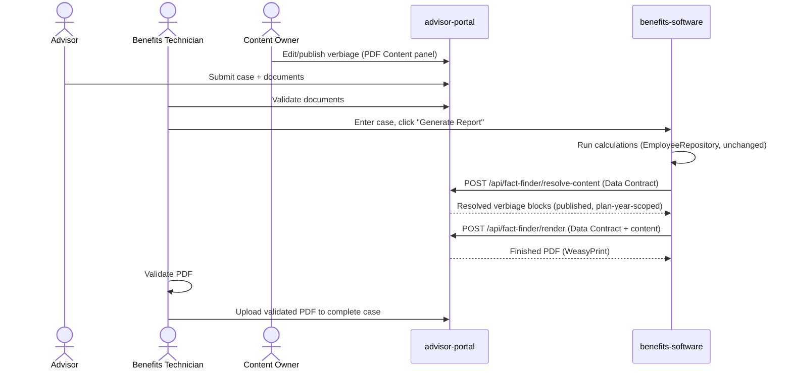

# Fact Finder PDF Modernization — Analysis & Options
Date: 2026-09-06 (updated 2026-09-12)
Scope: Research document for improving the Fact Finder PDF generation process currently owned by `benefits-software` (legacy PHP/Laravel 5.7 application, TCPDF-based rendering — corrected 2026-09-12 from an earlier "Python" mislabel).

## Executive summary

There are really **two separate problems** tangled together in the current system, and they need two separate fixes:

1. **A content/verbiage maintenance problem** — wording changes yearly, is hardcoded, and is painful to update.
2. **A logic-duplication problem** — the PDF template re-derives/replicates calculation logic that already exists (and is authoritative) elsewhere in `benefits-software`.

A verbiage panel alone (Option A below) only fixes problem #1. Fixing problem #2 requires establishing a **single source of truth for computed facts** that the PDF renderer consumes but never recalculates. The strongest long-term option (Option B) fixes both at once by extracting PDF rendering into a service built on this app's (advisor-portal's) Django stack — while leaving `benefits-software`'s actual calculation engine completely untouched.

This document lays out the problem more precisely, then gives you a tiered set of options — from lowest-risk/incremental to full extraction — plus a PDF-engine comparison, a data-contract pattern to eliminate the logic duplication, and a phased rollout plan that avoids a risky big-bang rewrite.

---

## Business workflow (confirmed 2026-09-12)

Recorded here because it explains exactly why the calculations and the PDF's correctness are non-negotiable, and why any change here needs to be validated, not just theoretically clean:

1. **Advisor** submits a case with supporting documents in `advisor-portal`.
2. **Benefits Technician** manually validates those documents.
3. **Benefits Technician** enters the case into `benefits-software`, which generates the Fact Finder PDF (the process this whole document is about).
4. The generated PDF is **validated** (by the technician/reviewer).
5. The validated PDF is **uploaded into `advisor-portal`** to complete the case.

**The PDF is the deliverable at the center of this entire process** — not an internal report, the actual work product handed to the advisor/member. That is why the calculation engine (`EmployeeRepository.php`) is explicitly off-limits in every option below: it has taken a long time to get right, it is trusted, and nothing here should risk it. Everything proposed operates strictly on *how the already-correct numbers get assembled and rendered*, never on *how they're calculated*.

You (the requester) own both `advisor-portal` and `benefits-software` outright — there is no separate team to coordinate with or get buy-in from for a cross-app change. This removes the usual biggest cost of an extraction-style option (Option B) and is factored into the concrete action plan below.

---

## Root cause breakdown

| Symptom | Root cause |
|---|---|
| Wording is hard to update yearly | Verbiage is hardcoded as string literals inside the PDF template/blade file, mixed with control flow |
| Template logic is "extremely difficult to maintain" | Presentation logic (what text to show) and business logic (conditions for showing it) are not separated |
| Some logic "replicates or recreates" calculation logic | There is no single authoritative "computed facts" contract — the renderer re-derives values/conditions instead of consuming already-computed results |
| TCPDF is undesirable | TCPDF is a low-level, imperative, coordinate-based PDF API — every layout tweak requires code changes; there's no separation between content and layout |
| Previous panel attempt still hard to maintain | A verbiage table alone doesn't fix the *conditional logic* problem — you likely still need code to decide *which* verbiage block applies, and that logic was probably left where it was |

**The key insight:** the verbiage panel you already tried is the right instinct, but it's addressing the *symptom* (wording), not the *cause* (logic duplication + tight coupling between calculation and presentation). Any durable fix needs to also address the second row of that table.

---

## Recommended target architecture: a Fact Finder "Data Contract"

Regardless of which option below you pick, the single highest-leverage change is this:

> `benefits-software`'s calculation engine should emit one versioned, well-defined JSON/dict structure — the **Fact Finder Data Contract** — containing every computed value, flag, and boolean condition the PDF could ever need. The renderer (old or new) is only allowed to consume this structure. It is never allowed to recompute or re-derive anything from raw inputs.

Example shape (illustrative, not literal):

```json
{
  "schema_version": "2026.1",
  "case_id": 1234,
  "plan_year": 2026,
  "member": { "first_name": "...", "workshop_code": "PF" },
  "computed": {
    "eligible_for_fers_supplement": true,
    "survivor_benefit_election": "max",
    "tsp_projection_at_62": 812345.00,
    "show_fehb_into_medicare_paragraph": true,
    "show_special_category_paragraph": false
  },
  "verbiage_context": {
    "retirement_system": "fers",
    "category": "leo"
  }
}
```

With this contract in place:
- The PDF renderer becomes a **pure function**: `render(data_contract, verbiage_templates) -> PDF`. It contains zero business logic.
- Any conditional logic that decides *content selection* (which paragraph to show) can live as **declarative rules** evaluated against `computed`/`verbiage_context` fields — not imperative code.
- You get a natural regression-testing seam: feed the same data contract into old and new renderers and diff the output.
- Historical PDFs remain reproducible — regenerating a 2024 Fact Finder just needs the 2024-dated verbiage + the stored data contract for that case, not the current code.

This is the piece worth prioritizing even before choosing a new PDF library — it's what makes everything else safe and maintainable.

---

## Option A — Verbiage/Rules Panel only (lowest risk, incremental)

**What it is:** Build a content management panel (in this app, using the existing Django/admin patterns already in `advisor-portal`) that manages:
- Versioned verbiage blocks, keyed by a stable identifier (e.g. `fehb_medicare_transition_paragraph`), with an **effective date/plan-year range** so historical wording is preserved.
- Declarative **display rules** per block — simple boolean expressions evaluated against fields from the Data Contract (e.g. `computed.eligible_for_fers_supplement == true`), not free-form code.
- A draft → review → publish workflow (leveraging the `AuditLog` pattern already used elsewhere in this app) so wording changes are tracked and approved before they go live — important since this content has compliance/legal implications.

`benefits-software` calls a small internal read API exposed by this app:
```
POST /api/fact-finder/resolve-content/
body: { "plan_year": 2026, "data_contract": {...} }
response: { "blocks": [ {"key": "...", "text": "...", "order": 1}, ... ] }
```
`benefits-software` still assembles the final PDF via TCPDF, but the *text and the decision of which blocks to include* now live in one governed place instead of scattered in code.

**Pros**
- Smallest change — doesn't touch the calculation engine or the PDF rendering pipeline at all.
- Immediately solves the "wording changes yearly and is painful" pain point.
- Can ship independently and iteratively; low risk of breaking existing PDFs.
- Reuses infrastructure you already have in `advisor-portal` (Django admin, auth, audit logging).

**Cons**
- Doesn't get you off TCPDF.
- Rule evaluation still needs to happen somewhere — if you evaluate rules in `advisor-portal` and just return resolved text, `benefits-software`'s template still needs a matching structural placeholder for every possible block (order, pagination, page-break logic stay in the old code).
- Doesn't fully eliminate the "the template recreates calculation logic" problem — it *centralizes* the decision logic but the two systems must still agree on what the Data Contract contains.

**Best if:** you want a quick, safe win this year, and a full rendering rewrite isn't in the budget yet.

---

## Option B — Extract PDF rendering into a service on this app's stack (recommended long-term)

**What it is:** `benefits-software` keeps 100% ownership of calculations. Once it finishes computing a case, it POSTs the Data Contract to an endpoint in `advisor-portal`:

```
POST /api/fact-finder/render/
body: { "data_contract": {...} }
response: application/pdf (binary) or a signed download URL
```

`advisor-portal` (already the receiving end of documents in this system based on `case_documents/`) renders the actual PDF using a modern HTML/CSS-based engine (see comparison below) and returns the finished file, which `benefits-software` then attaches/uploads exactly as it does today.

This turns PDF generation into a **strangler-fig** migration: you're not rewriting `benefits-software`, you're peeling one well-defined responsibility (rendering) off of it and re-hosting it somewhere better suited to maintain it — content team included.

**Pros**
- Fully removes TCPDF from the equation.
- Templates become HTML + CSS (or a proper templating language) instead of imperative drawing code — dramatically easier for non-engineers to help maintain layout, and for engineers to maintain logic.
- Verbiage panel (Option A) becomes a *natural part of the same app* instead of a cross-system dependency — no API round-trip needed for content resolution, since rendering and content live together.
- You get modern, testable, versioned rendering: same input (Data Contract) always produces the same PDF — trivial to unit test, diff, and regression-test.
- Leverages a stack (Django) your team already knows well and actively maintains, instead of investing further in the legacy Python app.

**Cons**
- Larger effort than Option A — needs a new service/module, an API contract, and a migration period running old and new renderers side-by-side.
- Requires `benefits-software` to change (it must call out to a new endpoint instead of rendering in-process) — some integration work on that side, though scoped narrowly.
- You'll want a validation phase (see rollout plan) before fully cutting over, to avoid subtle formatting regressions.

**Best if:** you're willing to invest moderate effort now to eliminate the underlying pain permanently rather than re-papering over it.

---

## Option C — Hybrid: verbiage panel now, extraction later

Practically, **A and B are not mutually exclusive — A is a subset of B.** A sensible path:

1. Build the Data Contract schema first (small, high-leverage, no UI needed).
2. Build the verbiage/rules panel in `advisor-portal` (Option A) against that schema. Ship it — get the yearly-wording pain resolved now.
3. Once the panel is live and the Data Contract is proven out in production, build the rendering service (Option B) reusing the *same* verbiage/rules data — you're not throwing away Option A's work, you're relocating where rendering happens.

This gives you a real win in the near term without foreclosing the bigger fix.

---

## PDF rendering engine comparison (for Option B)

| Engine | Language | Model | Maintainability | Notes |
|---|---|---|---|---|
| **WeasyPrint** | Python | HTML + CSS → PDF | High | Most natural fit for a Django app; templates are just Django/Jinja HTML templates with CSS for layout (page breaks, headers/footers via `@page` rules). Actively maintained, pure Python (no external binary dependency headaches). **Best default choice.** |
| **ReportLab** | Python | Code-first (draw calls) | Low–Medium | Same imperative drawing-API problem as TCPDF, just in Python. Would not solve the core maintainability complaint. |
| **Playwright/Chromium print-to-PDF** | Python (subprocess/binding) | HTML + CSS → PDF via headless Chrome | High (best fidelity) | Excellent CSS/JS support and pixel-perfect rendering, but adds a browser-engine dependency to deploy/maintain (heavier ops footprint than WeasyPrint). |
| **Prince XML / DocRaptor** | Commercial (HTML+CSS) | HTML + CSS → PDF | High | Best-in-class CSS Paged Media support (running headers, footnotes, complex TOCs) but adds licensing cost or a hosted dependency. |
| **LaTeX (via a Python wrapper)** | LaTeX | Markup → PDF | Medium | Superb typographic control, but a much steeper authoring curve for anyone who isn't already comfortable with LaTeX — likely a poor fit for a content team maintaining yearly wording. |

**Recommendation:** start with **WeasyPrint**. It directly replaces "hardcoded drawing code" with "HTML templates + CSS," which is the single biggest maintainability unlock relative to TCPDF, and it's a native Python library — no extra runtime/binary to manage in deployment. If you hit a specific advanced layout requirement it can't handle (e.g., very complex running headers or footnotes), evaluate Playwright print-to-PDF as a fallback for just that document type.

---

## Handling the "conditional logic" problem specifically

Today, the hardcoded conditionals likely look something like (pseudocode):

```python
if member.retirement_system == 'FERS' and member.years_of_service >= 20 and member.age >= 50:
    text += "Special category verbiage..."
```

The fix is to **externalize the condition, not just the text**, as a declarative rule stored alongside the verbiage block:

```json
{
  "block_key": "special_category_paragraph",
  "condition": "computed.retirement_system == 'FERS' and computed.is_special_category == true",
  "text_2026": "..."
}
```

Two implementation approaches for evaluating `condition`:
1. **Safe expression evaluator** (e.g., a restricted evaluator like `simpleeval`, or a small custom AST-based evaluator) — lets an admin write conditions in the panel without deploying code, while staying safe (no arbitrary code execution).
2. **JSON Logic** (a well-known, safe, declarative rule format with libraries in both Python and JS) — slightly more verbose but battle-tested for exactly this "non-engineers configure business rules safely" use case.

Either way: **the boolean facts referenced in the condition (`is_special_category`, `retirement_system`, etc.) must come from the Data Contract, computed once by the calculation engine — never recalculated in the rule or in the template.** This is what actually kills the duplication problem, not just moving text into a table.

---

## Governance & yearly-change workflow

Since wording changes are seasonal/annual and have compliance implications, the panel (whichever option) should support:
- **Plan-year-scoped content**: never overwrite last year's wording — add a new version effective for the new plan year, keep the old one for regenerating historical documents.
- **Draft → Review → Publish** states, so a second person can approve wording before it goes live (pattern already used for review workflows elsewhere in `advisor-portal`).
- **Audit trail** of who changed what and when (reuse the existing `AuditLog` model/pattern in this app).
- **Preview/sandbox rendering**: let the content owner render a sample PDF with draft wording against a real or synthetic Data Contract before publishing.

---

## Suggested rollout plan (de-risked, incremental)

| Phase | Deliverable | Risk |
|---|---|---|
| 1 | Define the Fact Finder Data Contract schema (version 1) in collaboration with whoever owns the calculation logic today | Low — no production changes |
| 2 | Instrument `benefits-software` to *emit* the Data Contract for every case (log it, don't use it yet) | Low — read-only, non-invasive |
| 3 | Build the verbiage/rules panel in `advisor-portal` (Option A), driven by the Data Contract | Medium — new feature, but isolated |
| 4 | Wire `benefits-software`'s existing TCPDF template to pull resolved text from the new panel via API, replacing hardcoded strings block-by-block | Medium — do this incrementally, block by block, not all at once |
| 5 | Once stable, prototype the WeasyPrint-based rendering service (Option B) using the same Data Contract + verbiage panel | Medium |
| 6 | Run old (TCPDF) and new (WeasyPrint) renderers in parallel for a sample of real cases; diff output (text-extraction diff, not just visual) | Low — parallel run, no cutover yet |
| 7 | Cut over renderer by document type or by workshop code cohort, monitoring for issues, with an easy rollback to the old renderer | Medium, but reversible |
| 8 | Decommission the old TCPDF template once confidence is high | Low, if phases 1–7 were followed |

This avoids ever having a single "big bang" cutover date, which is usually where legacy-replacement projects like this go wrong.

---

## Summary recommendation

1. **Do the Data Contract first** — it's the cheapest step and unlocks everything else, including safer testing of the current TCPDF template as-is.
2. **Build the verbiage/rules panel in `advisor-portal`** (Option A) next — it directly solves your most painful, recurring problem (yearly wording updates) and reuses infrastructure (admin UI, auth, audit logging) you already have.
3. **Treat full PDF-rendering extraction (Option B, WeasyPrint-based) as the follow-on phase**, not a prerequisite — you get to decommission TCPDF on your own timeline once the panel and Data Contract have proven themselves, rather than needing to solve everything at once.
4. **Externalize conditions, not just text** — this is the detail that actually eliminates the "logic duplication" complaint, rather than just relocating the maintenance burden.

---

## Addendum (2026-09-12): Workspace strategy + verified findings from `benefits-software`

This section records (a) the workspace/tooling approach agreed on for doing this cross-repo analysis, and (b) a code-verified deep dive into `benefits-software`'s actual PDF pipeline — replacing assumptions in the sections above with confirmed facts, file paths, and one important discrepancy that needs attention.

### Workspace strategy (decided)

Both apps must keep working — `benefits-software`'s calculation engine in particular has taken a long time to get accurate and **must not be touched as part of this effort**. Options considered:

| Option | Description | Risk |
|---|---|---|
| **1. Ad-hoc read-only access (chosen)** | No workspace/config changes. Files in `c:\Users\ProFed\workspace\benefits-software` are read directly by absolute path when needed for analysis; nothing is added to any `.code-workspace` and no edit surface is opened. | Lowest — zero write access, zero setup |
| 2. Add `benefits-software` as a 2nd folder in the current window | Multi-root workspace with a `files.readonlyInclude` guard on that folder | Low — still isolated repos, but adds a permanent write-capable window unless the guard is maintained |
| 3. Separate dedicated `.code-workspace` file | New file referencing both folders, existing single-folder windows untouched | Low — most explicit separation, extra window to manage |

**Decision:** Option 1. Nothing was added to any workspace configuration; `benefits-software` and `benefits-software - Copy` / `benefits-software-archive` were never modified. All findings below came from read-only file inspection plus read-only git history commands (`git log`, `git show`, `git branch -a`, `git stash list` — no checkout, no stash pop/apply, no cherry-pick, no writes of any kind). Note that the archive/copy folders were deliberately **not** consulted — only the canonical `benefits-software` folder is authoritative.

**Standing rule for this project:** any future work against `benefits-software` should be strictly **additive and read-only with respect to calculations** — e.g., a new method that packages *already-computed* values into the Data Contract shape, never a change to an existing calculation method's logic. See "Recommended integrity guardrail" below.

### Verified PDF pipeline (replaces assumptions above with confirmed facts)

- **Route → Controller**: `GET /employee/fegli/report/{empid}` → [`EmployeeController@createPdfFEGLI`](../../benefits-software/app/Http/Controllers/Admin/EmployeeController.php) (`app/Http/Controllers/Admin/EmployeeController.php`, ~lines 1086–1709 handling data assembly, PDF write/output).
- **Renderer**: TCPDF via `elibyy/tcpdf-laravel`, on Laravel 5.7 / PHP 7.1+ (both EOL) — confirms TCPDF's imperative/HTML-subset limitations called out in the original analysis are real, not theoretical.
- **Template**: `resources/views/admin/employee/report_pdf.blade.php` — **2,428 lines**, inline CSS throughout (TCPDF doesn't support external stylesheets well), mixing layout, ~65+ hardcoded educational text blocks, and business conditionals in the same file. Confirmed representative snippet (lines ~558–606):

  ```blade
  @if($pension['systemType'] == 'FERS')
      <tr><td>... Federal Employees Retirement System ...</td></tr>
  @else
      <tr><td>... Civil Service Retirement System ...</td></tr>
  @endif
  ...
  @if($pension['systemType'] == 'FERS')
      <!-- MRA education block, hardcoded paragraph with inline {{ }} value interpolation -->
      A FERS employee's Minimum Retirement Age (MRA) is determined by the year in which
      they were born ... Based on the year you were born ({{ $pension['bdayYear'] }}),
      your MRA is {{ $minimumRetirementAge['mra_year'] }}y {{ $minimumRetirementAge['mra_month'] }}m.
  @endif
  ```
  This is exactly the "wording + condition welded together" problem the original analysis described — confirmed, not hypothetical. [`PDF_REPORT_LITERAL_HARDCODING_INVENTORY.md`](../../benefits-software/PDF_REPORT_LITERAL_HARDCODING_INVENTORY.md) in `benefits-software` already catalogues the literal conditional branches in detail (e.g. `retirementType == "Deferred"`, `systemType == 'FERS'/'CSRS'/'CSRS Offset'/'Transfers'`), and is a ready-made source list for building the rule set in Option A/B — no need to re-derive it.

- **Calculation engine**: [`app/Repositories/EmployeeRepository.php`](../../benefits-software/app/Repositories/EmployeeRepository.php) (~5,000+ lines). Key methods that produce the values the PDF consumes:
  - `getFegliReport($data)` → `fegli_arr`, `biweekly_arr`, `monthly_arr` (year-by-year FEGLI premiums/coverage)
  - `getFegliAllScenarios($data, $last_salary, $retirementAge)` → all 9 FEGLI election-combination projections
  - `getSocialSecurityDetailPdf($empId)` → `ss_arr` (SRS + Social Security, handles WEP)
  - `getFirstPension($empId, $scenario)` → gross annual pension after penalties
  - Penalty methods: `getMRAPenalty()`, `getEarlyOutPenalty()`, `getCsrsOffsetPenalty()`, `getWepPenalty()`, `nonDeductionPanelty()`, `calcRefundedPanelty()`
  - Six retirement scenarios (current + 5 future years) are pre-calculated per case, each with its own pension/penalty/benefit numbers (`$netPensionScenario1`–`6`, etc.)
  - **There is no existing aggregate/DTO object** — the controller builds a plain `$pdf_data` array ad hoc and hands it straight to the Blade view. This *is* effectively today's (undocumented, unversioned) proto-Data-Contract; formalizing it is the whole point of Phase 1.

- **Core data model** (for writing real field names into the Data Contract instead of placeholders): `Employee`, `Eligibility` (DOB, LeaveSCD, retirement date), `Fegli` (coverage elections), `Tsp` (fund balances/loans), `MilitaryService` / `NonDeductionService` / `RefundedService` / `PartTimeService` (creditable-service adjustments), `AppLookup` (system-wide config: COLA %, salary increase %, premium rates), `EmployeeConfig` (per-employee overrides of those).

**PROD schema verified, no further DB analysis needed (2026-09-12):** all of the schema detail above was read from `master`'s code/migrations, not from PROD directly — given the user's own LOCAL/TEST seeding experiments (`pdf_content_blocks`, etc.), there was a real question of whether `master` still matches what's actually deployed. A read-only `php artisan migrate:status` run directly against PROD (157.245.85.180, zero data accessed) confirmed **exact parity**: PROD has all 26 of `master`'s migrations applied, batches 1–22, nothing more/less. This closes the loop — every table/field reference in this document can be trusted as an accurate description of PROD's real schema, and no separate database-schema-analysis pass is needed.

### ⚠️ Correction (2026-09-12, 2nd pass): this was already built once — and shelved. Read this before doing anything else.

The first pass of this addendum (above) concluded `pdf_content_blocks` was "0% implemented — synopsis doc only." **That was wrong, and the mistake is itself the lesson: it was only checked against `master`.** A look at `git branch -a` in `benefits-software` tells a very different story, and matches what you (the user) described — you attempted this exact fix, built a separate admin panel and seed files, and ultimately set it aside.

**What actually happened, reconstructed from the repo's own commit history and docs (all still present, just unmerged):**

1. Real, substantial work was done on branch `feature/pdf-viewer-v2` (and its later snapshot `preserve/pdf-viewer-v2-20260823`): a `pdf_content_blocks` table + a `pdf_content_block_history` audit-trail table, ~20 migrations backfilling specific sections (SBP/FEGLI/FEHB/FLTCIP/TSP/pension/cover/disclaimer), a `PdfContentBlocksSeeder` seeding **~185 verbiage keys**, an admin "PDF content editor" UI, and Blade partials refactored to read from the DB with hardcoded fallback text.
2. This reached a genuinely tested, near-production-ready state: `PDF_TEST_PARITY_AUDIT_2026-05-31.md` (still on the branch) documents a formal TEST parity-gate process that ended at `AUDIT_MISSING_ROWS=0` — i.e., it worked, and was verified against a real environment.
3. **The specific failure mode that caused pain**, per that same audit doc: `PdfContentBlocksSeeder` was insert-only, so when new keys were added the LOCAL and TEST copies of the `pdf_content_blocks` table silently drifted apart (TEST kept whatever partial rows it already had; missing keys were never backfilled automatically). This caused blank PDF sections on TEST that had to be forensically diagnosed key-by-key. This is a **three-environment database-parity problem** — it exists specifically because the verbiage table lives inside `benefits-software`'s own database, and LOCAL/TEST/PROD are three separately-seeded MySQL instances kept in sync only by manual scripts.
4. Per `PDF_WORK_REAPPLY_AND_RESET_PLAN.md` (also still on the branch), this work was deliberately reset out of LOCAL and TEST in August 2026 ahead of an unrelated production data sync, preserved on branch `preserve/pdf-viewer-v2-20260823` (final commit `e6350cd`) with an explicit intent to reapply it later in a controlled way — but that reapplication never happened. `master` — and therefore the live app — is still today's 100%-hardcoded legacy template.
5. Separately, branch `feature/snappy-pdf-migration` (also unmerged, also shelved) shows three renderer swaps in immediate succession: TCPDF → Snappy/wkhtmltopdf → DOMPDF → mPDF, with commit messages explicitly citing "no binary dependency" as the reason for each move away from a binary-based engine. This is independent evidence supporting Option B's WeasyPrint recommendation below: prefer a pure-language renderer with no external binary to deploy/maintain.

**What this means for this project, concretely:**

- `PDF_USER_FRIENDLY_CHANGE_SYNOPSIS.md` and the other root-level PDF docs describe **a real, working prototype that was built, validated, then shelved** — not vaporware, and not a reliable "current state" reference either. Treat them as historical/aspirational, not authoritative.
- **Do not propose resurrecting or merging `preserve/pdf-viewer-v2-20260823` as-is.** It's a working proof that the *content* side of this problem is solvable, but its architecture — verbiage stored inside `benefits-software`'s own DB, requiring manual seed-parity across three separately-managed environments — is exactly what caused the operational pain that led you to set it aside. Repeating that architecture risks repeating that exact failure mode.
- The **185-key seed list** (`PdfContentBlocksSeeder`) and `PDF_TEST_PARITY_AUDIT_2026-05-31.md` are still valuable as a **content/checklist reference** — they tell you precisely which text blocks and section groupings a new panel needs to cover — but should be read as input to a fresh Option A/B build in `advisor-portal`, not as code to merge.
- This materially **strengthens the case for Option A/B living in `advisor-portal`** rather than inside `benefits-software`: hosting the verbiage/rules panel in `advisor-portal`'s single database sidesteps the exact multi-environment seed-drift problem that broke the last attempt — there would be one panel, one database, consumed by both apps (or just by `advisor-portal` if/when rendering is also extracted), instead of three separately-seeded copies inside `benefits-software`.

### Draft Fact Finder Data Contract (v0, grounded in real field/method names above)

This replaces the illustrative example earlier in this doc with one anchored to what `EmployeeRepository` actually produces:

```json
{
  "schema_version": "2026.1",
  "employee_id": 12345,
  "generated_at": "2026-09-12T00:00:00Z",
  "system": {
    "system_type": "FERS",
    "retirement_type": "Deferred",
    "birth_year": 1968
  },
  "pension": {
    "mra": { "years": 56, "months": 4 },
    "eligibility_for_full_retirement": [ { "age": 62, "service": 5 }, { "age": 60, "service": 20 } ],
    "scenarios": [
      { "scenario_number": 1, "retirement_date": "2026-12-31", "gross_annual_pension": 48210.00, "mra_penalty": 0, "deposit_penalty": 0 }
    ]
  },
  "fegli": {
    "current_elections": { "basic": true, "option_a": true, "option_b_multiples": 3, "option_c_multiples": 2 },
    "all_scenarios": [ { "scenario_key": "basic_only", "monthly_premium": 42.10 } ]
  },
  "social_security": {
    "srs_eligible": true,
    "wep_applies": false,
    "year_by_year": [ { "year": 2027, "ss_amount": 21000.00, "srs_amount": 900.00 } ]
  },
  "tsp": {
    "current_balance": 512340.00,
    "projected_ending_balance": 812345.00,
    "funds": [
      { "fund_code": "G", "label": "G Fund", "balance": 102000.00, "allocation_pct": 20, "projected_balance": 162000.00 },
      { "fund_code": "C", "label": "C Fund", "balance": 250000.00, "allocation_pct": 40, "projected_balance": 400000.00 },
      { "fund_code": "L2050", "label": "Lifecycle 2050", "balance": 160340.00, "allocation_pct": 40, "projected_balance": 250345.00 }
    ]
  },
  "computed_flags": {
    "show_fers_supplement_paragraph": true,
    "show_deferred_retirement_paragraph": true,
    "show_csrs_offset_paragraph": false
  }
}
```

Every leaf value here already has a concrete producer method in `EmployeeRepository` (listed above) — Phase 1's job is to define this shape precisely (with the actual calculation owner) and Phase 2 is to add a single new **read-only aggregation method** (e.g. `EmployeeRepository::getFactFinderDataContract($empId)`) that calls the *existing* methods and reshapes their output — it performs no new math, so it cannot change a single calculated number.

Note the `tsp.funds` shape deliberately uses a **list of fund objects instead of one named field per fund** (`GFund`, `L2050`, etc.) — see the TSP pain-point deep-dive below for why.

### Pain point deep-dive: the Blade template's embedded business rules

You flagged this as one of your biggest pain points directly, so it's worth being concrete instead of abstract about it. A read-only pass over `resources/views/admin/employee/report_pdf.blade.php` found:

- **~55–68 `@if`/`@elseif`/`@else`/`@foreach`/`@forelse` directives** spread across the 2,428-line file — this is a genuinely large amount of control flow living inside a presentation template.
- **The deepest nesting found** ([lines 1109–1179](../../benefits-software/resources/views/admin/employee/report_pdf.blade.php#L1109-L1179)): an `@if` on `systemType` (FERS/Transfers) wrapping an `@if` on `retirementType` (Deferred vs. not) — two federal-benefits-specific facts have to both be evaluated correctly, inline, just to pick the right introductory sentence for the Survivor Benefit Plan section.
- **A representative "genuinely hard to maintain" example** — the TSP agency-match paragraph ([lines 2251–2271](../../benefits-software/resources/views/admin/employee/report_pdf.blade.php#L2251-L2271)):

  ```blade
  @if($pension['systemType'] == 'FERS' || $pension['systemType'] == 'Transfers')
      @if($projected_ending_balance_data['sal_percentage_in_contri'] >= 4.95)
          <!-- "you are receiving the full match" paragraph -->
      @else
          <!-- "you are missing out on ${{ $projected_ending_balance_data['missing_out_amount'] }}" paragraph -->
      @endif
  @else
      <!-- "As a CSRS employee, you receive no matching funds" -->
  @endif
  ```

  The **4.95% match threshold is a hardcoded magic number sitting inside a Blade conditional**, next to hardcoded HTML, next to a dollar-formatted sentence. If OPM's 5%-match rule or the exact threshold ever needs adjusting, someone has to find and edit this specific inline condition, and there is nothing under test to confirm they didn't also break the surrounding markup.
- **Confirmed logic duplication**: `sal_percentage_in_contri` is *computed* upstream (in the controller/repository layer) but the **decision of what that number means** ("did they hit the match threshold?") is *re-derived* in the Blade template via the hardcoded `>= 4.95` comparison, rather than the template simply consuming an already-computed `hit_full_match: true/false` flag. This is the exact "logic duplication" root cause called out at the top of this document — not hypothetical, confirmed in this specific spot.
- **Duplicated formatting logic**: the TSP loan rows (General Purpose #1, #2, Residential) each repeat an identical, fairly unreadable ternary for whole-dollar-vs-cents currency formatting ([e.g. line ~2216](../../benefits-software/resources/views/admin/employee/report_pdf.blade.php#L2214-L2226)) — a small thing individually, but indicative of the broader pattern: presentation-formatting decisions are copy-pasted inline rather than centralized.

**Why this matters for the Data Contract approach:** every one of these conditions is answerable with a boolean the calculation layer already has the inputs for (`hit_full_match`, `is_fers_or_transfers`, `is_deferred_retirement`, etc.). Once those booleans live in the Data Contract's `computed_flags`, the *new* renderer's template only ever asks "is this flag true?" — it never re-implements the threshold math, so a future regulation change is a one-line update in the calculation layer, not a scavenger hunt through a 2,428-line Blade file.

### Pain point deep-dive: adding a new TSP fund

You also flagged this specifically, and it's a clean, concrete illustration of the same root cause. `benefits-software` already has its own analysis of this exact problem — [`TSP_DYNAMIC_FUND_ADD_DELETE_OPTIONS_ANALYSIS.md`](../../benefits-software/TSP_DYNAMIC_FUND_ADD_DELETE_OPTIONS_ANALYSIS.md) — confirmed still accurate against the current code. Summary:

**Today's model is one column per fund**, both for balance and for allocation:

```php
// app/Models/Tsp.php — $fillable (abridged)
'GFund', 'FFund', 'CFund', 'SFund', 'IFund', 'LIncome', 'L2020', ... 'L2070', 'L2075',
'GFundDist', 'FFundDist', ... 'L2070Dist', 'L2075Dist',
```

Two migrations already show this pain playing out in practice — [`2020_12_24_120538_add_colmns_in_tsp.php`](../../benefits-software/database/migrations/2020_12_24_120538_add_colmns_in_tsp.php) added 6 new lifecycle funds, and [`2025_08_23_000000_update_lifecycle_funds_2025.php`](../../benefits-software/database/migrations/2025_08_23_000000_update_lifecycle_funds_2025.php) added L2070/L2075 in August 2025 (plus a data migration retiring the expired L2025 fund into `LIncome`). **Every time a new TSP fund needs to be added, someone repeats this same multi-file exercise:**

| Touchpoint | What has to change |
|---|---|
| Migration | Add 2 new columns (balance + allocation) to the `TSP` table |
| `Tsp` model | Add both new column names to `$fillable` |
| Calculation code | Update any loop/array in the repository that enumerates funds by name |
| `report_pdf.blade.php` | Add a new hardcoded `<tr>` for the fund **and** manually add the new field into the Total row's allocation sum (currently a flat `+`-chain of ~16 named fields, [lines ~2360](../../benefits-software/resources/views/admin/employee/report_pdf.blade.php#L2300-L2410)) |
| Config/seed | Add a display label (AppLookup) for the new fund |

Estimated at 3–5 hours plus deployment/testing risk per fund, purely for a labeling/administrative change (a fund being added or renamed by the federal government), not a calculation change.

`benefits-software`'s own analysis document already proposes the right fix on the calculation side — a `fund_catalog` table so a new fund is a data row, not a migration (its "Option 1," phased toward a fully normalized `tsp_employee_holdings` table as "Option 2"). **That work is independent of, and complementary to, this Fact Finder project** — it's scoped entirely inside `benefits-software` and doesn't have to happen for the PDF modernization to proceed. But it directly motivates one specific Data Contract design decision already reflected above: **model `tsp.funds` as a list of `{fund_code, label, balance, allocation_pct, projected_balance}` objects, not one named field per fund.** Even with today's wide-column storage unchanged, the new aggregation method can build this list from whatever fund columns currently exist — and critically, the *rendering template* then loops over the list once, so adding a fund later never requires a template change on the rendering side again, regardless of whether/when `benefits-software` ever adopts its own Fund Catalog idea.

### Recommended integrity guardrail (given how hard-won the calculations are)

1. **No edits inside any existing calculation method** (`getFegliReport`, `getFirstPension`, penalty functions, etc.) as part of this project, full stop.
2. The only new `benefits-software` code allowed in Phase 1–2 is a **pure aggregation/read method** that calls existing methods and copies their return values into the Data Contract shape — if it needs a value that doesn't exist yet, that's a signal to ask the calculation owner to expose it, not to recompute it inline.
3. Validate this guardrail mechanically: for a sample of real cases, diff the **existing PDF's numbers** against the **new Data Contract's numbers** field-by-field before building anything on top of it (verbiage panel or renderer). If they match exactly, the aggregation layer is provably non-invasive.
4. Everything else (verbiage panel, rules engine, WeasyPrint renderer) lives entirely in `advisor-portal`, per Options A/B above — `benefits-software` only ever gains one new read-only export method and, eventually, one outbound API call (Option B).

### Immediate next step

Phase 1 from the rollout plan above, scoped concretely: sit down with whoever owns `EmployeeRepository` and turn the draft schema above into an agreed v1 — pin down field names for every value currently assembled into `$pdf_data`, using [`PDF_REPORT_LITERAL_HARDCODING_INVENTORY.md`](../../benefits-software/PDF_REPORT_LITERAL_HARDCODING_INVENTORY.md) as the checklist of every conditional/value the contract must cover so nothing gets missed.

For the verbiage/content side specifically, use the shelved branch as a **content checklist, not a code source**: the ~185 keys in `PdfContentBlocksSeeder` (on `preserve/pdf-viewer-v2-20260823`) and the section groupings in `PDF_TEST_PARITY_AUDIT_2026-05-31.md` already enumerate exactly which text blocks a new `advisor-portal`-hosted panel needs to cover — pulling that list saves re-deriving it from scratch, without inheriting the branch's cross-environment DB architecture.

**TODO (deferred, confirmed 2026-09-12):** the `feature/pdf-viewer-v2`, `preserve/pdf-viewer-v2-20260823`, and `feature/snappy-pdf-migration` branches are still sitting in the repo, unmerged, and need to be cleaned up (archived and/or deleted) once their contents have been fully mined for reference as above. Not done yet / not in scope of this analysis — flagged here so it isn't forgotten and so a future analysis pass doesn't have to rediscover this same history from scratch.

---

## Concrete action plan (2026-09-12): fixing "I fix something and end up messing up something else"

This is the decision-ready plan, given you own both apps outright (no cross-team coordination cost) and the PDF is the actual work product handed to the advisor/member (Business workflow section above) — so calculation integrity is the one non-negotiable constraint, everything else is a maintainability problem that's solvable.

The core reason edits to `report_pdf.blade.php` keep breaking unrelated things: **it is one 2,428-line file with no automated regression check**, mixing layout, ~65+ hardcoded paragraphs, and business conditionals together, so a change anywhere can silently shift pagination, spacing, or a neighboring section, and the only way to catch it today is manually re-reading a 30-40 page PDF. Every phase below is ordered to remove that risk *before* asking you to make the file smaller or move it anywhere.

### Phase 0 — Golden-master regression harness (do this first; days, not weeks; zero production risk)

Build a small script (Artisan command or standalone PHP script) that, for a fixed set of ~10–15 representative test cases (one per major branch: FERS immediate, FERS deferred, CSRS, CSRS Offset, Transfers, VERA/early-out, WEP-affected, multiple FEGLI election combinations, TSP with/without loans, multiple TSP funds), captures the **raw HTML string** the controller builds right before it's handed to TCPDF (`$html_content` in `EmployeeController@createPdfFEGLI`) — not the final PDF binary, which is far harder to diff reliably.

- Run it once now → commit the HTML outputs as the "golden master" (a fixtures folder, not a DB table — plain files, no cross-environment sync problem).
- Before/after any future Blade or repository change, re-run it and **diff the HTML text** for all 10–15 cases.
- A clean diff (or an intentional, expected diff) is fast, mechanical, reviewable proof that a change didn't silently break something two sections away — replacing "manually re-read a 40-page PDF and hope you notice."
- This is the same validation *technique* the shelved `feature/pdf-viewer-v2` branch proved out with its TEST parity-gate process — reused here, deliberately, without the part that caused pain (no database table to seed/sync across environments; it's just files in the repo).

**This alone is the highest-leverage fix for "I fix something and break something else"** — everything after this phase is optional/incremental and can stop at any point without losing the safety net.

### Phase 1 — Decompose the monolith into partials (mechanical only, no logic changes)

Extract `report_pdf.blade.php` into one `@include`-d partial per section, matching the section table already in this document: `_cover.blade.php`, `_pension.blade.php`, `_sbp.blade.php`, `_srs_ss.blade.php`, `_fegli.blade.php`, `_fehb.blade.php`, `_fltcip.blade.php`, `_tsp.blade.php`, `_checklist.blade.php`. Pure move-only refactor — validate every single extraction against the Phase 0 harness (should produce a byte-identical or near-identical HTML diff).

Result: fixing a TSP-specific problem means opening a ~150–250 line `_tsp.blade.php`, not scrolling a 2,428-line file worrying about accidentally touching FEGLI's page breaks. This directly shrinks the blast radius of every future edit.

### Phase 2 — Externalize the computed flags (kills the logic-duplication problem specifically)

For every inline business condition found in the deep-dive above (`systemType == 'FERS'`, the `sal_percentage_in_contri >= 4.95` TSP-match threshold, `retirementType == 'Deferred'`, etc.), add one precomputed, named value returned from `EmployeeRepository` (e.g. `is_fers_or_transfers`, `is_deferred_retirement`, `hit_full_tsp_match`) and change the partial to check that flag only. No new math — these conditions are already evaluated somewhere, this only gives the result a name and moves the "what does this mean" decision to one authoritative place.

Payoff: a future regulation change (e.g. the match threshold moves from 5%) becomes a one-line fix in `EmployeeRepository`, not a hunt through Blade for every place that number is silently re-checked.

### Phase 3 — TSP funds as a loop, not hardcoded rows (kills the fund add/delete pain point specifically)

Inside the now-isolated `_tsp.blade.php`, replace the hardcoded per-fund `<tr>` rows and the manual Total-row `+`-chain with a loop over a fund list built by a small new aggregation helper (the same `tsp.funds` list shape drafted earlier in this document). Adding a fund in the future still requires the DB/model changes described in that pain-point section (unavoidable while storage stays wide-column) — but it stops *also* requiring a template edit and a hand-updated total formula, cutting the touchpoints roughly in half.

### Phase 4 — Extract rendering to `advisor-portal` (the long-term fix; do this once Phases 0–3 have proven the Data Contract shape in practice)

By this point `EmployeeRepository` already exposes a clean, flag-based, fund-list-based data shape (Phases 2–3 built exactly what the Data Contract needs) — so this phase is "send that same data over an HTTP call to `advisor-portal` and render it there with WeasyPrint (HTML+CSS)" rather than a from-scratch rewrite. Since you own both apps, this is an internal call between two systems you control, not a cross-team API negotiation. The verbiage/rules panel (Option A) is naturally built here too, in `advisor-portal`'s single database — avoiding the exact multi-environment seed-drift failure that shelved the previous attempt.

### Effort/risk summary

| Phase | What changes | Effort | Risk | Solves |
|---|---|---|---|---|
| 0 | New test-fixture script only; no app code touched | Days | ~None | Makes every later change safely verifiable |
| 1 | Move code into partials, no logic changes | ~1 week | Low (mechanical, Phase-0-verified) | "One giant risky file" |
| 2 | Add named flags to `EmployeeRepository`; partials check flags instead of re-deriving conditions | 1–2 weeks | Low–Medium (additive; verify with Phase 0) | Logic duplication |
| 3 | TSP section loops over a fund list instead of hardcoded rows | Few days | Low | Fund add/delete template pain |
| 4 | New rendering service in `advisor-portal` (WeasyPrint) + one outbound call from `benefits-software` | Weeks (largest phase) | Medium (new service, parallel-run validation before cutover, per the rollout plan earlier in this doc) | TCPDF/Blade entirely, verbiage governance, testability |

**Recommendation:** do Phases 0–3 first, in order, inside `benefits-software`, entirely independent of any `advisor-portal` work — each phase is individually low-risk, individually valuable, and stoppable. They also happen to build exactly the Data Contract Phase 4 (and the rest of this document) needs, so none of it is wasted if/when you proceed to the full extraction.

---

## Concrete UI design: the verbiage/content panel in `advisor-portal` (2026-09-12)

You already tried building this once on the `benefits-software` side (the shelved `feature/pdf-viewer-v2` work) and it was very difficult, and users found issues in the proof of concept. Before designing the new one, it's worth being explicit about *why* that's likely to have happened, so the new design specifically avoids it:

- **No safety net before publish** — nothing in that implementation appears to have validated a wording change against every retirement-system/scenario combination before it went live; the parity audit that eventually caught the TEST drift issue was reactive (run after users noticed blank sections), not a pre-publish gate.
- **Content lived inside `benefits-software`'s own DB**, which is why LOCAL/TEST/PROD could silently drift (already covered above) — a second, independent source of "issues users found."
- Likely **no real preview** — an admin editing raw text in a database row has no way to see the actual rendered PDF section until a real case is run through it.

The design below addresses each of those directly, and reuses infrastructure that already exists in `advisor-portal` today rather than inventing new patterns:

### Data model (new, in `advisor-portal`)

```python
class ContentBlockGroup(models.Model):
    """Mirrors the PDF's own sections, so the panel's grouping matches the document structure."""
    key = models.SlugField(unique=True)       # 'cover', 'pension', 'sbp', 'srs_ss', 'fegli', 'fehb', 'fltcip', 'tsp', 'checklist'
    label = models.CharField(max_length=100)  # 'TSP', 'Survivor Benefit Plan', ...
    display_order = models.PositiveIntegerField(default=0)

class ContentBlock(models.Model):
    """One stable, addressable piece of verbiage (e.g. 'fegli.basic_description')."""
    key = models.SlugField(unique=True)
    group = models.ForeignKey(ContentBlockGroup, on_delete=models.PROTECT, related_name='blocks')
    label = models.CharField(max_length=200)               # human-readable name shown in the UI list
    help_text = models.TextField(blank=True)                 # "Appears under Federal Pension when system is FERS"
    required_placeholders = models.JSONField(default=list)   # e.g. ["mra_years", "mra_months"] — validated on save
    display_condition = models.JSONField(null=True, blank=True)  # structured rule (see below); null = always shown

class ContentBlockVersion(models.Model):
    """One edit of a block, scoped to a plan year, moving through draft -> review -> published."""
    STATUS_CHOICES = [('draft', 'Draft'), ('in_review', 'In Review'), ('published', 'Published'), ('superseded', 'Superseded')]
    block = models.ForeignKey(ContentBlock, on_delete=models.CASCADE, related_name='versions')
    plan_year = models.PositiveIntegerField()
    body_html = models.TextField()          # sanitized HTML — see Security below
    status = models.CharField(max_length=10, choices=STATUS_CHOICES, default='draft')
    created_by = models.ForeignKey(User, on_delete=models.SET_NULL, null=True, related_name='content_versions_created')
    reviewed_by = models.ForeignKey(User, on_delete=models.SET_NULL, null=True, blank=True, related_name='content_versions_reviewed')
    published_at = models.DateTimeField(null=True, blank=True)
    created_at = models.DateTimeField(auto_now_add=True)
    # Only one (block, plan_year) pair may be 'published' at a time — enforced in the publish view, not the DB,
    # so old versions can stay as 'superseded' rows for historical PDF reproducibility.
```

This mirrors patterns already in this codebase rather than inventing new ones: `Case.STATUS_CHOICES`/`CaseReviewHistory`/`CaseReviewRequest` ([cases/models.py](../../cases/models.py)) are the existing draft→review workflow pattern; `AuditLog` ([core/models.py](../../core/models.py)) is the existing change-tracking pattern (a `post_save` signal, same as `SystemSettings`'s in [core/signals.py](../../core/signals.py), can auto-log every `ContentBlockVersion` transition).

### Screens

1. **Content list** (`/admin/fact-finder-content/`) — grouped by `ContentBlockGroup` (same order as the PDF's own sections), each row showing the block's label, current published status, and plan year. Reuses the tabbed-panel structure already built for `system_settings.html` ([templates/core/system_settings.html](../../templates/core/system_settings.html)) rather than a new UI pattern.
2. **Block editor** — reuses the **exact TinyMCE integration already wired up** for `SystemSettings.technical_notes_template` ([config/settings.py `TINYMCE_DEFAULT_CONFIG`](../../config/settings.py), the textarea/hidden-input/JS-sync pattern in `system_settings.html`). A restricted toolbar (bold/italic/lists/paragraph only — no images, no raw HTML source view) keeps output predictable for a PDF layout.
   - A **merge-field picker** (a dropdown listing `required_placeholders` for that block, e.g. "Insert: MRA Years") inserts a plain-text token like `[[mra_years]]` at the cursor — the admin never hand-types or can typo a template tag.
   - On save, the server validates every token in `required_placeholders` is present in the submitted text (reject/warn if one was accidentally deleted) — this specifically prevents the class of error a free-text field invites.
   - **Display condition**, if the block isn't always shown, is built with a **structured rule UI** (row-based: `[field dropdown] [operator dropdown] [value]`, ANDed together — fields populated from the Data Contract schema, e.g. `system.system_type`, `system.retirement_type`) instead of a free-text expression box. This is deliberately *not* a code/expression editor — it removes an entire class of syntax-error bugs a non-engineer (or even an engineer, under time pressure) can introduce.
3. **Pre-publish validation ("Test against sample cases")** — before a version can move from `in_review` to `published`, the panel runs the block's `display_condition` and placeholder set against the **same ~10–15 golden-master fixture cases from Phase 0** of the action plan above, and shows a table: *"This block will appear for: FERS-Deferred, FERS-Immediate, Transfers. It will NOT appear for: CSRS, CSRS Offset."* The admin confirms that matches intent before publishing — this is the missing pre-publish safety net that the old proof of concept lacked.
4. **Preview** — two tiers, so you get value immediately without waiting for Phase 4:
   - **Tier 1 (ships with the panel, `advisor-portal`-only):** render the block's resolved text with sample placeholder values substituted, styled in a plain HTML preview pane — catches wording/merge-tag problems immediately, no dependency on `benefits-software` at all.
   - **Tier 2 (once the `resolve-content` API below exists):** a "Generate real preview PDF" button that calls `benefits-software`'s existing PDF route for a designated **test employee record**, passing a `preview=1` flag so it resolves **draft** content instead of published — giving a byte-for-byte real preview without ever touching a live case.

### Integration contract with `benefits-software`

Per Option A earlier in this document: `benefits-software` calls `advisor-portal`:

```
POST /api/fact-finder/resolve-content/
body: { "plan_year": 2026, "data_contract": {...}, "draft": false }
response: { "blocks": [ {"key": "fegli.basic_description", "html": "...", "order": 1}, ... ] }
```

This is a **service-to-service call between two systems you own**, not a third-party integration, so authentication can reuse the access-code pattern already used for the existing sync tooling in [core/views_data_sync.py](../../core/views_data_sync.py) (a shared secret validated server-side) — plus an IP allowlist since both servers' addresses are known and static. No end-user ever hits this endpoint directly.

### Security notes (OWASP-relevant, since this is admin-authored HTML rendered into a document pipeline)

- **Sanitize on save, not just on render**: run `body_html` through a strict allow-list HTML sanitizer (e.g. `nh3` or `bleach` for Python) permitting only the tags the restricted TinyMCE toolbar can produce (`p`, `strong`, `em`, `ul`, `ol`, `li`, `br`) before it's stored — this is stored content viewed by other admins/reviewers and eventually merged into a rendered document, so treat it as untrusted input at the trust boundary (save time), not just at render time.
- **The merge-field tokens are plain text (`[[mra_years]]`), substituted via a simple safe string replace** on the `benefits-software`/renderer side — never `eval()`'d, never treated as executable template code. This avoids any server-side template injection risk.
- **The `resolve-content` endpoint is authenticated and not user-facing** — it returns rendered HTML fragments that go straight into a PDF pipeline; it should never accept arbitrary `data_contract` values that end up unsanitized in an HTML response elsewhere (keep its response strictly consumed by the PDF renderer, not displayed back in a browser context).

### Why this specifically fixes what went wrong last time

| Problem last time | Fix in this design |
|---|---|
| Content lived inside `benefits-software`'s own DB, drifted across 3 environments | Single database, inside `advisor-portal`, no environment-seed sync needed |
| No pre-publish safety net; issues found by users after the fact | Mandatory "test against golden-master cases" gate before publish is even allowed |
| Free-text conditions/placeholders invite typos and breakage | Structured rule builder + merge-field picker; no hand-typed template syntax |
| No way to see the real effect before publishing | Two-tier preview: instant text preview now, real PDF preview once wired to `benefits-software` |
| Built from scratch, high effort | Reuses this app's existing TinyMCE config, `system_settings.html` panel structure, `AuditLog`, and the `CaseReviewHistory`/`CaseReviewRequest` draft/review pattern almost verbatim |

---

## User-perspective walkthrough (2026-09-12): how this actually works day to day

Everything above is architecture; this section answers the practical question directly: **who does what, where, and where does the PDF actually get rendered** — at each stage of the migration, not just the end state.

### Where does the PDF get rendered? (short answer, by phase)

| Stage | Renderer | Where it lives |
|---|---|---|
| **Today** | TCPDF | `benefits-software` — 100% hardcoded Blade template |
| **After the verbiage panel ships (Option A)** | Still TCPDF | Still `benefits-software` — but the *text* it renders is fetched live from `advisor-portal` on every PDF generation. Rendering hasn't moved yet; only content ownership has. |
| **After Phases 1–3 (Blade cleanup)** | Still TCPDF | Still `benefits-software` — same as above, just a much smaller/safer template (partials + named flags + fund loop) |
| **After Phase 4 (Option B, the long-term target)** | WeasyPrint (HTML/CSS) | `advisor-portal` — `benefits-software` sends the Data Contract over an internal API call and gets a finished PDF back; TCPDF and the Blade template are retired |

So the honest answer is: **rendering stays in `benefits-software` for most of this migration**, and only moves to `advisor-portal` at the very end (Phase 4/Option B). What moves to `advisor-portal` *first*, and delivers value immediately, is **ownership of the verbiage** — that's Option A, and it doesn't require rendering to move at all.

### Walkthrough 1 — updating verbiage for the new plan year (content-owner perspective, in `advisor-portal`)

This is the part you're most focused on fixing, and it's entirely new UI in `advisor-portal` (the panel designed above):

1. You (or whoever owns the wording) log into `advisor-portal` and open the **PDF Content** panel — a new admin screen, grouped by PDF section (Cover, Pension, SBP, SRS/SS, FEGLI, FEHB, FLTCIP, TSP, Checklist), same visual pattern as the existing System Settings screen.
2. You find the block that needs updating (e.g. `pension.mra_explanation`) by section, not by hunting through a 2,428-line file.
3. You edit the text in the TinyMCE editor. If the block needs a computed value (e.g. the employee's MRA), you click **Insert merge field → MRA Years** instead of typing a template tag — it's inserted as a safe token, not hand-typed code.
4. If this block only applies in certain situations (e.g. FERS only), you set that using the **structured condition builder** (dropdowns: field / operator / value) — no code, no free-text expression to get wrong.
5. You save — this creates a new **draft** version, plan-year-scoped, without affecting the currently published wording at all.
6. Before you're allowed to publish, the panel runs your draft against the **golden-master test cases** (FERS immediate, FERS deferred, CSRS, CSRS Offset, Transfers, VERA, WEP, etc.) and shows you exactly which scenarios will and won't see this block — you confirm that matches what you intended.
7. You click **Preview** — today (Tier 1) that's an instant styled text preview with sample values; once the `resolve-content` API is wired to `benefits-software` (Tier 2), it's a real generated PDF for a designated test case.
8. You **Publish**. From this moment forward, every new Fact Finder PDF `benefits-software` generates picks up this wording automatically — no deployment, no code change, no waiting on IT.
9. Every step above (draft created, published, by whom, when) is recorded in `AuditLog`, exactly like every other change already tracked in `advisor-portal` — so you have a full history of who changed what wording and when, which matters given this content has compliance implications.
10. **Historical PDFs are unaffected** — old, already-generated PDFs are untouched files; only *new* PDF generations pick up the new wording, and even those can be regenerated later with the wording that was live at that time (superseded versions are kept, not overwritten).

### Walkthrough 2 — generating an actual case's Fact Finder PDF (benefits technician's perspective, in `benefits-software`)

This is the existing business workflow from earlier in this document, now with the internals made explicit:

1. **Advisor** submits a case with supporting documents in `advisor-portal` (unchanged).
2. **Benefits Technician** manually validates the documents (unchanged).
3. **Benefits Technician** enters/updates the case in `benefits-software` and clicks **Generate Fact Finder Report** — this screen and this click **do not change** from what the technician does today.
4. Behind that click, here's what's new (once Option A + the Data Contract are wired up):
   - `EmployeeRepository` runs its existing calculation methods (`getFegliReport`, `getFirstPension`, `getSocialSecurityDetailPdf`, etc.) — **completely unchanged**, same trusted math as always.
   - A new, additive aggregation method packages those results into the Data Contract shape (system type, retirement scenarios, FEGLI elections, TSP fund list, computed flags) — no new math, just reshaping.
   - `benefits-software` calls `advisor-portal`'s `resolve-content` API with that Data Contract, and gets back the exact wording blocks that apply to this specific case (right FERS/CSRS branch, right deferred/immediate wording, etc.) — this is the same content the technician would have seen in the panel's "test against sample cases" preview.
   - The (now much smaller, partial-based) Blade template renders those blocks + the calculated numbers into the PDF, same as today, still via TCPDF (until Phase 4) or via the new `advisor-portal`-hosted WeasyPrint service (after Phase 4).
5. The technician **validates the generated PDF** (unchanged step — this human review doesn't go away just because the pipeline is more reliable).
6. The technician **uploads the validated PDF into `advisor-portal`** to complete the case (unchanged — this is the existing final workflow step).

**The technician's experience barely changes.** What changes is everything upstream of their click: the wording is centrally governed instead of hardcoded, a bad wording change can't reach them without having passed the golden-master gate, and (eventually, post-Phase-4) the rendering itself runs on a modern, testable stack instead of TCPDF.

### Sequence diagram — steady state (after Option A + Phase 4 are both live)



Note this diagram shows the **fully migrated end state** (both Option A and Phase 4/Option B live) — in the nearer term, the `render` call stays inside `benefits-software` (TCPDF) instead of going to `advisor-portal`, and everything else is identical. That's the one thing that changes as you move through the phases; who does what, and in what order, does not.

---

## Progress log (living section — update as each increment ships)

Tracks actual implementation work against the rollout plan above. Each entry is a shipped, tested increment — not a plan.

### 2026-09-12 — Phase 1: Data Contract schema v1 ("2026.1")

- **What:** Defined the Fact Finder Data Contract as a set of DRF serializers in `advisor-portal`, grounded in verified (not guessed) field names read directly from `benefits-software`'s `EmployeeRepository.php` / `EmployeeController.php`.
- **Where:** [cases/fact_finder_data_contract.py](../../cases/fact_finder_data_contract.py) (schema), [cases/tests_fact_finder_contract.py](../../cases/tests_fact_finder_contract.py) (tests).
- **Note:** Not the same thing as `FederalFactFinder` (`cases/models_fact_finder.py`), which is the advisor-facing intake form — the two happen to share the name "Fact Finder."
- **`computed_flags` grounded in:** `benefits-software/PDF_USER_LITERAL_AND_CONDITIONAL_LOGIC.md`'s per-section "Condition logic" catalogue — `is_fers_or_transfers`, `is_csrs_or_csrs_offset`, `is_deferred_retirement`, `is_wep_applicable` (CSRS/CSRS Offset + SSYearsEarning < 30), `is_gpo_applicable` (pure CSRS only), `hit_full_tsp_match` (the `>= 4.95` threshold hardcoded today at `report_pdf.blade.php` ~line 2191).
- **Tested:** `python manage.py test cases.tests_fact_finder_contract` — 7/7 passing. No `INSTALLED_APPS`/settings changes needed (DRF `Serializer` works standalone). `git status` confirmed zero existing files touched.

### 2026-09-12 — Phase 2 (step 1 of 2): read-only aggregation builder

- **What:** A pure PHP reshaping class — performs **zero calculations, zero new DB/repository calls** — that takes values already computed by the existing (untouched) calculation methods and repackages them into the Data Contract shape. Every `computed_flags` boolean is a verbatim copy of one specific existing `report_pdf.blade.php` condition (each documented inline with which condition it mirrors).
- **Where:** `benefits-software/app/Services/FactFinderDataContractBuilder.php`.
- **Tested:** `benefits-software/tests/Unit/FactFinderDataContractBuilderTest.php` — 9/9 passing, run via `vendor/bin/phpunit.bat --bootstrap vendor/autoload.php` (extends plain `PHPUnit\Framework\TestCase`, not Laravel's DB-backed `TestCase` — no local DB/bootstrap required, since `benefits-software` has no local `phpunit.xml` and `.env.testing`'s DB looks remote/test-server-only, not safely runnable locally).

### 2026-09-12 — Phase 2 (step 2 of 2): wired into the controller (read-only instrumentation)

- **What:** `EmployeeController@createPdfFEGLI` now builds the Data Contract (from variables it already computes — no new calculation or repository calls added) and logs it via `\Log::info('fact_finder_data_contract', ...)`, immediately before the existing `\View::make('admin.employee.report_pdf', ...)` call. The entire block is wrapped in `try/catch (\Throwable)` specifically so a bad assumption here can **never** break real PDF generation — on failure it only logs a warning and the existing flow continues untouched. `$view`/`$html_content`/the generated PDF are not read from or written to by this block at all.
- **Where:** `benefits-software/app/Http/Controllers/Admin/EmployeeController.php` (one `use` import + one block added; nothing existing was edited or removed).
- **Verified:** `php -l` clean on both changed files; `FactFinderDataContractBuilderTest` still 9/9 after the change; `git status --short` in `benefits-software` shows only the two new files (`FactFinderDataContractBuilder.php`, its test) plus this one edited controller — no other tracked file touched.
- **Explicitly not done (by design, per the rollout plan's Phase 2 = "log it, don't use it yet"):** nothing consumes this logged contract yet; the PDF still renders exactly as it did before. Not run against a live case/real DB — validating against real case output (the "diff old vs. new numbers" integrity check described earlier in this doc) is the next increment, not this one.

### Up next
- Diff a real case's logged Data Contract against that same case's existing PDF numbers, to mechanically prove the aggregation is non-invasive (per the "Recommended integrity guardrail" section above).
- Then: Option A verbiage panel in `advisor-portal`.

### 2026-09-12 — Phase 2 validated against real case data (local `profeds` DB, synced from PROD)

- **What:** Built `benefits-software/scripts/validate_fact_finder_data_contract.php` — a read-only, standalone script that boots the Laravel app and calls the *exact same* `EmployeeRepository` methods `EmployeeController@createPdfFEGLI` calls (skipping only that controller's side-effecting `updateDateCompleted()` call and the actual PDF file write, neither of which this validation needs), feeds the results into `FactFinderDataContractBuilder::build()`, and prints a side-by-side cross-check of contract values vs. the raw repository return values, plus every `computed_flags` boolean. This script lives in `scripts/`, which is already gitignored in this repo (same as its other ad hoc diagnostic scripts) — it was never committed/deployed.
- **Database used:** the local `profeds` MySQL database via XAMPP (a local sync of PROD data per this repo's `sync_prod_to_local.ps1` tooling) — **not** the remote `test_profeds` server. Flagged explicitly here since "test database" could mean either; this run used the local synced copy, with the user's explicit go-ahead to use real data.
- **Cases tested (auto-selected, one real case per system type, all with complete Eligibility/FEGLI/TSP data):**

  | System type | EmployeeId | Retirement type |
  |---|---|---|
  | FERS | 42293 (Brooke Turner) | Deferred |
  | CSRS | 36798 (Sheue-Yann Cheng) | Regular |
  | CSRS Offset | 41444 (Glenda Larson Petersen) | Regular |

- **Cross-check results (contract value vs. raw repository return value, all 3 cases):** `system_type`, `retirement_type`, scenario-1 gross annual pension, and `sal_percentage_in_contri` all **matched exactly** — proving the builder is a lossless pass-through with no value drift.
- **`computed_flags` results (all correct, matching the exact blade conditions they're grounded in):**

  | Flag | FERS (42293) | CSRS (36798) | CSRS Offset (41444) |
  |---|---|---|---|
  | `is_fers_or_transfers` | true | false | false |
  | `is_csrs_or_csrs_offset` | false | true | true |
  | `is_deferred_retirement` | true | false | false |
  | `is_wep_applicable` | false | true | true |
  | `is_gpo_applicable` | false | **true** | **false** |
  | `hit_full_tsp_match` | true | true | true |

  The `is_gpo_applicable` row is the most important result: it's `true` only for pure CSRS and `false` for CSRS Offset, on real records — confirming the "pure CSRS only, not CSRS Offset" GPO distinction (a subtlety easy to get wrong) is implemented correctly, not just correct in a synthetic unit test.
- **Conclusion:** Phase 2's aggregation logic checks out against real, varied production-derived data across all three major system-type branches, with zero discrepancies. Still true that nothing consumes the logged contract in production yet (per the rollout plan's Phase 2 scope), and this was a local DB, not a live PDF-generation request — the "diff old PDF vs. new contract" end-to-end check (next item below) is still the next increment.

### Up next (revised)
- Diff a real case's logged Data Contract against that same case's existing PDF numbers end-to-end, to close the loop per the "Recommended integrity guardrail" section above.
- Then: Option A verbiage panel in `advisor-portal`.

### 2026-09-12 — Phase 2 committed; end-to-end HTML diff (contract vs. actual rendered PDF)

- **Committed:** the Phase 2 changes (`FactFinderDataContractBuilder.php`, its 9 tests, and the `EmployeeController` instrumentation) are now committed in `benefits-software` (commit `ddc9b45`, "Fact Finder: add read-only Data Contract builder (Phase 2) + controller instrumentation"). The Phase 1 schema work is committed in `advisor-portal-app` on branch `feature/fact-finder-data-contract` (commit `6537ec1`).
- **What:** Built `benefits-software/scripts/validate_fact_finder_html_diff.php` — mirrors `EmployeeController@createPdfFEGLI` almost verbatim (same repository calls, same order) with exactly two intentional differences: (1) skips `updateDateCompleted($empId)`, the controller's one DB write, and (2) stops right after `$view->render()` — never instantiates TCPDF/MYPDF, never writes a PDF file. It then renders the **real** `report_pdf.blade.php` view (the actual production template, unmodified) into an HTML string held only in memory, and diffs specific figures/sentences in that HTML against the Fact Finder Data Contract built from the same underlying values. One incidental side effect was observed and reverted: rendering triggered Laravel's normal Blade-cache recompilation of one stale compiled view file (`storage/framework/views/...php`, tracked in git in this repo) — reverted via `git checkout --` immediately after, restoring a byte-identical working tree. No database rows were written; no PDF files were written.
- **Cases tested (same 3 as the earlier repository-level validation):**

  | System type | EmployeeId | Pension figure found in rendered HTML | WEP sentence present | TSP wording matches flag |
  |---|---|---|---|---|
  | FERS | 42293 | ✅ `$2,228`/mo (see note below) | n/a (WEP doesn't apply to FERS) | ✅ "full match" sentence present (`hit_full_tsp_match=true`) |
  | CSRS | 36798 | ✅ `$205,243`/yr and `$17,104`/mo both present | ✅ WEP penalty sentence present (`is_wep_applicable=true`) | n/a — CSRS never gets match wording regardless of `hit_full_tsp_match` (see note) |
  | CSRS Offset | 41444 | ✅ `$63,801`/yr and `$5,317`/mo both present | ✅ WEP penalty sentence present (`is_wep_applicable=true`) | n/a — same as CSRS |

- **Independent cross-validation bonus:** case 42293's contract-derived monthly pension ($2,228, from $26,739/yr ÷ 12, rounded) matches the **pre-existing, independently-verified** expected value for this exact case already hardcoded in this repo's `validate_deferred_fix.php` ("42293 ... Brooke Turner ... expected 2228 // $2,228/mo (18y8m)") — a fixture built for an unrelated pension-rounding bug fix, with no connection to this project. The contract's numbers matching a completely independent prior validation is stronger evidence than a self-consistency check alone.
- **Nuance discovered (not a bug, but worth recording):** `hit_full_tsp_match` was `true` for all 3 cases (all three employees contribute well above 4.95%), but the rendered HTML only shows "full match" wording for the FERS case — CSRS/CSRS Offset always render "you receive no matching funds" regardless of contribution %, because the blade template's TSP-match wording is nested *inside* the `is_fers_or_transfers` branch, not evaluated independently. This confirms `computed_flags` are correctly modeled as independent atomic booleans (matching what the calculation layer can determine), and any future rules panel/renderer must combine them the same way the template does today (`is_fers_or_transfers AND hit_full_tsp_match` → full-match wording), not treat `hit_full_tsp_match` alone as sufficient.
- **Conclusion:** the Data Contract's numbers and flags now check out against (a) the raw repository values Phase 2 already validated, (b) the actual rendered production PDF template's real output text, and (c) an independent, previously-verified fixture value from unrelated bug-fix work. This closes the "Recommended integrity guardrail" loop for Phase 1–2 with real evidence, not just code review.

### Up next (revised again)
- Option A verbiage panel in `advisor-portal`.

### 2026-09-12 — Option A (step 1): content block models

- **What:** New Django app `fact_finder_content` with `ContentBlockGroup`, `ContentBlock`, and `ContentBlockVersion` — matching this doc's earlier "Concrete UI design" data model, adapted to this codebase's existing conventions (`settings.AUTH_USER_MODEL`, `CaseReviewHistory`-style draft/review pattern). Models + admin registration + migration only in this step — no views, no API, no rules-engine evaluation yet.
- **Where:** `fact_finder_content/models.py`, `admin.py`, `migrations/0001_initial.py`.
- **Key design point carried over from the doc:** only one `(block, plan_year)` pair may be `published` at a time, enforced in `ContentBlockVersion.publish()` (not a DB constraint) — so old versions stay as `superseded` rows for historical PDF reproducibility, and publishing a new version for one plan year never touches another plan year's already-published wording.
- **Tested:** 8 new tests in `fact_finder_content/tests.py` (group/block `__str__`, placeholder-detection via `missing_placeholders()`, publish/supersede semantics, cross-plan-year isolation, `PROTECT` on group delete). Full suite: 67 tests, 1 pre-existing unrelated failure (`DashboardSearchTests`), 0 regressions.
- **Committed:** `advisor-portal-app` commit `99faca2` on `feature/fact-finder-data-contract`.

### Up next
- Option A (step 2): admin/content-editor views — the list screen, TinyMCE-based block editor (reusing the `system_settings.html` panel pattern and existing TinyMCE config), and the draft → review → publish workflow UI.

### 2026-09-12 — Option A (step 2): content list + block editor views

- **What:** Admin-only views wired into a new `fact_finder_content` URL namespace (`/fact-finder-content/`):
  - `content_list` — groups blocks by `ContentBlockGroup`, shows published/draft status per plan year (switchable via a `?plan_year=` query param).
  - `content_block_detail` — version history table, a "New Draft" form, and `submit_for_review`/`publish` actions.
- **Publish gating:** `publish` is blocked server-side (with an inline error, not a silent bad publish) when `required_placeholders` are missing from `body_html` — reusing `missing_placeholders()` from step 1. Draft creation is allowed to proceed with only a warning, so content editors aren't blocked mid-edit.
- **Deliberately deferred to a later increment:** TinyMCE integration (plain `<textarea>` for now), the merge-field picker, and the structured `display_condition` rule builder — all still just plain textarea/raw JSON. Keeping each increment small and testable per the agreed approach.
- **Tested:** 10 new tests (permission checks for both views, draft creation, publish blocked when a placeholder is missing, publish succeeds when present, submit-for-review). Full suite: 75 tests, 1 pre-existing unrelated failure, 0 regressions.
- **Committed:** `advisor-portal-app` commit `93c5f5a` on `feature/fact-finder-data-contract`.

### Up next
- Option A (step 3): TinyMCE editor + merge-field picker for `body_html` (reusing the existing `TINYMCE_DEFAULT_CONFIG` already wired up for `SystemSettings.technical_notes_template`).
- Option A (step 4): structured `display_condition` rule builder UI (field/operator/value dropdowns against the Fact Finder Data Contract schema — no free-text expressions).
- Option A (step 5): HTML sanitization on save (restricted tag allow-list) before this is exposed to any real, non-developer content editor.
- Later: golden-master pre-publish validation gate; `resolve-content` API endpoint for `benefits-software` to call.

### 2026-09-12 — Option A (step 3): TinyMCE editor + merge-field picker

- **What:** The "New Draft" `body_html` field now uses a restricted TinyMCE instance — toolbar limited to `formatselect | bold italic underline | bullist numlist`, no images/link/raw-HTML-source plugin — instead of a plain textarea. A merge-field picker dropdown (populated from the block's `required_placeholders`) inserts a safe `[[token]]` at the cursor via TinyMCE's `mceInsertContent`, so editors never hand-type merge tags. Reuses the textarea+hidden-input+JS-sync pattern already established for `SystemSettings.technical_notes_template` (TinyMCE mounts on an unnamed textarea; a hidden input carries the actual POSTed value).
- **Bug caught by writing the tests first, fixed immediately:** the view passed the `ContentBlock` instance into the template context as `'block'`, which collides with Django's own `` tag — Django pushes a `BlockContext` into `context['block']` to support `{{ block.super }}`, silently blanking every `{{ block.* }}` reference inside `...`. Renamed the context key to `'content_block'` everywhere in the view and template. Worth remembering: **never name a Django template context variable `block`.**
- **Tested:** 6 new tests (merge-field picker renders block's placeholders as options, hidden entirely when a block has none, TinyMCE script tag + restricted toolbar string + hidden-input presence, textarea correctly has no `name` attribute). Full suite: 78 tests, 1 pre-existing unrelated failure, 0 regressions.
- **Committed:** `advisor-portal-app` commit `77776ec` on `feature/fact-finder-data-contract`.

### Up next
- Option A (step 4): structured `display_condition` rule builder UI (field/operator/value dropdowns against the Fact Finder Data Contract schema — no free-text expressions).
- Option A (step 5): HTML sanitization on save (restricted tag allow-list) before this is exposed to any real, non-developer content editor.
- Later: golden-master pre-publish validation gate; `resolve-content` API endpoint for `benefits-software` to call.

### 2026-09-12 — Option A (step 4): structured display_condition rule builder

- **What:** A small, non-code rule engine (`fact_finder_content/rules.py`) plus its UI wiring. `AVAILABLE_FIELDS` is a fixed registry grounded directly in the Fact Finder Data Contract schema (`system.system_type`, `system.retirement_type`, all six `computed_flags.*` booleans) — not a free-text expression box, nothing `eval()`'d. `validate_rules()` rejects unknown fields, invalid operators, and out-of-range values with specific errors; `evaluate_rules()` ANDs a list of `{field, operator, value}` rows against a data-contract-shaped dict.
- **UI:** the block detail page now has a "Display Condition" card — a table of current rules with per-row Remove, and an Add Rule form (field dropdown → operator dropdown → value dropdown). The value dropdown's options swap client-side based on the chosen field's declared type (boolean fields get `true`/`false`; choice fields get their exact declared choices) — populated from a server-rendered JSON registry, never hand-typed.
- **Validation is server-side and atomic:** adding a rule re-validates the *entire* candidate rule list before saving; an invalid addition is rejected with an inline error and never persisted (no partially-bad state).
- **Tested:** 22 rule-engine unit tests (including a case grounded directly in the earlier Phase 2 real-data validation: `is_gpo_applicable` true for pure CSRS, false for CSRS Offset — proving the rule engine reproduces that exact distinction) + 6 view tests (registry rendering, valid choice/boolean rule addition, invalid-rule rejection, rule removal, permission check). Full suite: 106 tests, 1 pre-existing unrelated failure, 0 regressions.
- **Committed:** `advisor-portal-app` commit `4f841a4` on `feature/fact-finder-data-contract`.

### Up next
- Option A (step 5): HTML sanitization on save (restricted tag allow-list) before this is exposed to any real, non-developer content editor.
- Later: golden-master pre-publish validation gate; `resolve-content` API endpoint for `benefits-software` to call.

### 2026-09-12 — Option A (step 5): HTML sanitization on save

- **What:** New dependency `bleach==6.4.0`. `fact_finder_content/sanitize.py`'s `sanitize_body_html()` allow-lists exactly the tags the restricted TinyMCE toolbar is meant to produce (`p`, `strong`, `em`, `ul`, `ol`, `li`, `br`) with **no attributes permitted at all** — no `style`, no `href`/`src`, no `on*` handlers — eliminating attribute-based XSS regardless of any future toolbar change. Disallowed tags (`script`, `img`, `a`, `span`, `div`, etc.) are stripped; their text content survives as inert plain text (safe, since it's no longer inside an executable/interactive element).
- **Enforced at the trust boundary, per the doc's own Security notes ("sanitize on save, not just on render"):** `ContentBlockVersion.save()` is overridden to sanitize `body_html` on every save — create *and* update — so it applies no matter which code path writes a version (view, admin, shell, or a future API), not just the one view action that exists today.
- **Tested:** 11 new tests — 9 direct sanitizer unit tests (script stripped-but-inert, `onclick`/`style`/`href` stripped, disallowed tags removed, merge-field `[[tokens]]` survive untouched since they're plain text, `None`/empty input handled) + 2 model-level `save()` tests (create and update both sanitize) + 1 view-level integration test (POSTing malicious HTML through `create_draft` comes out clean in the DB). Full suite: 118 tests, 1 pre-existing unrelated failure, 0 regressions.
- **Committed:** `advisor-portal-app` commit `62a22bc` on `feature/fact-finder-data-contract`.
- **This closes out the core Option A build-out** (steps 1–5: models, list/editor views, TinyMCE + merge-field picker, structured rule builder, sanitization). What's left is integration work, not new UI surface — see "Up next" below.

### Up next
- Golden-master pre-publish validation gate: before allowing `publish`, run the version's `display_condition` + placeholder checks against a fixed set of ~10–15 representative real cases (one per major branch: FERS immediate/deferred, CSRS, CSRS Offset, Transfers, WEP-affected, etc.) and show the content owner exactly which scenarios will/won't see the block — the pre-publish safety net described in the "Concrete UI design" section above.
- `resolve-content` API endpoint (`POST /api/fact-finder/resolve-content/`) for `benefits-software` to call — the other end of the integration contract described earlier in this document. Needs an authentication mechanism (shared secret / IP allowlist, per the doc's Integration contract section) before it's callable from outside this app.
- Nav link into the content panel from the admin dashboard (currently only reachable by direct URL).

### 2026-09-12 — Nav link + resolve-content API (both integration gaps closed)

- **Nav link:** added a "Fact Finder Content" button to the admin dashboard's action row, next to System Settings — no longer only reachable by direct URL. 1 new test.
- **`resolve-content` API shipped:** `POST /api/fact-finder/resolve-content/` — the other half of Option A's integration contract, finally connecting the panel to something that can call it.
  - **Request:** `{"plan_year": 2026, "data_contract": {...}}` → **Response:** `{"blocks": [{"key": "...", "html": "...", "order": 1}, ...]}`.
  - **Auth:** shared-secret `Authorization: Bearer <key>` header, timing-safe compared (`hmac.compare_digest`) against `SystemSettings.benefits_software_api_key` — the exact field this app already had reserved for benefits-software integration (previously only used for the *outbound* direction in `cases/services/api_integration.py`), so no second secret was invented. The shipped placeholder value is explicitly never accepted — a misconfigured deployment fails closed, not open.
  - **Validation-first:** the submitted `data_contract` is validated against the existing Phase 1 `FactFinderDataContractSerializer` before anything else runs — malformed/incomplete contracts are rejected with field-level error details, never partially processed.
  - **Resolution logic:** for each active `ContentBlock` with a published version for the requested plan year, its `display_condition` rules (Option A step 4's rule engine) are evaluated against the submitted contract; only blocks whose rules pass (or have none) come back, in a stable order.
- **Tested:** 16 new tests total (1 nav link + 15 API: auth paths, payload validation, and content-resolution logic — no published version, condition match/no-match, wrong plan year, inactive-block exclusion, multi-block ordering). Full suite: 134 tests, 1 pre-existing unrelated failure, 0 regressions.
- **Committed:** `advisor-portal-app` commits `75d73e2` (nav link) and `9e2dc7a` (API) on `feature/fact-finder-data-contract`.
- **Still not done:** `benefits-software` doesn't call this endpoint yet — today it only logs the Data Contract (Phase 2 scope). Wiring `EmployeeController` (or, better, the eventual Blade partials) to actually call `resolve-content` and use the returned blocks is the next cross-repo increment. The golden-master pre-publish validation gate is also still unbuilt. Neither the `feature/fact-finder-data-contract` branch nor `benefits-software`'s equivalent work has been merged to `main`/`master` yet.

### Up next
- Wire `benefits-software` to actually call `resolve-content` and use the returned HTML (currently it only logs the contract) — this is what makes Option A's content governance real instead of theoretical.
- Golden-master pre-publish validation gate (test a draft against ~10–15 representative cases before allowing publish).
- Merge `feature/fact-finder-data-contract` to `main` once the above is further along.
