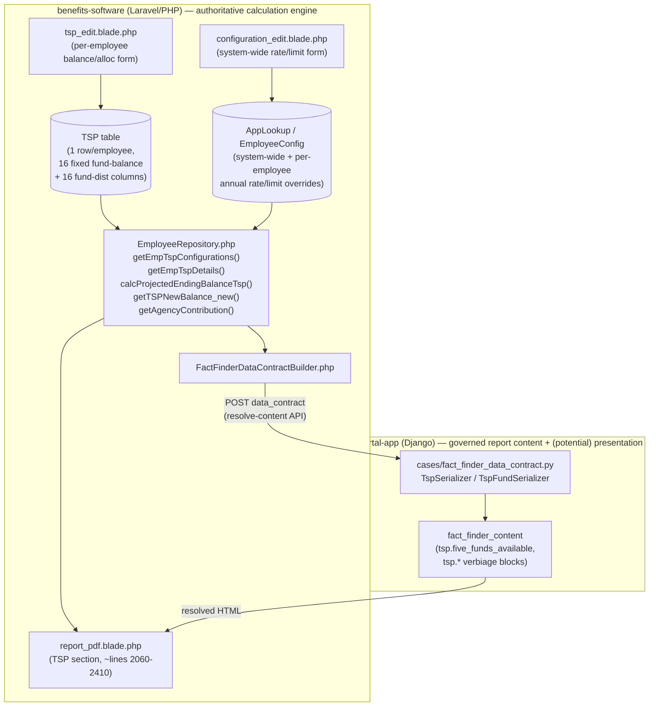

# TSP Dynamic Fund Maintenance — Cross-Application Architecture Analysis

**Date:** 2026-10-03
**Type:** ANALYSIS ONLY. No source files, templates, tests, configuration, or databases were modified in either repository as part of this task. No migrations created. Nothing staged, committed, pushed, or deployed. See §30 for verification.
**Placement note:** This workspace is a two-folder VS Code multi-root workspace — `advisor-portal-app` and `benefits-software` are two independent Git repositories with no shared on-disk repo root (their common OS-level parent, `c:\Users\ProFed\workspace\`, is not part of either repository and would not be tracked by either repo's `git status`). Per the task's explicit fallback instruction, this single document is placed at **`advisor-portal-app/docs/TSP_DYNAMIC_FUND_MAINTENANCE_ARCHITECTURE_ANALYSIS.md`** — not scattered across both repos. This repo already hosts the related `docs/FACT_FINDER_PDF_MODERNIZATION_ANALYSIS_2026-09-06.md`, so this is consistent with existing documentation placement convention.

**Relationship to two pre-existing analyses (read in full before writing this document, not duplicated here):**
- `benefits-software/TSP_DYNAMIC_FUND_ADD_DELETE_OPTIONS_ANALYSIS.md` (dated 2026-05-30) — a prior, benefits-software-scoped analysis of exactly this problem (Options 1/2/3, a phased WBS, legacy-safety/effective-dating requirements, a 2026-05-30 legacy-case smoke test). **Still architecturally accurate for the data-model problem it describes**, but its §11.1 "current PDF feed path" references `report_pdf_v2.blade.php` and `resources/views/admin/employee/pdf_partials/_tsp_tables.blade.php` — **verified in this session that neither file exists in the current repository.** The real, current, single rendering path is `resources/views/admin/employee/report_pdf.blade.php` (confirmed throughout this analysis and by the existing Fact Finder modernization project). Treat that one subsection as stale; everything else in that document remains a valid, citable prior analysis and this document builds on it rather than re-deriving it.
- `advisor-portal-app/FACT_FINDER_ADMIN_FUNCTIONAL_CAPABILITY_AUDIT.md` (dated 2026-10-03, same day) — an advisor-portal-scoped functional audit that already independently reached the same core conclusion about TSP funds being hardcoded, with its own file/line citations. This document cross-validates, extends (full benefits-software-side calculation/admin/Blade trace, which that audit explicitly flagged as out of its scope in its own §12), and formally answers the cross-application architecture questions that audit did not attempt (system-of-record, phased plan, migration/rollback strategy).
- `advisor-portal-app/docs/FACT_FINDER_PDF_MODERNIZATION_ANALYSIS_2026-09-06.md` already contains a short "Pain point deep-dive: adding a new TSP fund" section (added 2026-09-12) that correctly cites the May 2026 benefits-software analysis and explains *why* the Data Contract's `tsp.funds` field is list-shaped. That section is corroborated and extended here, not contradicted.

---

## 1. Executive Summary

**VERIFIED CURRENT BEHAVIOR:** Across every layer this analysis traced — the `benefits-software` database schema, Eloquent model, calculation engine, per-employee admin edit form, system-wide configuration admin screen, PDF (Blade) rendering template, the `advisor-portal-app` Data Contract schema, and the PHP builder that populates it — the five traditional TSP funds (G/F/C/S/I) plus a fixed set of Lifecycle funds are **hardcoded by literal field/column/key name**, not represented as a dynamic, iterable collection anywhere a real calculation, storage write, or render actually happens today.

**One partial, schema-only exception exists:** `advisor-portal-app`'s Data Contract (`cases/fact_finder_data_contract.py`) models `tsp.funds` as a list of `{fund_code, balance, allocation_pct}` rows (`TspFundSerializer`/`TspSerializer.funds`), explicitly designed for a future dynamic fund set. **This analysis independently discovered a concrete, previously-undocumented finding: even this "dynamic-looking" list is populated today by a hardcoded PHP array of exactly 10 literal fund keys** (`EmployeeController.php` lines ~1651-1663: `GFund, FFund, CFund, SFund, IFund, LIncome, L2020, L2030, L2040, L2050`) — and that hardcoded list is **already stale relative to the real `TSP` table schema**, which has 16 fund-bearing columns today (it omits `L2055, L2060, L2065, L2070, L2075`, all of which exist as real columns per the `2020_12_24_120538_add_colmns_in_tsp.php` and `2025_08_23_000000_update_lifecycle_funds_2025.php` migrations). This means the Data Contract's `tsp.funds` list is currently **silently incomplete** for any employee holding one of those five newer Lifecycle funds — not a dynamic capability today, and additionally a live accuracy gap independent of the dynamic-funds question. This is flagged for the user's attention; **no code change was made** (out of scope — analysis only).

**Architectural conclusion, matching the required principle:** `benefits-software` must remain the authoritative TSP calculation engine and the system of record for fund identity/rates. The path to admin-maintainable funds does **not** require moving calculations to `advisor-portal`. It requires `benefits-software` to introduce a **Fund Catalog** (a data table describing which funds exist, their display properties, and which legacy columns/config keys they map to) and to refactor its own calculation/rendering code to iterate that catalog instead of naming each fund — exactly the direction already recommended, independently, by `benefits-software/TSP_DYNAMIC_FUND_ADD_DELETE_OPTIONS_ANALYSIS.md`. `advisor-portal-app`'s role is to consume whatever dynamic `tsp.funds` collection `benefits-software` eventually emits (the schema already anticipates this) and, if desired later, to host a presentation-layer admin UI that writes back to `benefits-software`'s catalog via an API — never to own the catalog itself or duplicate calculation logic.

**Recommended first real phase (not yet started, no code written):** a zero-behavior-change `Phase 1` entirely inside `benefits-software` — introduce the Fund Catalog table seeded with the 5 core + current Lifecycle funds mapped to their *existing* columns, without changing any calculation or template output. See §23–§25.

---

## 2. Current TSP Architecture (Overview)



The flow for a real PDF generation today (verified in `EmployeeController.php`, `EmployeeRepository.php`, `report_pdf.blade.php`):
1. `EmployeeController@createPdfFEGLI` calls `getEmpTspConfigurations($empId)` (system-wide/per-employee rate & limit config) and `getEmpTspDetails($empId)` (the employee's actual `TSP` row).
2. `calcProjectedEndingBalanceTsp($empId)` and `getTSPNewBalance_new($empId)` run the real projection math, fund-by-fund, by name.
3. The resulting `$tsp`, `$tsp_configurations`, `$projected_ending_balance_data` arrays are handed to `report_pdf.blade.php`, which prints fixed `<tr>` rows per fund.
4. Separately (Phase 2 instrumentation, not used for rendering), a hardcoded 10-fund subset is also packaged into the Fact Finder Data Contract and sent to `advisor-portal-app`'s `/api/fact-finder/resolve-content/`, purely for governed-verbiage resolution (e.g. `tsp.five_funds_available`'s merge fields) — the per-employee balance/allocation table is never sent and never governed.

---

## 3. Benefits-Software TSP Data Model

**VERIFIED.** Fund identity and balances live in one wide table, `TSP` (Eloquent model `App\Models\Tsp`, [app/Models/Tsp.php](../../benefits-software/app/Models/Tsp.php)):

```php
protected $table = 'TSP';
protected $primaryKey = 'EmployeeId';
protected $fillable = [
    'EmployeeId', 'GFund', 'FFund', 'CFund', 'SFund', 'IFund',
    'L2020', 'L2030', 'L2040', 'L2050', 'LIncome',
    'GFundDist', 'FFundDist', 'CFundDist', 'SFundDist', 'IFundDist',
    'L2020Dist', 'L2030Dist', 'L2040Dist', 'L2050Dist', 'LIncomeDist',
    'ContributionRegular', 'ContributionCatchUp', 'EndingBalance', 'LoanRepayment', 'PayoffDate',
    'loan_balance_general', 'loan_repayment_general', 'payoff_date_general',
    'loan_balance_general_2', 'loan_repayment_general_2', 'payoff_date_general_2', 'StatementDate',
];
```

This `$fillable` list is itself stale (pre-dates later migrations) — the *actual* schema, built across three migrations, is wider:
- Base migration (pre-existing, not re-read in this pass) + [`2020_12_24_120538_add_colmns_in_tsp.php`](../../benefits-software/database/migrations/2020_12_24_120538_add_colmns_in_tsp.php): adds `L2025, L2035, L2045, L2055, L2060, L2065` (+ their `*Dist` columns) and the second-loan columns.
- [`2025_08_23_000000_update_lifecycle_funds_2025.php`](../../benefits-software/database/migrations/2025_08_23_000000_update_lifecycle_funds_2025.php): adds `L2070, L2075` (+ `*Dist`), and **retires `L2025` via a one-time data migration** (`UPDATE TSP SET LIncome = LIncome + L2025 WHERE L2025 > 0`, then zeroes `L2025`/`L2025Dist`) — a real precedent for "fund retirement," done as an ad hoc manual migration, not a reusable mechanism.
- [`2025_08_23_000001_fix_l2070_l2075_data_types.php`](../../benefits-software/database/migrations/2025_08_23_000001_fix_l2070_l2075_data_types.php): precision fix for the two newest columns.

**Real current fund-bearing columns on `TSP` (16 funds, verified via migrations + live usage in `EmployeeRepository.php`):** `GFund, FFund, CFund, SFund, IFund, LIncome, L2020, L2030, L2035, L2040, L2045, L2050, L2055, L2060, L2065, L2070, L2075` (each with a matching `*Dist` allocation-percentage column). `L2025`/`L2025Dist` columns still physically exist post-migration but are always zero (expired fund, "soft-retired" by zeroing, not dropped — see §20).

Two related, smaller models:
- `App\Models\LfundsDist` ([app/Models/LfundsDist.php](../../benefits-software/app/Models/LfundsDist.php)) — table `lfundDistribution`, `$fillable = ['date', 'lfund_type', 'gfund', 'ffund', 'cfund', 'sfund', 'ifund']`. This is the time-series glide-path table (per L-fund, per date, its G/F/C/S/I sub-allocation weights) used by `getDistributionForLfund_new()`. **Still hardcoded to exactly the 5 core sub-funds as named columns**, same pattern as everywhere else.
- `App\Models\TspCalculation` ([app/Models/TspCalculation.php](../../benefits-software/app/Models/TspCalculation.php)) — table `tsp_calculate`, `$fillable = ['id', 'year', 'g', 'f', 'c', 's', 'i']`. Used only by `getTspCalculation($year, $tspfund)` ([EmployeeRepository.php ~line 4057](../../benefits-software/app/Repositories/EmployeeRepository.php)), which this analysis traced and found **no live call site anywhere else in the codebase** — appears to be dead/unused code, itself hardcoded to the same 5 funds, not part of the live PDF path. Flagged as inference (not exhaustively proven dead across the whole codebase), not a finding requiring action.

**Rates and annual limits (the "configuration," distinct from employee balances)** live in two generic key/value tables, not fund-specific ones:
- `AppLookup` (`AppLookupTypeName='EmployeeConfig'`, `AppLookupName=<key>`, `AppLookupDescription=<value>`) — the **system-wide default** for every config value, including `TSPGFundReturn, TSPFFundReturn, TSPCFundReturn, TSPSFundReturn, TSPIFundReturn, TSPDeferralLimit, TSPCatchUpLimit, year_of_contribution` (confirmed in `getEmpTspConfigurations()`, `saveSystemConfig()`, [EmployeeRepository.php ~lines 3296-3340, 3529-3552](../../benefits-software/app/Repositories/EmployeeRepository.php)).
- `EmployeeConfig` (`EmployeeId, ConfigType, ConfigValue`) — a **per-employee override** of the same keys, checked first; falls back to the `AppLookup` system default if absent (`getEmpTspConfigurations()`'s `if ($empConf) {...} else {...}` pattern).

**VERIFIED:** rates are keyed by a fixed, literal `ConfigType` string per fund (`'TSPGFundReturn'`, etc.) — adding a 6th fund's rate requires a brand-new literal key, not a new row in an existing fund-keyed table.

---

## 4. Current TSP Administration

Two genuinely different admin screens exist, both in `benefits-software`, neither in `advisor-portal-app`:

### 4a. System-wide / per-employee **rate and limit** configuration — `configuration_edit.blade.php`
([resources/views/admin/employee/configuration_edit.blade.php lines ~120-165](../../benefits-software/resources/views/admin/employee/configuration_edit.blade.php))

A plain HTML form with one literal `<input name="gfund">`, `name="ffund"`, `name="cfund"`, `name="sfund"`, `name="ifund"` per fund (labeled "G Fund", "F Fund", etc.), plus `deff_limit`/`catchup_limit`. Submits to `saveSystemConfig()` ([EmployeeRepository.php ~line 3302](../../benefits-software/app/Repositories/EmployeeRepository.php)) or `saveEmployeeConf()` (per-employee variant, ~line 3480), both of which write to the literal `AppLookup`/`EmployeeConfig` keys listed in §3.

**This is classification A (changing the value/rate for an EXISTING fund) only.** There is no "add a row" affordance — the form has exactly 5 fund-rate inputs hardcoded in the template; adding a 6th requires a new `<input>` element and a new literal array key in `saveSystemConfig()`/`saveEmployeeConf()`/`getEmpTspConfigurations()`, i.e. a code change in at least 3 places, confirmed by direct inspection.

### 4b. Per-employee **TSP account balance/allocation** editing — `tsp_edit.blade.php`
([resources/views/admin/employee/tsp_edit.blade.php lines ~200-340](../../benefits-software/resources/views/admin/employee/tsp_edit.blade.php))

A separate form, one block of 3 inputs per fund (`name="gfund"` current balance, `name="gfund_distri"` allocation %, a read-only computed "new balance" label) repeated literally for `gfund/ffund/cfund/sfund/ifund` (verified — the L-funds are present further down the same file, not shown in the excerpt but following the identical hardcoded pattern per `TSP_PROJECTION_ANALYSIS.md`'s own column inventory). Submits to `updateEmployeeTsp()` ([EmployeeRepository.php ~line 3600+](../../benefits-software/app/Repositories/EmployeeRepository.php)), which does a per-field `if ($tsp->GFund != $data['gfund'])` history-diff and write, one literal fund at a time.

**This is a completely different kind of "administration"** than §4a — it is per-employee *data entry* (the employee's actual statement balances), not *assumption configuration*. Both are hardcoded to the same fixed 5(+Lifecycle)-fund set, but they are separate forms, separate controller actions, and separate underlying tables (`EmployeeConfig`/`AppLookup` vs. `TSP`), and must be treated as **two distinct requirements** in any dynamic-fund design (§21).

### 4c. Classification summary (per the task's A/B/C/D/E distinction)

| Classification | Supported today? | Where | Evidence |
|---|---|---|---|
| A. Change rate/value for an EXISTING fund | **Yes** | `configuration_edit.blade.php` → `saveSystemConfig()`/`saveEmployeeConf()` | §4a |
| A (balances). Change an EXISTING employee's existing-fund balance/allocation | **Yes** | `tsp_edit.blade.php` → `updateEmployeeTsp()` | §4b |
| B. Add a NEW fund identity | **No** | — | No UI/form/DB path anywhere; requires migration + code in ≥5 files (§11) |
| C. Remove/deactivate an existing fund | **No** (only the one-off manual `L2025`→`LIncome` data migration precedent, §3/§20) | — | No reusable "deactivate" mechanism exists |
| D. Rename/display-label change | **Partially** — fund *rate* labels in `configuration_edit.blade.php` are hardcoded English text ("G Fund"), not editable; the PDF's fund *description* text (e.g. "Government securities") is editable only as free HTML inside the `tsp.five_funds_available` governed-content block in `advisor-portal-app` (§9, §6) | — | §4a labels are template literals; only the PDF-facing description text is admin-editable, and only in `advisor-portal-app`, not `benefits-software` |
| E. Change report descriptions/presentation | **Yes, for prose; no, for the data table's structure** | `fact_finder_content` panel (`advisor-portal-app`), `tsp.*` content blocks | §9 |

**INFERENCE (flagged explicitly, not verified by this analysis):** the `benefits-software/TSP_DYNAMIC_FUND_ADD_DELETE_OPTIONS_ANALYSIS.md` document's §2.3 phrase "You already have name editing for funds under Configuration" appears to refer to §4a's rate-input labels being hardcoded template text (not actually editable), **unless** there is a separate screen this analysis did not locate. This discrepancy is noted, not resolved — a decision-maker should confirm which screen that May 2026 document meant before relying on it for "today, names are already editable."

---

## 5. Current Calculation Flow

All in `App\Repositories\EmployeeRepository.php` (confirmed single real engine; `App\Services\FactFinderReportRenderer.php` and `App\Services\FactFinderDataContractBuilder.php` both call into it, never duplicate its math):

| Method | Role | Fund-explicit? |
|---|---|---|
| `getEmpTspConfigurations($empId)` (~3529) | Resolves 7 literal config keys (`deff_limit, catchup_limit, gfund, ffund, cfund, sfund, ifund, year_of_contribution`) per-employee-then-system-default | **Yes** — fixed array of 7 literal keys |
| `getEmpTspDetails($empId)` (~3553) | Loads the `TSP` row, computes `totalCurrentBalance` as an explicit `+`-chain of all 16 fund columns, contribution percentages | **Yes** — explicit named sum |
| `getAgencyContribution($tsp)` (~VERA_PRESERVATION copy, ~4040 current) | FERS/Transfers agency-match tiering (1%/2%/3%/3.5%/4% by contribution %) | **No** — pure salary/percentage math, fund-agnostic |
| `calcProjectedEndingBalanceTsp($empId)` (~4085) | Orchestrates the agency-match + missing-out-amount calculation for the "Matching Funds" paragraph | **No** for its own math; calls fund-explicit helpers |
| `getTSPNewBalance_new($empId)` (~8999) | The real per-fund ending-balance projection, including loan payoff math | **Yes** — explicit `$data['GFund'] = ...`, `$data['FFund'] = ...` etc., one call to `getEndingBalanceForFunds()` per fund, repeated 5(+Lifecycle) times verbatim (confirmed via the `VERA_PRESERVATION_2025-10-07...` historical copy at lines ~6965-7075, functionally identical pattern to the live method) |
| `getEndingBalanceForFunds($balance, $newMoney, $rate, $months)` | Core compounding formula | **No** — generic, takes a balance/rate/months triple; this is the one piece of real calculation logic that is **already fund-agnostic and loop-ready** |
| `getEndingBalanceForLoans(...)` / `getEndingBalanceForLoans_lfunds(...)` | Loan-proceeds compounding, split by a fund's `*Dist` allocation % | **Partially** — takes a `$fund` parameter as a string in some call sites (`public/update_l_funds.php`'s code-generation script literally interpolates `{$fund}` into a regex-replace, confirming the *call sites* are generated/copy-pasted per fund even though the *function* itself is generic) |
| `getDistributionForLfund_new($fundType, ...)` | L-fund glide-path sub-allocation (queries `LfundsDist`) | **Yes**, internally, to the 5 sub-funds (G/F/C/S/I weights) |
| `getTspCalculation($year, $tspfund)` (~4057) | Unused/dead (see §3) | **Yes** — `$res['g']/['f']/['s']/['c']/['i']` |

**ANSWER to critical question #2/#3 (which calculations are fund-specific vs. generic iteration):** **No formula is genuinely fund-specific.** Every fund uses the identical compounding formula (`getEndingBalanceForFunds`), the identical loan-split formula, and the identical glide-path algorithm (for Lifecycle funds specifically, which is itself uniform across all Lifecycle funds). The *only* per-fund specificity anywhere in the calculation layer is: (a) which literal config key supplies that fund's rate of return, and (b) which literal `TSP` table column supplies its balance/allocation. Both are pure "lookup key" concerns, not calculation logic — this is the strongest evidence that **the calculation engine can be safely refactored to iterate a dynamic fund collection without touching any actual formula** (§23 Phase 2).

**One required exception to "it's all generic":** Lifecycle funds are NOT the same kind of fund as G/F/C/S/I — they are a *computed blend* of the 5 core funds via the `lfundDistribution` glide-path table, not an independent rate. Any fund catalog design must distinguish `category = core` (has its own rate-of-return config key) from `category = lifecycle` (has no independent rate; derives its return from the current core-fund blend for its target date). See §18.

---

## 6. Current Projection Flow

Already the subject of two existing, detailed, verified-accurate internal documents — summarized rather than re-derived:
- [`benefits-software/TSP_PROJECTION_ANALYSIS.md`](../../benefits-software/TSP_PROJECTION_ANALYSIS.md) — full data-input/config-input/step-by-step breakdown, explicitly documents the "Known Column Naming Quirk" (§11 of that doc) and the exact fund-by-fund core formula.
- [`benefits-software/TSP_PROJECTION_BREAKDOWN.md`](../../benefits-software/TSP_PROJECTION_BREAKDOWN.md) — the glide-path algorithm in plain language, and the exact final-balance summation formula (`G + F + C + S + I + LIncome + L2030 + ... + L2075`), confirming the explicit named-sum pattern independently of this analysis's own `EmployeeRepository.php` reads.

Both documents' core formula descriptions were spot-checked against the live `EmployeeRepository.php` source during this session (§5 above) and found accurate.

**Key fact for dynamic-fund design:** the projection loop (`getTSPNewBalance_new`) is a `for` loop over *years to retirement*, not over *funds* — within each year iteration, it does 16 near-identical, hand-written fund calculations. This is mechanically convertible to an outer fund loop + inner year loop (or vice versa) without altering the math, because (per §5) the per-fund formula is identical for every fund.

---

## 7. Current Employee Allocation Storage

**VERIFIED:** allocations are stored as **dedicated columns, not rows** (answering critical question #5 directly). Each fund has exactly 2 columns on the single `TSP` row per employee: `<Fund>` (current dollar balance) and `<Fund>Dist` (allocation percentage for new contributions). There is no `tsp_allocations` child table. This is the central structural fact driving every downstream hardcoding — confirmed by `Tsp::$fillable` (§3), `getEmpTspDetails()`'s explicit sum (§5), and both admin edit screens (§4) all operating on the same fixed column set.

**Answering critical question #6 (are historical fund values year-specific):** **Partially.** The `TSP` table holds only the *current* statement-date snapshot per employee (`StatementDate` column) — there is no year-by-year history of an employee's own balances. However, `lfundDistribution` *is* a genuine time-series (`date, lfund_type, gfund%, ffund%, ...`) for the Lifecycle-fund glide path, and `EmployeeConfig`/`AppLookup` config values are mutated in place with **no effective-dating at all** (confirmed: `saveSystemConfig()`/`saveEmployeeConf()` do a plain `updateORCreate`, overwriting the prior value with no history table beyond the separate, generic `updateHistory()` audit-log call, which records old/new values for display but does not make the *old* value queryable as "the rate that was in effect as of PDF-generation-date D"). This is a real latent risk flagged by the May 2026 analysis's §16-18 (legacy-safety/effective-dating) and independently reaffirmed here: **today, regenerating an old case's PDF after a rate change would silently use the NEW rate**, not the rate in effect when the case was originally processed, because there is no effective-dating mechanism at all on `AppLookup`/`EmployeeConfig`. This is pre-existing behavior, not something this analysis is asked to fix, but it is directly relevant to any "historical-data strategy" for dynamic funds (§20) since a dynamic Fund Catalog without effective-dating would inherit the same risk.

---

## 8. Current PDF/Blade Dependencies

All in [`resources/views/admin/employee/report_pdf.blade.php`](../../benefits-software/resources/views/admin/employee/report_pdf.blade.php), TSP section spans roughly lines 2060-2410 (confirmed by direct read, not estimated):

| Sub-element | Lines (approx., confirmed) | Dynamic or hardcoded? |
|---|---|---|
| "The 5 funds available" intro paragraph | ~2103 | Hardcoded prose: "Employees have a choice of **5 funds**..." — the literal number 5 is baked into governed *and* fallback text |
| `tsp.five_funds_available` rates table (Fund Name / Description / Index / Rate of Return) | ~2126-2170 | **5 literal `<tr>` rows** (G/F/C/S/I only — **no Lifecycle funds in this table at all**), each with hardcoded description/index text and one merge-field-style rate (`$tsp_configurations['gfund']` etc., or `[[tsp.gfund_rate]]` in the governed-content version) |
| New Contributions & Matching Funds section | ~2180-2260 | Fund-agnostic prose (percentages/dollar amounts only) |
| Per-employee Current Balance & Growth table | ~2265-2375 | **16 literal `<tr>` rows**, one per real fund column (G/F/C/S/I + LIncome + L2030...L2075), each hardcoding `$tsp['GFund']`, `$tsp['GFundDist']`, `$tsp['new_balance']['GFund']` by name; the **Total row is a flat 16-term `+`-chain** (`$tsp['GFundDist'] + $tsp['FFundDist'] + ... + $tsp['L2075Dist']`) — confirmed this chain is **missing `L2025Dist`** (consistent with §3's finding that `L2025` is soft-retired-but-still-present; the Total formula was evidently updated when L2025 was retired, which is actually *correct* current behavior, not a bug) |
| Admin debug view (`calculate_and_debug.blade.php`) | ~830-945 | Same 16-fund hardcoded table pattern, for an internal diagnostic screen, not the member-facing PDF |

**Answering critical question "are any existing formulas genuinely fund-specific" at the template layer too:** no — every `<tr>` is structurally identical, varying only in which literal array key it reads. This is a textbook "loop over a collection, but hand-unrolled" pattern — the single clearest, most mechanical refactoring target in the entire system (§13, §23 Phase 2/3).

---

## 9. Advisor-Portal TSP Contract

Already documented exhaustively and accurately by `advisor-portal-app/FACT_FINDER_ADMIN_FUNCTIONAL_CAPABILITY_AUDIT.md` §4 (independently verified again in this session — see §1 above). Key facts, not repeated verbatim:

- `cases/fact_finder_data_contract.py`'s `TspSerializer`/`TspFundSerializer` (lines ~232-275) is the **only** place in either repository where TSP funds are modeled as a list rather than named fields.
- **It exists** (per its own docstring, confirmed) specifically because the analysis doc's TSP pain-point section called for it — a deliberate, forward-looking design choice, not an accident.
- **It is populated in real integration requests** — contrary to a plausible assumption, this analysis confirmed (via `EmployeeController.php` lines ~1651-1663) that `$tspFundsForContract` IS built and IS sent on every real PDF-generation call, with real balance/allocation data (confirmed against a real golden-master fixture, `fact_finder_content/golden_master_fixtures/19833.json`, which shows real `{"fund_code": "GFund", "balance": 311, "allocation_pct": 0}`-shaped rows). **However — new finding, not previously documented** — the PHP code building that list hardcodes an array of exactly 10 fund keys (`GFund, FFund, CFund, SFund, IFund, LIncome, L2020, L2030, L2040, L2050`), silently omitting `L2055, L2060, L2065, L2070, L2075` even though those columns are real and populated on the `TSP` table today (§1, §3). **This is a second, independent "hardcoded fund list" location beyond the ones the May 2026 analysis catalogued**, and it means the one field that *looks* dynamic is, in practice, itself an incomplete hardcoded enumeration.
- **Nothing consumes `tsp.funds` as a dynamic rendering source today.** The governed-content `tsp.five_funds_available` block and the Blade balance table both still read named keys (§8); `fact_finder_content/rules.py`'s `AVAILABLE_FIELDS` registry does not reference `tsp.funds` at all (confirmed: the rule engine has no "funds" concept, only scalar fields).
- **It could become the canonical report-facing representation** if, and only if, (a) `benefits-software` populates it completely and correctly (fixing the 5-fund omission above) from a real Fund Catalog rather than a second hardcoded list, and (b) the Blade balance table and `tsp.five_funds_available` are rewritten to loop over it instead of naming funds (§13).
- **What `benefits-software` would have to emit for it to become real:** a complete, catalog-driven list (not the current partial hardcoded one), including whichever metadata the renderer needs (display name, description text, index/benchmark text, rate — see §18 for the full derived shape).
- **Backward compatibility:** fully preservable — the explicit `gfund_rate`...`ifund_rate` scalar fields can remain alongside `funds` for a transition window (§19), since DRF's `Serializer` tolerates additional/missing optional fields already (confirmed: every field in `TspSerializer` other than `funds` and `sal_percentage_in_contri` is `required=False`).

---

## 10. Cross-Application Data Flow

Confirmed, end-to-end, via direct code reads (not inferred from documentation) in this session and the pre-existing `fact-finder-pdf-modernization` project history:

1. `EmployeeController@createPdfFEGLI` runs the real calculation methods (§5), assembles `$pdf_data`/`$tsp`/`$tsp_configurations`/`$projected_ending_balance_data`.
2. The *same* already-computed values are reshaped (read-only, zero new calculation — confirmed by `FactFinderDataContractBuilder`'s own docblock and this session's direct read) into the versioned Fact Finder Data Contract and POSTed to `advisor-portal-app`'s `/api/fact-finder/resolve-content/`.
3. Django validates the payload against `FactFinderDataContractSerializer` (which **would currently reject** a payload containing an 11th-16th fund in `tsp.funds` only if the schema were stricter than it is — in fact `TspFundSerializer` has no `fund_code` choice-restriction, so extra/unknown fund codes pass schema validation fine today; the omission in §9 is a PHP-side under-population bug, not a Django-side rejection).
4. Django's rule engine (`fact_finder_content/rules.py`) evaluates each `ContentBlock`'s `display_condition` against the contract and returns matching blocks' raw (unsubstituted) HTML.
5. Back in PHP, `FactFinderGovernedContentResolver`/`FactFinderMergeFieldSubstitutor` substitute `[[tsp.gfund_rate]]`-style tokens using the **same PHP-side contract array** (not a round-trip of Django's response) and inject the result into `report_pdf.blade.php` via `inline()`.
6. The per-employee balance/allocation/projection table (§8) is **never sent to Django and never governed** — by the project's own explicit, documented design (pure computed data, "left in Blade").

**Fail-safe behavior (verified, not assumed):** if advisor-portal is unreachable/misconfigured/disabled, `FactFinderGovernedContentResolver::resolveUsing()` returns `[]` and every Blade `inline()` call falls back to its hardcoded literal fallback string — the PDF never breaks, it just reverts to pre-modernization wording. This matters for dynamic funds too: any future dynamic rendering must preserve an equivalent fail-safe (§22, §26).

---

## 11. Complete G/F/C/S/I Hardcoding Inventory

Consolidated across all searches this session (both repositories). "Enumerates" = the exact 5 funds (or the 16-fund superset) are named individually, not looped.

| # | Layer | File | Lines (confirmed) | Enumerates |
|---|---|---|---|---|
| 1 | DB schema | `benefits-software/database/migrations/2020_12_24_120538_add_colmns_in_tsp.php` | 1-50 | 6 L-funds added by name |
| 2 | DB schema | `benefits-software/database/migrations/2025_08_23_000000_update_lifecycle_funds_2025.php` | 1-72 | L2070/L2075 added, L2025 retired, by name |
| 3 | DB schema (seed) | `benefits-software/database/seeds/HistoryColumnsSeeder.php` | ~250-320 | Every fund column individually registered for the audit-history subsystem |
| 4 | Model | `benefits-software/app/Models/Tsp.php` | 10-13 | `$fillable`, 5+5(partial L-funds, stale) |
| 5 | Model | `benefits-software/app/Models/LfundsDist.php` | 1-12 | `$fillable`, 5 sub-funds |
| 6 | Model | `benefits-software/app/Models/TspCalculation.php` | 1-15 | `$fillable`, 5 funds (likely-dead code, §3) |
| 7 | Config read | `EmployeeRepository::getEmpTspConfigurations()` | ~3529-3552 | 5 literal `ConfigType` keys |
| 8 | Config write | `EmployeeRepository::saveSystemConfig()` | ~3302-3335 | 5 literal keys |
| 9 | Config write (per-emp) | `EmployeeRepository::saveEmployeeConf()` | ~3480-3510 | 5 literal keys |
| 10 | Balance aggregate | `EmployeeRepository::getEmpTspDetails()` | ~3560-3568 | 16-term `+`-chain |
| 11 | Dead/legacy calc | `EmployeeRepository::getTspCalculation()` | ~4057-4068 | `$res['g']/['f']/['s']/['c']/['i']` |
| 12 | Projection engine | `EmployeeRepository::getTSPNewBalance_new()` (and historical `VERA_PRESERVATION` copy) | ~6965-7075 / ~8999+ | Per-fund repeated block ×16 |
| 13 | Loan-split code-gen | `benefits-software/public/update_l_funds.php` | ~20-50 | A **code-generation script** that literally string-interpolates `{$fund}` to mechanically rewrite `EmployeeRepository.php` per L-fund — direct evidence that even past *maintenance* of this hardcoding was done by scripted find/replace, not by editing a loop |
| 14 | Admin UI (rates) | `resources/views/admin/employee/configuration_edit.blade.php` | ~120-165 | 5 literal `<input>` blocks |
| 15 | Admin UI (balances) | `resources/views/admin/employee/tsp_edit.blade.php` | ~200-340+ | 5(+L-funds) literal 3-input blocks |
| 16 | Admin UI (diagnostic) | `resources/views/admin/employee/calculate_and_debug.blade.php` | ~830-945 | 16-column literal table ×2 (with/without salary increase) |
| 17 | PDF — rates table | `report_pdf.blade.php` | ~2126-2170 | 5 literal `<tr>` |
| 18 | PDF — balance table | `report_pdf.blade.php` | ~2265-2375 | 16 literal `<tr>` + 16-term Total sum |
| 19 | Django schema | `cases/fact_finder_data_contract.py` `TspSerializer` | ~242-275 | 5 literal rate fields (`gfund_rate`...`ifund_rate`), separate from the list field |
| 20 | PHP contract builder (dynamic-looking list) | `EmployeeController.php` | ~1651-1663 | **10**-fund hardcoded array feeding the "dynamic" `funds` list — new finding, §1/§9 |
| 21 | Governed content fallback | `report_pdf.blade.php` inline `tsp.five_funds_available` fallback string | ~2126-2170 | Same 5 literal rows duplicated as a fallback string |
| 22 | Test fixtures | `benefits-software/tests/GoldenMaster/fixtures/*.html` (24 files) | throughout | Captured HTML snapshots of the above — will need re-capture after any dynamic-fund change (§26) |
| 23 | Test fixtures | `advisor-portal-app/fact_finder_content/golden_master_fixtures/*.json` (24 files) | throughout | Same, Data-Contract-shaped |
| 24 | Unit tests | `benefits-software/tests/Unit/FactFinderDataContractBuilderTest.php` | ~300-330 | Hardcodes the 4.95% match-threshold constant and fund-rate assertions |

**No JavaScript/frontend fund enumeration was found** in either repository (searched both `benefits-software`'s resources/js and public assets, and `advisor-portal-app`'s static/template JS) — the PDF is server-rendered HTML→TCPDF with no client-side TSP logic, and the `fact_finder_content` TinyMCE editor has no fund-aware JS (its merge-field picker is a generic dotted-path dropdown, confirmed in the earlier Fact Finder project work, not fund-specific).

---

## 12. Existing Database Constraints

- `TSP.EmployeeId` is the primary key (one row per employee) — no secondary uniqueness/foreign-key constraints on fund columns (they are plain `decimal` columns, not FK'd to any fund-identity table, because no such table exists).
- No `CHECK` constraints enforcing allocation percentages sum to 100 at the DB layer (enforced, if at all, only in application code — not verified in this pass; out of scope).
- `lfundDistribution` (`LfundsDist`) has no explicit unique constraint on `(date, lfund_type)` confirmed in this pass — `getDistributionForLfund_new()`'s fallback logic (nearest-prior, then nearest-future record) suggests the application tolerates sparse/gapped data rather than relying on a DB guarantee.
- **A new Fund Catalog table would need to introduce its own constraints from scratch** (unique `fund_code`, valid `display_order`, etc.) — see §18.

## 13. Existing API Constraints

- `TspSerializer.funds` (`TspFundSerializer`, many=True) has **no `fund_code` choice/enum restriction** — any string is currently accepted, meaning the schema itself does not block a 6th fund's code from round-tripping through the API today. The blocker is entirely on the **population** (PHP builder, §9/§11 #20) and **consumption** (Blade, rule engine) sides, not the Django schema's validation rules.
- `sal_percentage_in_contri` is the only required field in `TspSerializer`; everything else (including `funds` itself, implicitly, since `many=True` with no `required=False` still requires the key but tolerates an empty list) is tolerant of partial/missing data — a deliberate backward-compatibility design already in place (confirmed by the serializer's own inline comments throughout the file, consistent with the broader project's "every new field defaults gracefully" convention documented in the Fact Finder modernization project history).
- The `/api/fact-finder/resolve-content/` endpoint's auth (shared-secret Bearer token) and fail-closed behavior (§10) are unrelated to fund dynamism but constrain *how* any future bidirectional "advisor-portal writes back to benefits-software's catalog" design (§17, critical question 11) would need to authenticate — no such reverse-direction endpoint exists today in either repository.

## 14. Existing Test Coverage

- **benefits-software:** 24-case golden-master HTML harness (`php artisan fact-finder:golden-master`, `tests/GoldenMaster/fixtures/*.html`) exercises the real Blade TSP tables end-to-end per real employee, including at least one case deliberately chosen for "TSP with GP loan #1+#2" and one for "L2050 lifecycle fund" variety (per prior project history, `fact-finder-pdf-modernization` memory). Plus `tests/Unit/FactFinderDataContractBuilderTest.php` (TSP match-threshold, rate passthrough tests).
- **advisor-portal-app:** 24-case golden-master JSON fixtures (`fact_finder_content/golden_master_fixtures/*.json`) validate schema + rule-engine behavior against real `tsp.funds`/`tsp.*_rate` data; `fact_finder_data_contract` test suite covers `TspSerializer` field validation (CharField-not-DecimalField formatting edge cases, per prior project history).
- **No test anywhere exercises a 6th fund, a deactivated fund, or dynamic fund iteration** — consistent with §1's conclusion that this capability doesn't exist yet. This is expected, not a gap to fix today (analysis only).
- **No test currently proves the §9/§11 #20 omission** (missing L2055/L2060/L2065/L2070/L2075 in the Data Contract's `funds` list) — none of the 24 golden-master fixtures happen to isolate that specific gap in an assertion (they capture whatever the current code produces, which already silently omits those funds, so the fixtures encode the bug rather than catch it). Flagged as a real testing gap, not fixed in this pass.

---

## 15. Requirements for Dynamic Funds (derived from the calculation engine, not assumed)

Per §5's method-by-method trace, a fund entity needs exactly these attributes to satisfy every real current call site — no more, no fewer:

| Attribute | Why it's needed | Source today |
|---|---|---|
| `fund_code` | Primary key / lookup key everywhere | Literal column name today (`GFund`) |
| `display_name` | Admin UI labels, PDF table "Fund Name" column | Literal template text |
| `category` (`core` \| `lifecycle`) | Core funds have an independent rate; Lifecycle funds derive theirs from the glide-path blend (§5, §18) | Implicit in code structure (two different method families) |
| `rate_config_key` (core funds only) | Looked up in `AppLookup`/`EmployeeConfig` for the rate of return | Literal `ConfigType` string (`TSPGFundReturn`) |
| `balance_column` / `allocation_column` | Maps a catalog row to the existing wide-table columns (near-term, column-based model — §23 Option 1) | Literal column name |
| `description_text`, `index_text` | PDF rates table's "Description"/"Index" columns | Literal template text |
| `active_flag` | Governs whether a fund appears in new/current rendering | Does not exist today — implicit "always on" for the 16 hardcoded funds |
| `display_order` | Table row ordering | Implicit (source-code order) |
| `effective_start_date` / `effective_end_date` | Historical accuracy (§7, §20) — e.g. preserves that `L2025` existed through July 2025 | Does not exist; `L2025`'s retirement was a one-time manual data migration, not a declarative effective-date |

This list matches, almost field-for-field, `benefits-software/TSP_DYNAMIC_FUND_ADD_DELETE_OPTIONS_ANALYSIS.md` §4 "Option 1" catalog field proposal and §12.1's "Catalog row fields required for PDF" — **independently re-derived here directly from the calculation engine, confirming that prior analysis's catalog shape is sound** (not simply trusted at face value).

**Lifecycle funds need one additional thing the core funds don't:** a resolvable reference to their `lfundDistribution` glide-path row (by `lfund_type` string) — i.e. a Lifecycle catalog entry's "rate" is not a static config key but a pointer to a time-series table keyed by the same `fund_code`-shaped string. Any catalog design must accommodate this bifurcation (§18).

---

## 16. Recommended System of Record

**RECOMMENDATION (not yet decided/approved):** `benefits-software` remains the sole system of record for TSP fund identity, rates, and calculation configuration — matching the task's explicit architectural principle and this analysis's own finding (§5) that no calculation needs to move. The Fund Catalog table lives in `benefits-software`'s database, alongside `TSP`/`AppLookup`/`EmployeeConfig`.

`advisor-portal-app` should **never** write directly to `benefits-software`'s database (no existing precedent for cross-database writes was found anywhere in either repository — the only existing integration is the one-directional PHP→Django HTTP call for governed-content resolution, §10; introducing a direct DB write from Django into the legacy MySQL instance would be a wholly new, unjustified architectural pattern and is explicitly **not recommended**, matching the task's own stated preference for a single authoritative owner).

---

## 17. Recommended Maintenance-UI Location

**RECOMMENDATION:** Build the Fund Catalog CRUD screen in **`benefits-software`** first (§4's existing `configuration_edit.blade.php` is the natural home — it already owns rate configuration; extending it to catalog-row CRUD is an incremental step, not a new subsystem). This directly satisfies critical questions 9/10/12: the maintenance UI lives next to the data it maintains, with zero new cross-application trust boundary.

**A later, optional presentation-layer UI in `advisor-portal-app`** (critical question 13) is architecturally possible but should be sequenced *after* `benefits-software`'s catalog is real and API-exposed (read, and eventually write) — exactly the same pattern already proven safe for governed content (`fact_finder_content` reads `benefits-software`'s Data Contract; it does not recompute pension/FEGLI/SS math). If ever built, it would need a **new**, explicit, authenticated API surface in `benefits-software` (a `/api/tsp-fund-catalog/` CRUD endpoint, reusing the existing shared-secret Bearer pattern from `resolve-content`, §13) — `advisor-portal-app` would hold zero authoritative fund data itself, only a UI that calls that API. This is a `Phase 4+` concern (§23), not required for the core dynamic-fund capability.

**Why not build the maintenance UI in `advisor-portal-app` first:** it would require either (a) direct cross-database writes (rejected, §16) or (b) building the write-API in `benefits-software` anyway before the UI could do anything real — meaning `benefits-software`-side work is required regardless, so there's no actual effort saved by starting the UI in the other repo, only added round-trip latency/complexity during initial development.

---

## 18. Recommended Dynamic Data Model

Combining §15's derived requirements with the existing precedent (`benefits-software/TSP_DYNAMIC_FUND_ADD_DELETE_OPTIONS_ANALYSIS.md`'s Option 1), expressed as a concrete near-term (column-mapping) schema — **not implemented, proposal only**:

```
tsp_fund_catalog
----------------
id                      PK
fund_code               varchar, UNIQUE          e.g. 'GFund', 'L2030'
display_name            varchar                  e.g. 'G Fund'
category                enum('core','lifecycle')
description_text        text, nullable           PDF rates-table "Description" column
index_text               text, nullable           PDF rates-table "Index" column
rate_config_key         varchar, nullable        e.g. 'TSPGFundReturn' (core funds only; null for lifecycle)
lfund_distribution_key  varchar, nullable        matches lfundDistribution.lfund_type (lifecycle funds only)
balance_column          varchar                  e.g. 'GFund' (maps to TSP.<column>)
allocation_column       varchar                  e.g. 'GFundDist'
is_active               boolean, default true
display_order           integer
effective_start_date    date, nullable
effective_end_date      date, nullable
created_at / updated_at timestamps
```

This is deliberately **Option 1** from the existing May 2026 analysis (a thin catalog mapped onto the *existing* wide `TSP` columns), not the fully-normalized Option 2 (`tsp_employee_holdings` row-per-fund-per-employee) — matching that document's own "Option 3: Hybrid Migration Path" recommendation (catalog now, normalize later only if truly needed) and this analysis's independent finding (§7) that normalizing storage is a *much* larger, higher-risk change than the catalog alone, and is not required merely to make rate/label/add/deactivate/reorder maintainable. **A brand-new fund with no pre-existing column still requires one schema migration to add its 2 columns to `TSP`** (or, if pursuing Option 2 fully, none) — this is the one capability the column-mapped catalog genuinely cannot eliminate (§25's Phase 5 boundary).

---

## 19. Backward-Compatibility Strategy

1. **Phase 1-2 (catalog + calculation refactor):** zero output change by construction — the catalog is seeded 1:1 from the current hardcoded fund set, mapped to the exact same columns/config keys already in use. Golden-master byte-for-byte parity is the acceptance gate (§26), exactly as this project's own Fact Finder modernization work has repeatedly used for every other change.
2. **Phase 3 (dynamic Data Contract/API):** `TspSerializer`'s existing explicit `gfund_rate`...`ifund_rate` scalar fields should remain **for at least one full deployment cycle** after `funds` becomes fully populated/trustworthy, so any consumer still reading the old scalar fields (confirmed today: `[[tsp.gfund_rate]]` merge tokens inside the *published* `tsp.five_funds_available` content block body, §8/§9) continues to work unchanged. Only once the governed-content block itself is rewritten to loop over `[[tsp.funds]]`-shaped data (requiring a **new** merge-field capability — the current `FactFinderMergeFieldSubstitutor` only replaces scalar `[[dotted.path]]` tokens, confirmed by direct read of `substitute()`, it has no loop/repeat-block construct) should the scalar fields be deprecated.
3. **Phase 4 (admin add/deactivate):** must not retroactively change any already-generated historical PDF (§20) — enforced via `effective_start_date`/`effective_end_date` filtering at render time, not by mutating history.

**Existing explicit G/F/C/S/I fields would need to remain temporarily — yes, confirmed necessary** per point 2 above, for exactly as long as the governed-content merge-field substitutor lacks a repeating/loop construct.

---

## 20. Historical-Data Strategy

Directly answering critical questions 6/7/8:

- **Are historical fund values year-specific?** Only the Lifecycle glide-path table (`lfundDistribution`) is genuinely time-series; employee balances are single-snapshot (`StatementDate`); rate/limit config has no history at all beyond a generic audit log (§7).
- **What happens to historical cases if a fund is deactivated?** Today: nothing automatically — there is no deactivation concept, only the one precedent of manually zeroing `L2025`'s balance during a one-time migration (§3), which is a **data retirement**, not a **catalog/UI retirement**. Under the proposed catalog (§18), `is_active=false` + `effective_end_date` must **not** hide a fund from a *historical* PDF being regenerated for a case whose original report date predates the fund's retirement — this requires the render path to resolve "which funds were active as of date D," not "which funds are active now" (exactly the `TSP_DYNAMIC_FUND_ADD_DELETE_OPTIONS_ANALYSIS.md` §16 "as-of" requirement, reaffirmed here as a hard requirement, not optional).
- **Should "delete" actually mean deactivate?** **Yes, recommended** — matches existing precedent (soft-retirement via zeroing+flag, not column drop) and avoids breaking any historical rendering or audit trail. Physical column/catalog-row deletion should only ever be a separate, rare, explicit `Phase 5` cleanup action, gated on proof that no historical case still references the fund (§25).

---

## 21. Add / Deactivate / Reorder Workflow (conceptual, not built)

1. **Add:** admin creates a `tsp_fund_catalog` row. If the fund maps to pre-existing columns (e.g. reviving a currently-unused mapping), it can go live immediately. If it needs brand-new columns, a migration is still required first (§18) — the catalog makes the *maintenance workflow* easier but does not eliminate schema work for a truly novel fund with no existing storage.
2. **Deactivate:** admin sets `is_active=false` and/or `effective_end_date=<today>`. Render paths must filter by "active as of the report's as-of date," not just "active now" (§20).
3. **Reorder:** admin edits `display_order` — a pure presentation change, lowest risk of the three.
4. **Rename/re-describe:** admin edits `display_name`/`description_text`/`index_text` — already partially possible today only for the PDF's free-text description (via the `fact_finder_content` panel, §4c classification D), not for the rate-input label; the catalog unifies both into one admin-maintained place.

---

## 22. Security and Authorization

- Any new Fund Catalog admin screen in `benefits-software` should follow that application's existing admin-authentication pattern (not separately audited in this pass — out of scope; this analysis did not re-audit `benefits-software`'s own role/permission system).
- If a future `advisor-portal-app`-hosted presentation UI calls a new `benefits-software` write-API (§17), it must reuse the existing shared-secret Bearer + `hmac.compare_digest` timing-safe pattern already established for `resolve-content` (`fact_finder_content/views_api.py`), **not** invent a new auth mechanism — consistent with this codebase's own established convention (per `fact-finder-pdf-modernization` memory).
- **Direct cross-database writes are explicitly not recommended** (§16) — this is itself a security boundary, not just an architectural preference: it keeps `benefits-software`'s database credentials, connection, and write-path entirely out of `advisor-portal-app`'s trust boundary.
- Recall the independently-discovered, **pre-existing, unrelated** finding from `FACT_FINDER_ADMIN_FUNCTIONAL_CAPABILITY_AUDIT.md` §8 that the `administrator` Django role currently grants full `is_staff`/`is_superuser` — relevant context if a future TSP-catalog presentation UI is gated on that same role; worth revisiting access-control scoping before building any such UI, not specific to TSP itself.

---

## 23. Phased Implementation Plan

| Phase | Description | Repo(s) | Behavior change? |
|---|---|---|---|
| **Phase 1** | Introduce `tsp_fund_catalog` table in `benefits-software`, seeded 1:1 from the current 16 hardcoded funds, mapped to existing columns/config keys. No calculation/rendering code reads it yet. | benefits-software | **None** |
| **Phase 2** | Refactor `EmployeeRepository`'s TSP calculation methods (§5) to iterate the catalog instead of naming each fund; refactor `report_pdf.blade.php`'s two hardcoded tables (§8) into loops over the same catalog-driven dataset. Golden-master byte-for-byte parity required before/after. | benefits-software | **None** (by construction + golden-master gate) |
| **Phase 3** | Fix the §9/§11 #20 omission (Data Contract `funds` list under-population) by sourcing it from the same catalog-driven loop as Phase 2, not a separate hardcoded array; extend `FactFinderMergeFieldSubstitutor`/governed-content with a repeat/loop construct so `tsp.five_funds_available` can be authored once and rendered per-fund dynamically. | benefits-software + advisor-portal-app | **Fixes a bug** (newer Lifecycle funds now appear in the Data Contract); no change to existing 11-fund data |
| **Phase 4** | Build the admin add/deactivate/reorder UI (extends `configuration_edit.blade.php` or a new dedicated screen) in `benefits-software`, writing to the catalog. Add `effective_start_date`/`effective_end_date` enforcement to every render path (as-of logic, §20). | benefits-software | **New capability**, no existing behavior changes until an admin actually uses it |
| **Phase 5** | (Only if truly needed) Normalize `TSP` balances into a row-per-fund `tsp_employee_holdings` table (Option 2), removing the column-mapping constraint so a brand-new fund needs zero schema migration. Remove now-obsolete wide columns only after proof no historical case references them. | benefits-software | **Storage migration**, output-preserving if done correctly; highest risk phase |
| *(Optional, later)* | Presentation-layer catalog-management UI in `advisor-portal-app`, calling a new `benefits-software` write-API (§17, §22). | advisor-portal-app (UI) + benefits-software (new API) | **New capability only** |

For each phase, the specific files/components affected are enumerated in §28.

---

## 24. Risk Analysis

| Risk | Phase | Mitigation |
|---|---|---|
| Golden-master drift mistaken for a real regression (age-drift false positives, a recurring, already-documented pattern in this exact codebase — see `fact-finder-pdf-modernization` project history, "7 of 24 cases differ... pure age-drift") | 2, 3 | Always diff actual content, never trust byte-count alone — same lesson already learned/documented repeatedly in this codebase |
| Stale compiled Blade view cache masking whether a change took effect (a **repeatedly-encountered, well-documented bug in this exact repo** — `storage/framework/views/*.php` is unusually tracked in git here) | 2 | Always run `view:clear` before any golden-master capture/check — already automated into the harness per prior project history |
| Normalizing storage (Phase 5) silently breaks a diagnostic/report screen not covered by the 24-case golden master (e.g. `calculate_and_debug.blade.php`, §8, or any other TSP consumer not yet found) | 5 | Explicitly re-search for every `Tsp::` / `$tsp['...Fund...']` usage before Phase 5, not just the PDF path — the May 2026 analysis's own §12 open question flags this same risk |
| A future fund needing a formula that genuinely isn't generic (e.g. a hypothetical new fund type with different mechanics than core/lifecycle) | 2+ | Not encountered in current data (§5's finding that all formulas are generic) — would require re-validating this assumption before trusting the catalog design for that specific new fund type |
| Effective-dating omitted, causing historical PDF regeneration to silently use current (wrong) config | 1 (if skipped) | Must be designed in from Phase 1's schema, even if not enforced until Phase 4 — retrofitting effective-dating onto a live table later is harder than including nullable columns now |
| Cross-database write temptation for a faster `advisor-portal-app`-hosted UI | optional phase | Explicitly rejected (§16, §22) — would violate the task's own stated architectural principle |

---

## 25. Migration and Rollback Strategy

- **Phase 1:** purely additive (new table + seed data) — rollback is a single `DROP TABLE`/migration `down()`, zero risk to existing behavior since nothing reads the new table yet.
- **Phase 2:** each calculation/template refactor should be an isolated, individually-golden-master-verified commit (matching this codebase's own established practice throughout the entire Fact Finder modernization project — one section at a time, verify, commit) — rollback is `git revert` of that specific commit, with the golden-master fixtures as the regression proof it's safe to do so.
- **Phase 3:** the merge-field loop construct is new, additive capability; rollback leaves the existing scalar fields fully functional (per §19's backward-compatibility requirement).
- **Phase 4:** before enabling real admin add/deactivate, a feature-flag-gated soft launch (catalog exists and is admin-editable, but render paths still read catalog data filtered to exactly today's 16 funds) de-risks the cutover — matches this codebase's own precedent (`FACT_FINDER_GOVERNED_CONTENT_ENABLED` kill-switch pattern, confirmed existing in `benefits-software`'s config per prior project history) for exactly this kind of staged rollout.
- **Phase 5 (only if pursued):** requires a dual-write/backfill period (write to both old wide columns and new normalized rows, verify parity, then cut reads over, then stop dual-writing, then drop old columns) — standard, higher-risk data-migration pattern; out of scope to design in full here since Phase 5 is explicitly optional/long-term.

---

## 26. Regression-Test Strategy

Extends, rather than replaces, the existing 24-case golden-master harness already proven reliable in this exact codebase (`fact-finder-pdf-modernization` project history — same harness, same `view:clear` discipline, same "diff content not byte-count" lesson already learned the hard way at least twice).

**Minimum case set to prove Phase 1-2 convert the existing 5(+Lifecycle) funds to dynamic representation with ZERO calculation change:**
- All 24 existing golden-master cases (already span G-only/F-only/mixed/zero-allocation/boundary-percentage scenarios incidentally, per real production data — re-verify this claim by inspecting each fixture's allocation percentages before relying on it, not re-confirmed field-by-field in this pass).
- Explicit single-fund cases: construct (or confirm existing) cases with 100% G, 100% F, 100% C, 100% S, 100% I allocation individually if the current 24 don't already include all five in isolation.
- The two already-chosen TSP-variety cases (GP loan #1+#2 case, L2050-lifecycle case, per prior project history) specifically stress the loan-split and glide-path code paths that are the least mechanically-obvious to convert to a loop.
- Current-rates vs. a temporarily-modified-rates run (prove the catalog's rate lookup produces identical numbers to the literal `AppLookup` lookup it replaces).
- Fact Finder API payload: diff the full `tsp.funds` list, pre- and post-Phase-3, for every case (not just rendering output) — this is the one layer where Phase 3 is expected to show a **real, intentional difference** (the 5 previously-missing Lifecycle funds now appearing), which must be explicitly distinguished from a regression.

**Tests for the hypothetical sixth fund (new, to be written when Phase 4 is implemented, not yet written):**
- Add a 6th catalog row mapped to two brand-new `TSP` columns (requires its own small migration, per §18's stated limit) → confirm it appears in the PDF table, in `tsp.funds`, and participates in the Total row — with zero change to the other 16 funds' output.
- Deactivate an existing fund (not L2025, to avoid colliding with its already-special-cased retirement) → confirm it disappears from *current-date* rendering but still appears when regenerating a historical case whose original date predates deactivation.
- Retain historical data for an inactive fund → confirm its balance/allocation columns are untouched (not zeroed, unlike the one-time `L2025` precedent, which was a deliberate data-migration decision specific to that fund's expiry, not a generic deactivation behavior to replicate).
- Reorder funds → confirm only presentation order changes, no value changes.
- Duplicate `fund_code` prevention → a straightforward DB `UNIQUE` constraint test.
- Invalid percentages/rates → confirm existing validation behavior (not separately audited in this pass) is preserved once routed through the catalog instead of literal fields.
- Calculation compatibility → re-run the full 24-case set, confirm every non-fund-set-related number is byte-identical.

---

## 27. Hypothetical Sixth-Fund Test (summary — detailed cases in §26)

Already covered in full in §26 above (the task's numbered list items are addressed there to avoid duplication); the key acceptance criterion, directly reused from `benefits-software/TSP_DYNAMIC_FUND_ADD_DELETE_OPTIONS_ANALYSIS.md` §14 ("Zero template change test"): **adding or deactivating a fund via the catalog must require zero Blade/controller code changes**, confirmed achievable per this analysis's own independent re-derivation (§5, §8) that every current fund-specific formula and template row is mechanically identical across funds.

---

## 28. Files Likely to Change by Phase

**Phase 1 (benefits-software only):**
- New migration: `database/migrations/xxxx_create_tsp_fund_catalog_table.php`
- New model: `app/Models/TspFundCatalog.php`
- New seeder populating the 16 current funds mapped to existing columns

**Phase 2 (benefits-software only):**
- `app/Repositories/EmployeeRepository.php`: `getEmpTspConfigurations()`, `getEmpTspDetails()`, `getTSPNewBalance_new()`, `calcProjectedEndingBalanceTsp()`, `getAgencyContribution()` (confirm untouched — already fund-agnostic), `getEndingBalanceForLoans`/`getEndingBalanceForLoans_lfunds`, `getDistributionForLfund_new()`
- `resources/views/admin/employee/report_pdf.blade.php`: rates table (~2126-2170), balance table (~2265-2375)
- `resources/views/admin/employee/calculate_and_debug.blade.php`: diagnostic tables (~830-945), lower priority but should not be left inconsistent
- Golden-master fixtures: re-capture after parity is proven (not before)

**Phase 3 (both repos):**
- `app/Http/Controllers/Admin/EmployeeController.php` (~1651-1663): replace the hardcoded 10-fund array with a catalog-driven loop
- `app/Services/FactFinderDataContractBuilder.php`: no change expected (already a pure passthrough of whatever `$params['tsp']['funds']` contains)
- `advisor-portal-app/cases/fact_finder_data_contract.py`: `TspFundSerializer` likely gains a `display_name`/`description_text`/`index_text` optional field if the governed-content loop construct needs them
- `advisor-portal-app/app/Services/FactFinderMergeFieldSubstitutor.php` (benefits-software side): new loop/repeat-block capability
- `fact_finder_content`'s `tsp.five_funds_available` content block: re-authored to use the new loop construct
- Golden-master fixtures (both repos' 24-case sets): re-captured, with an **expected, reviewed** diff (newer Lifecycle funds now present)

**Phase 4 (benefits-software primarily):**
- `resources/views/admin/employee/configuration_edit.blade.php` (or a new dedicated screen): catalog CRUD UI
- `app/Repositories/EmployeeRepository.php`: new catalog CRUD methods, effective-date-aware "active as of date D" resolution helper used by both calculation and rendering
- New authorization checks (whatever `benefits-software`'s existing admin-permission pattern is — not characterized in this pass)

**Phase 5 (benefits-software only, if pursued):**
- New `tsp_employee_holdings` table + migration/backfill scripts
- Dual-write period code in `EmployeeRepository`'s write paths (`updateEmployeeTsp()`, `tsp_edit.blade.php`'s submit handler)
- Eventual migration to drop the old wide `TSP` fund columns (only after historical-safety proof, §25)

**Optional presentation-layer phase (advisor-portal-app):**
- New Django app or extension of `fact_finder_content` for a catalog-browsing/editing UI
- New `benefits-software` write-API (`app/Http/Controllers/Api/TspFundCatalogController.php`-shaped, reusing the `resolve-content` Bearer-auth pattern)

---

## 29. Decisions Required Before Implementation

1. Confirm/resolve the §4c discrepancy: does any existing screen actually support fund *name* editing today (per the May 2026 doc's §2.3 claim), or was that imprecise? (Not business-blocking, but should be cleared up before citing that doc as "today, names are already editable.")
2. Decide whether to fix the §9/§11 #20 Data Contract under-population (missing 5 Lifecycle funds) as a **standalone bugfix**, independent of and prior to the full dynamic-fund program — this is a small, isolated, high-value fix (extend the hardcoded array to 16 funds, or better, do it as part of Phase 3) that does not require the catalog to exist first.
3. Confirm the Phase 1→5 sequencing and whether Phase 5 (full normalization) is even a near-term goal, or whether Phase 1-4 (catalog + column-mapping) is considered "done" for business purposes — the May 2026 analysis explicitly frames Phase 5-equivalent work as optional/strategic, not required.
4. Confirm who owns/approves `benefits-software`'s admin-permission model for the new catalog screen (not characterized in this pass).
5. Confirm whether a presentation-layer UI in `advisor-portal-app` is actually wanted at all, or whether `benefits-software`'s own extended `configuration_edit.blade.php` is sufficient indefinitely — building the cross-app API (§17's optional phase) is real, non-trivial work that should not be started speculatively.
6. Confirm the effective-dating/historical-snapshot policy (§20, and the broader pre-existing gap noted in §7 that `AppLookup`/`EmployeeConfig` have no effective-dating today at all, independent of TSP funds specifically) — this is a bigger, codebase-wide question that TSP fund dynamism surfaces but does not fully solve on its own.

---

## 30. Final Recommendation

Proceed with the phased plan in §23, starting with **Phase 1** (catalog table + seed, zero behavior change, benefits-software only) as the safest, smallest, independently-valuable first step — it unblocks nothing on its own but de-risks every subsequent phase by establishing the catalog schema and seed data against which Phase 2's refactor can be golden-master-verified. Do **not** begin any `advisor-portal-app` schema/UI work until Phase 2-3 prove the catalog-driven calculation/rendering refactor is output-identical to today's hardcoded behavior — building the presentation layer before the authoritative side is solid would create exactly the kind of premature cross-application coupling the task's architectural principle warns against.

Recommended **immediate next action** (separate from any TSP-fund work, found as a side-effect of this analysis): consider fixing the §9/§11 #20 Data Contract under-population as a small, standalone, low-risk correction — it is a real, currently-shipping data-accuracy gap (newer Lifecycle funds silently absent from `tsp.funds`), independent of whether the larger dynamic-fund program is ever pursued.

---

## Git Status — Both Repositories (confirmed clean of this task's changes)

```
# advisor-portal-app
 M cases/templates/cases/case_detail.html
 M cases/templates/cases/member_dashboard.html
 M cases/templates/cases/technician_dashboard.html
?? FACT_FINDER_ADMIN_FUNCTIONAL_CAPABILITY_AUDIT.md
?? FACT_FINDER_ADMIN_PRESENTATION_LAYER_ANALYSIS.md
?? FACT_FINDER_PRE_MERGE_BACKOUT_PLAN.md

# benefits-software
 M storage/framework/views/2eb160819b4341aa7006926302ee7b3bd453c035.php
 M storage/framework/views/bc356608657637f9da38fe09d5107cd3dac44ba8.php
 D storage/framework/views/f8ce95c6c486c4d29c1c9df21c444a3746e97423.php
?? CASE_42210_USER_RESPONSE.md
?? IDEAL_TEST_CASE_SEARCH.md
?? PDF_ORIGINAL_REPORT_LOGIC_ANALYSIS_VALIDATED.md
?? PDF_REPORT_LITERAL_HARDCODING_INVENTORY.md
?? PDF_USER_FRIENDLY_CHANGE_SYNOPSIS.md
?? PDF_USER_LITERAL_AND_CONDITIONAL_LOGIC.md
?? PDF_WORK_REAPPLY_AND_RESET_PLAN.md
?? TSP_CASE_41216_ANALYSIS.md
?? TSP_DYNAMIC_FUND_ADD_DELETE_OPTIONS_ANALYSIS.md
?? TSP_PROJECTION_ANALYSIS.md
?? TSP_PROJECTION_BREAKDOWN.md
?? TSP_PROJECTION_USER_GUIDE.md
?? UNICORN_CASE_QUERIES.sql
?? UNICORN_CASE_REPORT.md
?? UNICORN_CASE_REPORT_FINAL.md
?? UNICORN_CASE_REPORT_REVISED.md
?? run_unicorn_report.ps1
?? storage/logs/
?? sync_dump_20260829_084609.sql
```

**All of the above modifications/untracked files were already present before this analysis session began** (confirmed: this session performed zero edits, zero migrations, zero test runs, zero `php artisan` invocations, and zero writes of any kind prior to this status check — only `read_file`/`grep_search`/`file_search`/`explore_subagent` read-only tools and this one new document were used). The only new file this task produced is this document itself, `advisor-portal-app/docs/TSP_DYNAMIC_FUND_MAINTENANCE_ARCHITECTURE_ANALYSIS.md`.
